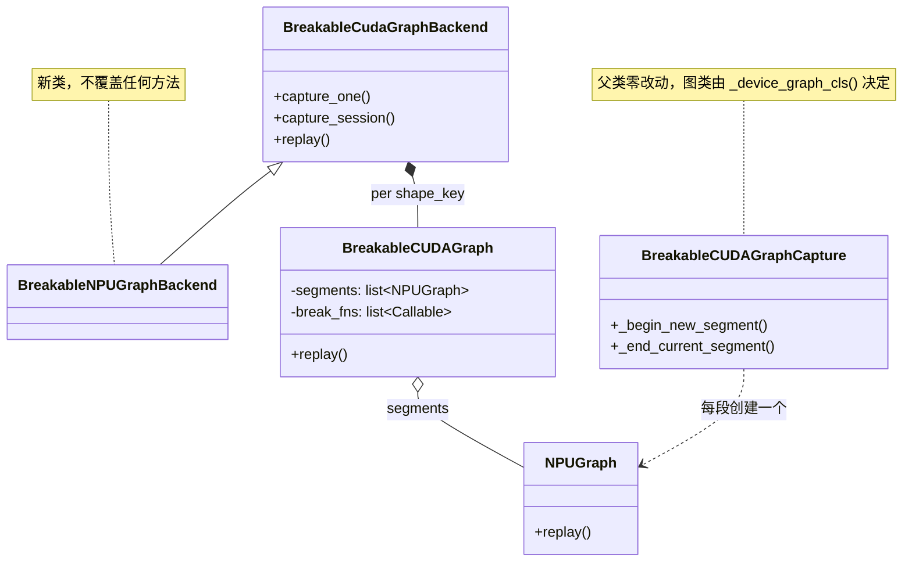
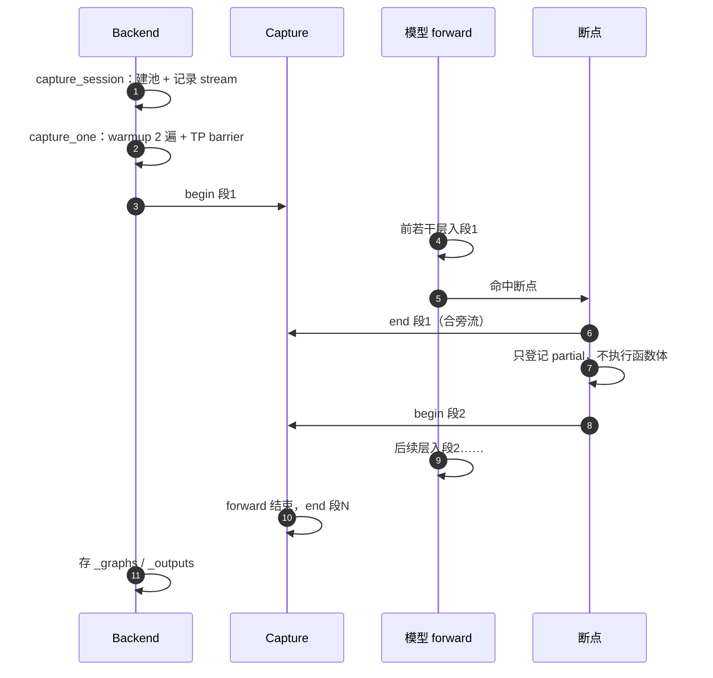
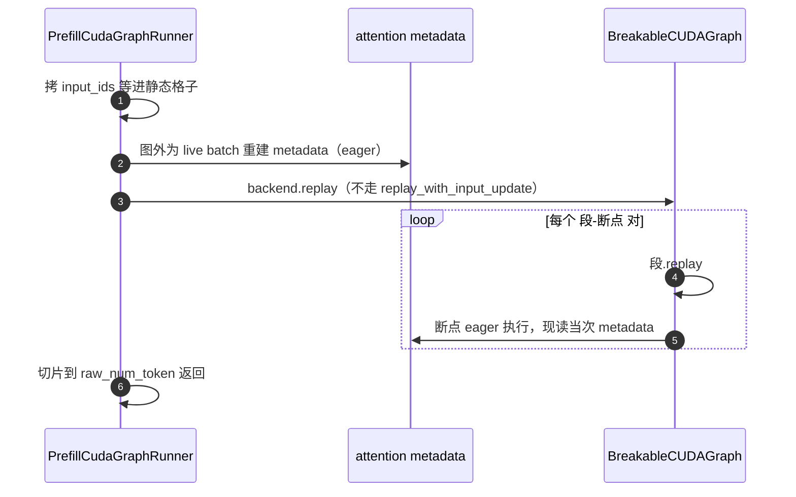
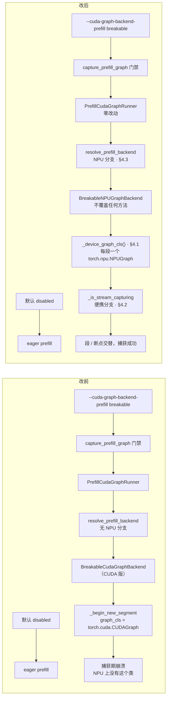
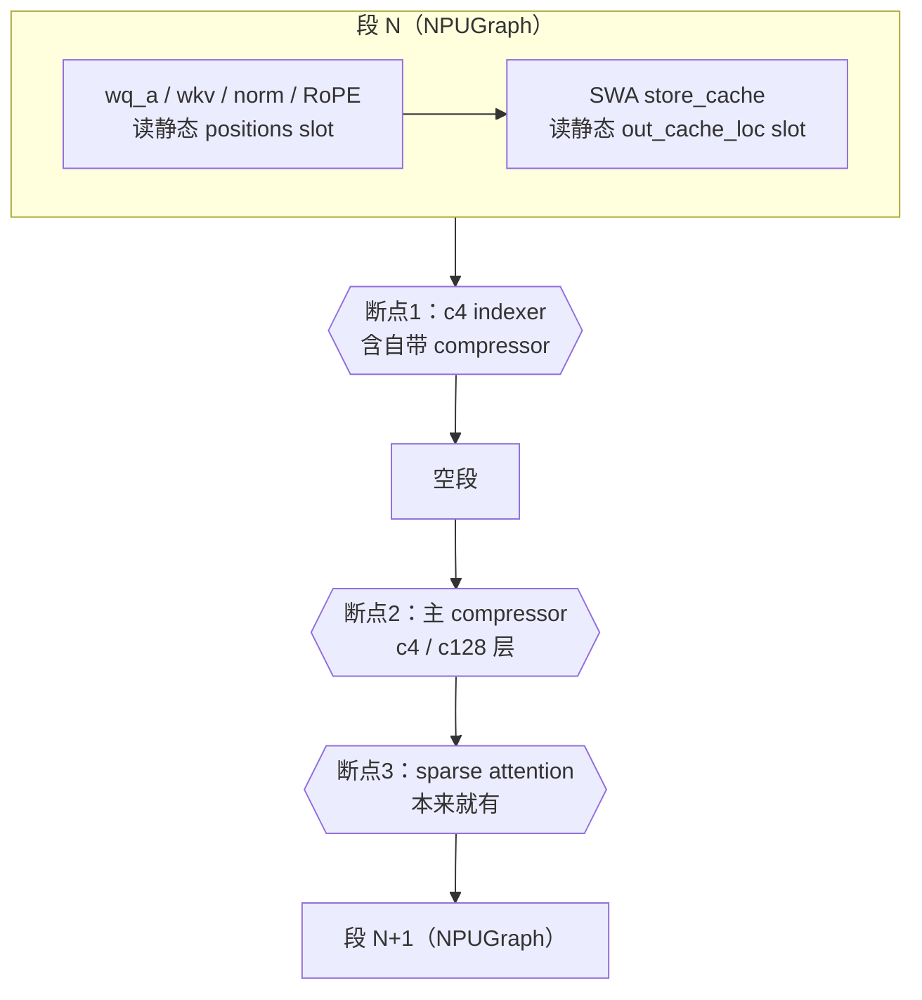
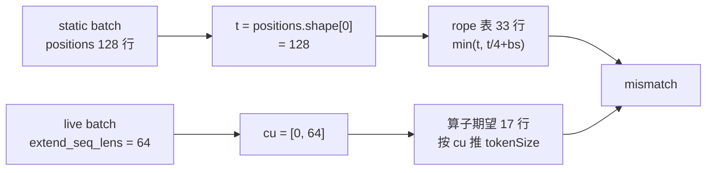

# BreakableNPUGraphBackend

让 Ascend NPU 的 prefill 入图：沿用 CUDA 的 breakable graph 框架，每段用一个
`torch.npu.NPUGraph`，吃 host 侧输入的算子（attention、compressor、indexer）在段之间
eager 执行。行号会漂移，以内容为准。

## 状态

| 项 | 值 |
| --- | --- |
| 开关 | `--cuda-graph-backend-prefill breakable`（NPU 上只接受 `breakable`，其他值报 `ValueError`） |
| bucket | `--cuda-graph-bs-prefill`，**必须 >= 128** |
| GLM-5.2（DSA） | 重构后直接支持，已测，无需模型侧适配 |
| DSV4 Flash | 经 §5 的适配后支持，已跑通 capture 与在线请求（DP16/TP16/EP16） |
| 提交 | `d08d2b52b0` P1 接线 · `1c095d6948` DSV4 断点 · `85860762c4` rope 口径 |

已知限制：

- **bucket 必须 >= 128。** 小于压缩粒度 128 的 bucket 会被 sparse-attn metadata AICPU
  算子拒绝（`execute kernel param invalid`）。capture batch 对该算子而言与一个真实的
  N token 单请求 prefill 无法区分，所以 eager 下的超短 prompt 多半同样不可用；这是
  DSV4-on-NPU 的既有限制，不是入图引入的。未做自动过滤。
- decode 不走这条路（已有全图后端）；EAGLE / draft prefill、段间 dedup 不支持。
- 其他普通 MLA 模型未验证。
- `docs/docs/advanced_features/breakable_cuda_graph.mdx:169` 的平台兼容表仍写 NPU
  不支持，待更新。
- 精度尚未用 sgl-eval 对 breakable 与 disabled 做 gsm8k 对比。

## 1. 为什么 breakable 适合 NPU

NPU 的注意力算子吃 **host 侧的 IntArray** 序列长度，捕获时会固化进图。

| 维度 | CUDA | NPU |
|---|---|---|
| 可变数据 | 显存格子，重放前 `copy_()` | 注意力 KV 长度是 host 侧 IntArray，捕获时固化 |
| 换值通道 | `copy_()` | `graph.update(cpu_update_input=...)` |
| breakable 下 | 不变 | 注意力在断点处 eager 执行，每次重放现读现传，**不需要 `update`** |

立足点就是最后一行：把吃 host 输入的算子摘到段之间 eager 执行，就绕开了 `graph.update`
那套机制。

**反过来也不能对段图调 `update()`。** `auto_dispatch_capture` 的唯一作用就是让它可用，
且只对 5 类注册过的注意力算子生效（`torch_npu/npu/_npugraph_handlers/`）；breakable 下
段内没有这些算子，`graph_dispatch_records` 为空，`update()` 无用且会因长度校验报错。将来
若把注意力圈回段内，要改用 `torch.npu.graph(..., auto_dispatch_capture=True)` 并重新
验证，代价是最大 workspace 预分配、`.out` 重载、record 数对齐。

## 2. 结构



设备相关的只有三处，都在 §4：图类、stream capture 查询、后端解析。
`BreakableCudaGraphBackend`、`BreakableCUDAGraphCapture` 和 `PrefillCudaGraphRunner`
都没有为 NPU 改动。

同一 stream、同一 pool 下连续捕获多段是合法的，段间地址稳定，换输入重放结果正确；空段
也能正常捕获和重放，所以不需要把连续的断点合并。`NPUGraph` 的裸
`capture_begin/capture_end` 签名与 CUDA 一致，父类的段捕获代码原样可用。


## 3. 时序

**录制**



**重放**



**录制期不执行断点函数体**，只记 `functools.partial(run, *args)`。所以断点逻辑每次
重放都重跑、读当次 metadata——这是 replay 正确性的全部依据，也意味着断点里不能依赖任何
capture 期算出的 host 值。

断点的输入张量是上一段在图 pool 里产出的，以弱引用保存、由 pool 的 use-count 保活，
段图存活期间跨重放有效；每次重放由该段在同一地址重写。所以不需要为弱引用加开关。

## 4. P1 改动前后对比

改前 NPU 上没有任何参数能**成功**开启 prefill 图：门禁能过、runner 能建，但后端解析没有
NPU 分支，拿到 CUDA 版后端后在段捕获处崩。



默认值没变：NPU 上"不入图"本来就是默认，改动只让显式开启这条路走得通。`breakable`
以外的值现在直接报 `ValueError`，不再静默拿错后端。

下面三处逐一对比，左改前、右改后，第三列只回答"不改会怎样"。`…` 为未改动部分。

### 4.1 `_device_graph_cls()`：设备无关图类

`runner_backend_utils/breakable_cuda_graph/breakable_cuda_graph.py`

<table>
<tr><th>改前</th><th>改后</th><th>为什么</th></tr>
<tr>
<td><pre>
def _begin_new_segment(self):
    graph_cls = torch.xpu.XPUGraph \
        if _is_xpu else torch.cuda.CUDAGraph
    …
</pre></td>
<td><pre>
def _device_graph_cls():
    if is_npu():
        return torch.npu.NPUGraph
    if _is_xpu:
        return torch.xpu.XPUGraph
    return torch.cuda.CUDAGraph

def _begin_new_segment(self):
    graph_cls = _device_graph_cls()
    …
</pre></td>
<td>图类写死 CUDA/XPU，NPU 上不存在，捕获直接崩。改完后父类的
<code>capture_begin/capture_end</code>（签名与 CUDA 一致）原样可用，<b>不需要捕获子类，
也不需要工厂方法</b>。</td>
</tr>
</table>

用裸 `capture_begin/capture_end` 而不是 `torch.npu.graph` 上下文，就没有它每段的
`synchronize()` + `empty_cache()`。裸捕获在有在途 kernel 时（显式 sync、另一条流有
kernel、捕获流本身有 kernel）地址依然稳定，所以这个同步可以省，收益是 61 层 ≈ 122 次
整设备同步消失。

### 4.2 `_is_stream_capturing()`：并入便携分支

同一文件。段收尾合旁流时调用。

<table>
<tr><th>改前</th><th>改后</th><th>为什么</th></tr>
<tr>
<td><pre>
if is_hip() or is_musa() or _is_xpu:
    with get_device_module().stream(stream):
        return get_device_module() \
            .is_current_stream_capturing()
return _capture_status(stream.cuda_stream) == …
</pre></td>
<td><pre>
if is_npu() or is_hip() or is_musa() or _is_xpu:
    with get_device_module().stream(stream):
        return get_device_module() \
            .is_current_stream_capturing()
return _capture_status(stream.cuda_stream) == …
</pre></td>
<td>CUDA 分支依赖 <code>stream.cuda_stream</code> + cuda-python，NPU 两者都没有。NVIDIA 上
保留直接查 runtime，是因为 <code>is_current_stream_capturing()</code> 在那里不可靠。</td>
</tr>
</table>

### 4.3 `resolve_prefill_backend()`：NPU 分支

`runner_backend/utils.py`

<table>
<tr><th>改前</th><th>改后</th><th>为什么</th></tr>
<tr>
<td><pre>
backend_name = cfg.prefill.backend …
if backend_name == Backend.BREAKABLE:
    return BreakableCudaGraphBackend(…)
if backend_name == Backend.FULL:
    …
</pre></td>
<td><pre>
backend_name = cfg.prefill.backend …
if model_runner.device == "npu":
    if backend_name != Backend.BREAKABLE:
        raise ValueError(
            "NPU prefill graph only supports "
            f"'breakable', got '{backend_name}'")
    return BreakableNPUGraphBackend(
        cuda_graph_runner,
        enable_memory_saver=…,
        debug_eager=…)
if backend_name == Backend.BREAKABLE:
    return BreakableCudaGraphBackend(…)
…
</pre></td>
<td>没有设备分支时 NPU 会拿到 CUDA 版后端，段捕获直接崩。显式 ValueError 也比静默拿错类
好查。</td>
</tr>
</table>

新文件 `hardware_backend/npu/graph_runner/breakable_npu_graph_backend.py` 只提供 NPU
身份和一条 `torch.compile` 断言，其余全部继承；`capture_session` 不重写，父类内部就是
`device_module.graph_pool_handle()`。

## 5. DSV4 Flash 怎么适配的

### 5.1 一层 attention 怎么被切开



NPU 上 `is_unified_kv_triton()` 恒为 False（只在 HIP 为 True），mega attention 只在 CUDA
启用，所以 prefill attention 一定走断点3。断点1 与 断点2 之间没有被录制的算子，于是产生
空段。空段能正常捕获和重放（§2），但重放开销待 profiling。

适配只动了两个 NPU 专属文件，公共代码零改动：

| 文件 | 改动 |
| --- | --- |
| `attention/dsv4_prefill_graph.py`（新增 69 行） | 两个断点函数 + `in_prefill_graph` 判定 |
| `attention/ascend_dsv4_backend.py`（+49/-2） | 两个入口分发到断点；indexer 函数体拆成 `forward_c4_indexer_eager`；capture 期补占位 loc |

### 5.2 为什么 indexer 和 compressor 必须是断点

它们依赖 host 侧算出的 metadata，本来就进不了图。录进 segment 的后果：

| 后果 | 机制 | 表现 |
| --- | --- | --- |
| 读到已释放的显存 | replay 为 live batch 重建整套 metadata，capture 期旧张量随之释放，而它们分配在图 pool 之外 | **不报错，算错** |
| capture 期 host 值被固化 | `dsv4_max_input_capacity` 来自 `cu.cpu().tolist()`，决定 state block table 形状；还有 `cmp_kv[: loc.numel()]` 的截断长度和 `if loc is not None` 这类 Python 分支 | **不报错，算错** |
| c4 层拿不到 topk | indexer 把结果赋给 `forward_metadata.c4_topk_indices`，这是 Python 属性赋值，只在 capture 时执行一次，且赋给 capture 期的 fm 对象 | `topk.view` 报错 |

受影响的张量：`forward_compress` 读 `positions_cmp_padding_c*` / `start_pos` / `seqused` /
`actual_seq_lengths_q_pa` / state block table / `c*_loc`；lightning indexer 读
`actual_seq_lengths_q/kv` / `c4_page_table` / `kernel_metadata["li_quant_metadata"]`。

CUDA 侧有同样先例：ratio 1/2 的 indexer 和 compressor 由
`bcg_deepseek_v4_low_ratio_sources` 作为断点执行，注释写的是 "The compressor and prefill
indexer sync with the host, like the attention."

### 5.3 三个口径 bug

断点把 **live 行数** 和 **bucket 行数** 两套口径同时带进同一个函数，三个 bug 都出在这里。

**(1) capture batch 没有分配 bundle** → `loc=None` → `set_index_k_scale` 的 `loc.view` 崩


<table>
<tr><th>改前</th><th>改后</th></tr>
<tr>
<td><pre>
bundle_loc = (… if bundle is not None
              else None)
setattr(fm, f"c{ratio}_loc",
        bundle_loc … if … else None)
</pre></td>
<td><pre>
bundle_loc = (… if bundle is not None
              else None)
if bundle_loc is None and \
   get_flags().dp.capturing_prefill_graph:
    bundle_loc = torch.zeros(
        sum(b.numel()
            for b in ratio_lists[ratio]),
        dtype=torch.int32, device=device)
setattr(fm, f"c{ratio}_loc",
        bundle_loc … if … else None)
</pre></td>
</tr>
</table>

- 块数直接用同一函数里刚算好的 `ratio_lists`，与 `positions_cmp_padding_c*` 天然一致。
- 条件用 `capturing_prefill_graph`，**不能用 `is_in_breakable_cuda_graph()`**——后者
  replay 时也为真，万一 replay 缺 bundle 会把真实数据悄悄写进 slot 0。该标志挂在 `dp`
  下但不论是否开 DP 都会设置，且在 `warmup()` 之后才置位。
- slot 0 不会分给真实请求：`page_size` 固定 128；`NPUPagedTokenToKVPoolAllocator` 继承的
  `clear()` 让空闲页从 1 开始，注释写明 slot 0 留给 padding 写入；c4 loc 由
  `full_loc // 4` 推出，full page 0 的 slot 0~127 不分配，对应 c4 slot 0~31 也不会分出去。

**(2) 断点内要把输入切到 live 行。** `static_forward_batch` 的 `positions` 按 bucket
补齐，而 indexer 的 `_compute_q_npu` 要按 live 行算 RoPE。对 batch 浅拷贝再切片，不改
replay batch 本身，后面的 attention 断点仍看到 bucket 长度的 positions：

```python
num_tokens = forward_batch.global_num_token_non_padded_cpu
live_batch = copy.copy(forward_batch)
live_batch.positions = forward_batch.positions[:num_tokens]
backend.forward_c4_indexer_eager(
    x=x[:num_tokens], q_lora=q_lora[:num_tokens], forward_batch=live_batch, ...
)
```

indexer 写结果用的是后端上的 `forward_metadata`、不写 batch，所以浅拷贝不丢结果；RoPE
的 per-forward 缓存按 positions 对象匹配，切片后会按真实 positions 重算。

**(3) compress metadata 的 token 数要取自 cu，不能取自 positions。**



```
[compressor] ropeSin shape dim 0, should be equal to
min(tokenSize, tokenSize/cmpRatio+batchSize): 17, but got 33
```

同一函数里的 `cu` / `seqused` / `start_pos` 和算子收到的 `x` 全是 live 的，只有 `t` 取自
bucket 长度的 positions。eager 下 `positions.shape[0] == cu[-1]` 恒成立，所以从未暴露。

<table>
<tr><th>改前</th><th>改后</th></tr>
<tr>
<td><pre>
positions = forward_batch.positions
t = positions.shape[0]
bs = forward_batch.batch_size
cu = fm.actual_seq_lengths_q_pa

cu_cpu = cu.cpu().tolist()
</pre></td>
<td><pre>
bs = forward_batch.batch_size
cu = fm.actual_seq_lengths_q_pa

cu_cpu = cu.cpu().tolist()
# 口径随 cu，不随 bucket 补齐的 positions
t = int(cu_cpu[bs])
</pre></td>
</tr>
</table>

> 通用形态：**live 口径与 bucket 口径同时出现在一个函数里时，要逐个确认每个派生量跟的
> 是哪一套。** 下一个候选是断点里的 `global_num_token_non_padded_cpu`——它必须恒等于
> `cu[-1]`，目前只在单请求场景核对过，DP 下未在设备上验证。

### 5.4 为什么不照搬 CUDA 的 captured-metadata 契约

CUDA 的 DSV4 后端打开 `use_captured_forward_metadata_for_breakable_cuda_graph`：capture
时建一份地址稳定的 metadata，replay 时原地刷新。这套契约的前提是**段内有 kernel 读这份
metadata**。NPU 的 compressor、lightning indexer 和 sparse attention 都依赖 host 侧的值
（`kernel_metadata` 由 host 算子生成，state block table 宽度来自 host 长度），本来就进
不了图。照搬只是把 metadata 改写成可原地刷新的 buffer，工作量与 decode graph 的
`_init_dsv4_graph_metadata` / `_refresh_graph_*` 相当（数百行），换不来任何算子进图。只有
将来 compressor 有了纯 device 侧接口、能进图时，这套契约才值得做。

## 6. 未覆盖的风险

| 风险 | 状态 |
| --- | --- |
| `SGLANG_NPU_USE_MULTI_STREAM=1` | 打开后 attention 走 `_forward_prepare_multi_stream_npu`，先用 `wait_stream` 把 KV 和 Q 分到侧流。BCG 的 hook 能跟踪分流，断点结束 segment 时会自动 join。代码上能走通，**未在设备上验证**。官方部署文档只在 decode 节点设这个开关 |
| attn-TP 序列切分 | 断点按 `global_num_token_non_padded_cpu` 切行，与已有 attention 断点一致，前提是 `attn_tp_size == 1`（DP16 部署满足） |
| CP 与 MoE | DSV4 不在 `PREFILL_CP_BCG_SUPPORTED_COMBINATIONS` 里，CP 的 BCG capture 不会为它打开；CP batch 是否会 replay 非 CP 的图没有分析。这些路径里若有 host 同步，capture 会直接报错，不会悄悄算错 |
| 段粒度 | 每层 1~2 个断点，61 层 ≈ 122 次段 launch，另有空段。必要时改粗断点（每 N 层），或在模型层合成一个断点，仿照 `bcg_deepseek_v4_low_ratio_sources`，代价是要改共享的模型文件 |
| 图卸载 / 重捕 | `graph_pool_handle()` 的 token 在所有引用它的图销毁后**不能再用**：`use_count` 计的是活图数（`NPUCachingAllocator.cpp`，递减在 `NPUGraph` 析构），降到 0 后池被标记 freeable 但 token 仍在表里，再用会撞 `create_or_incref_pool: use_count > 0`，**进程随之不可恢复**。BCG 的图常驻 `_graphs`，当前不触发；将来做卸载或重捕时必须重新取 token |

---

本目录的 [v2](v2_spike_two_segments.py) / [v4](v4_weak_ref_spike.py) /
[v8](v8_raw_capture_spike.py) 脚本是上述 NPUGraph 行为的真机探针，CANN 或 torch_npu
升级后可以复跑确认。
