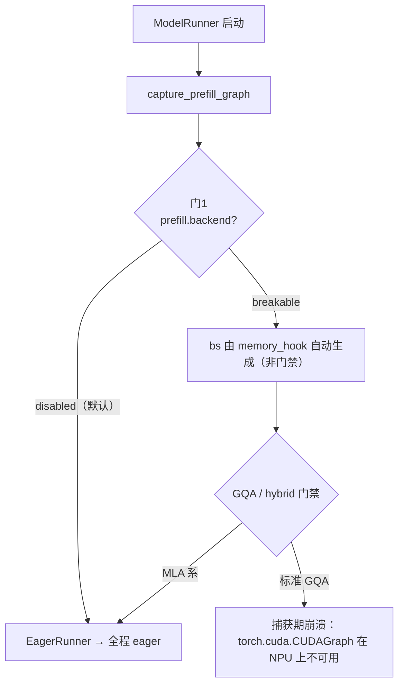
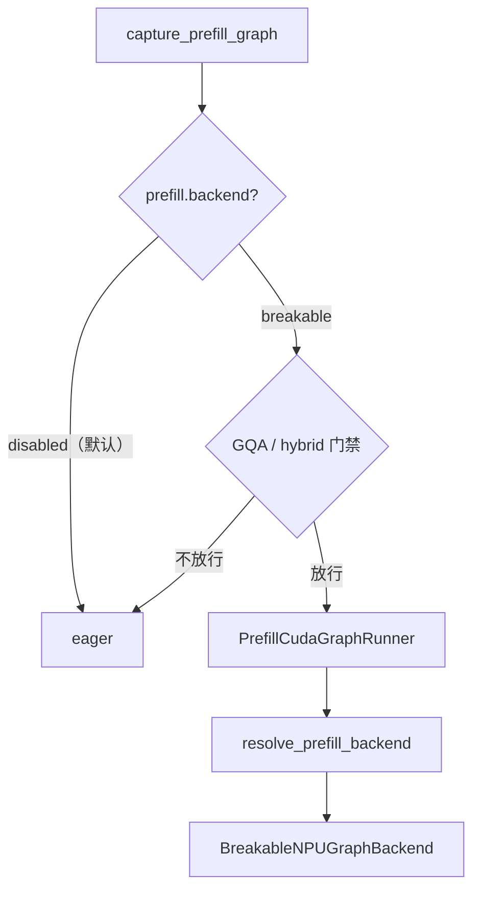
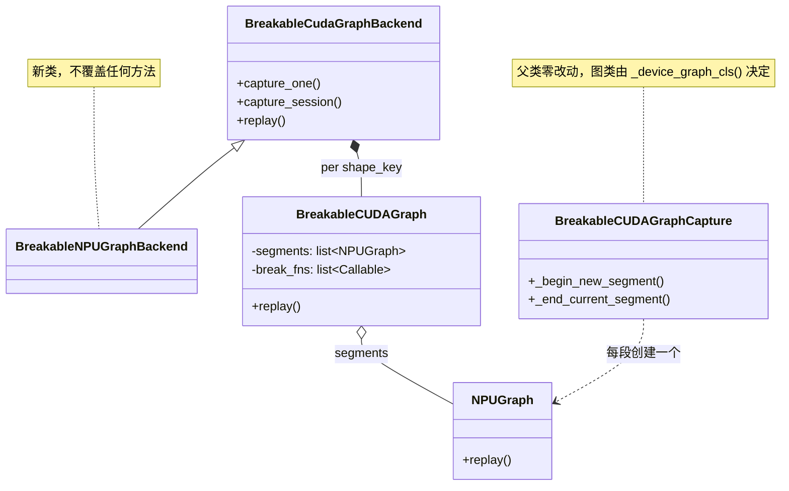
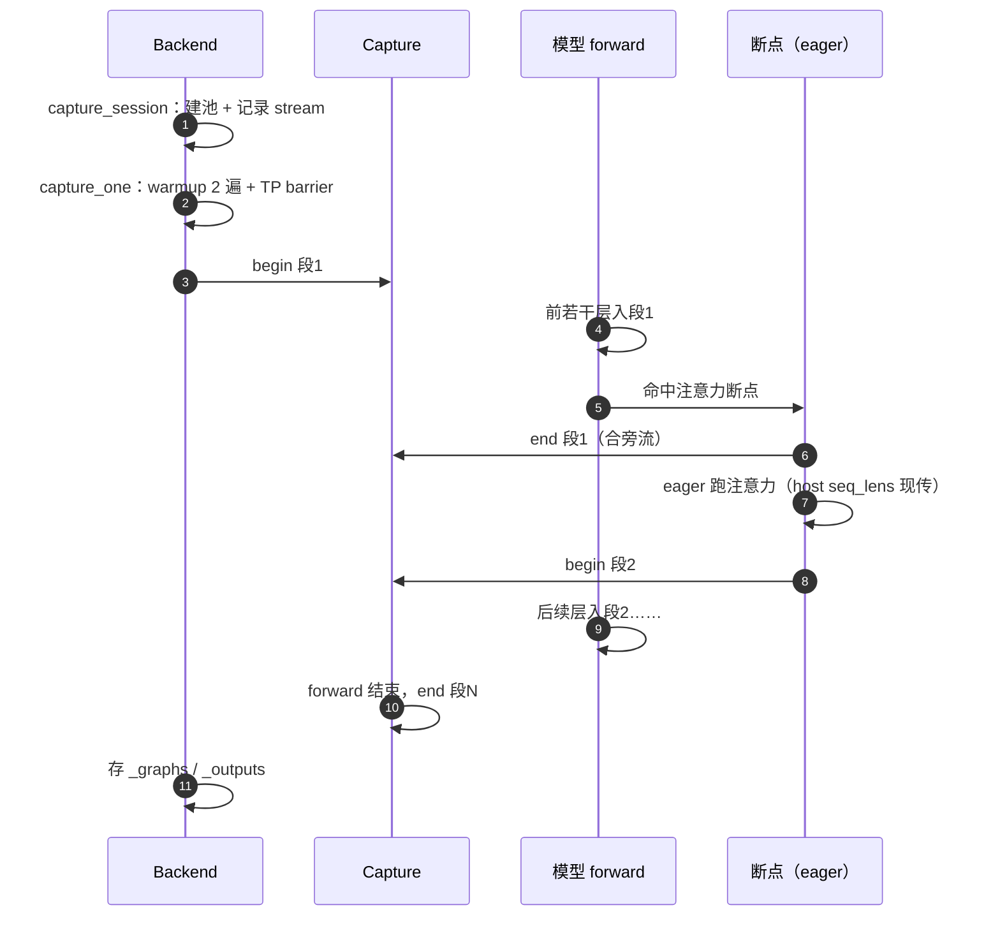
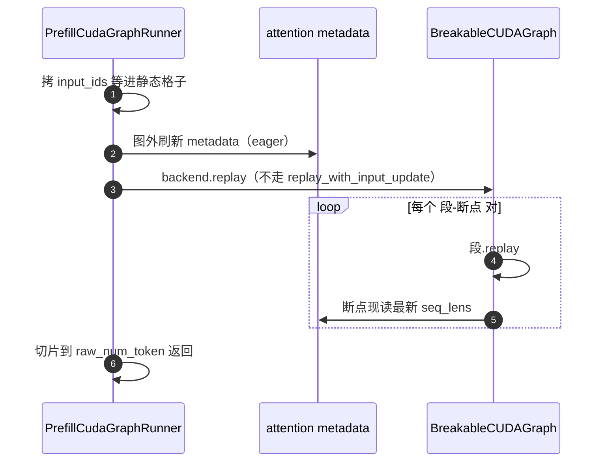
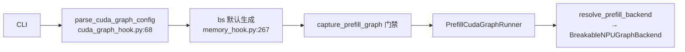

# BreakableNPUGraphBackend 设计方案

状态：设计稿（未实现）｜可行性 spike 全部通过（V1–V4 / V6 / V8，2026-10 真机）｜行号会漂移，以内容为准

## 0. 摘要

让 NPU 的 prefill 可选 breakable 图。现状是 prefill 默认 eager，显式开启会在捕获期崩溃（图类写死 CUDA）。

| 项 | 内容 |
|---|---|
| 开关 | `--cuda-graph-backend-prefill breakable`（默认 `disabled`，§2.5） |
| 思路 | 沿用 CUDA 的 BCG 框架，只把“每段用什么图对象”换成 NPU 的 |
| 规模 | 2 处工具模块小改 + 1 个薄后端子类 + 1 处模型断点（P3） |
| 边界 | `BreakableCudaGraphBackend` / `BreakableCUDAGraphCapture` **零改动** |

| # | 文件 | 类型 | 内容 | 阶段 |
|---|---|---|---|---|
| 1 | `runner_backend_utils/.../breakable_cuda_graph.py` | 改 | `_device_graph_cls()` + `_is_stream_capturing` NPU 分支 | P1 |
| 2 | `runner_backend/utils.py` | 改 | `resolve_prefill_backend` NPU 分支 | P1 |
| 3 | `hardware_backend/npu/graph_runner/breakable_npu_graph_backend.py` | 增 | NPU 后端（身份 + compile 断言） | P1 |
| 4 | `hardware_backend/npu/modules/deepseek_v2_attention_mla_npu.py` | 改 | MLA/DSA core 加断点 | P3 |
| 5 | `test/registered/unit/npu/graph_runner/` | 增 | 单测 | P1 |
| 6 | `docs/docs/advanced_features/breakable_cuda_graph.mdx` | 改 | 兼容性表 | P3 |

## 1. 背景

### 1.1 Breakable Graph


录制时剪段，重放时“段 replay + 断点函数现场执行”交替；断点用 `@eager_on_graph` 标记。

### 1.2 NPU 的关键差异

| 维度 | CUDA | NPU |
|---|---|---|
| 可变数据 | 显存格子，重放前 `copy_()` | 注意力 KV 长度是 **host 侧 IntArray**，捕获时固化进图 |
| 换值通道 | `copy_()` | `graph.update(cpu_update_input=...)` |
| **breakable 下** | 不变 | 注意力在断点处 eager → 每次重放现读现传，`update` 通道不需要 |

### 1.3 现状流程



### 1.4 基建盘点

| 基建 | 处理 |
|---|---|
| `eager_on_graph` / `BreakableCUDAGraph` / 输出回写 / TP barrier / 双 warmup / 共享输出 buffer | 直接复用 |
| `weak_ref_tensor` | NPU 已接好（`torch_npu._C._weak_ref_tensor`） |
| `PrefillCudaGraphRunner` 的 BCG 协议 | 继承即满足 |
| `DedupedCudaGraphMixin` | 自动关闭（无 cuda-python） |
| 段捕获 `capture_begin/capture_end` | **需适配**：图类写死 CUDA/XPU |
| `_is_stream_capturing` | **需适配**：无 NPU 分支 |
| CUDA 池机制（precarve/borrow/scope）、`graph.update` | 不移植 |

## 2. 设计

### 2.1 目标形态





### 2.2 决策

| 决策 | 选择 | 依据 / 回退 |
|---|---|---|
| 类关系 | 继承 `BreakableCudaGraphBackend`，子类不覆盖方法 | runner 的 `isinstance` 检查自动命中 |
| runner | 标准 `PrefillCudaGraphRunner`，零改动 | 原生支持 BCG |
| 段捕获 | 父类改用 `_device_graph_cls()`，裸 `capture_begin/capture_end` | **V8**：三种在途场景 `err=0` |
| 捕获上下文 | 复用父类 `BreakableCUDAGraphCapture` | 零副本、零漂移 |
| host seq_lens | 断点在图外，重放现读 | 不需要 `graph.update`（§8.1） |
| 内存池 | 沿用父类全局池 | precarve 默认关；borrow/scope 仅 CUDA |
| weak-ref | 沿用弱引用，不加开关 | **V4** |
| 旁流追踪 | `_is_stream_capturing` 并入 HIP/XPU 分支 | **V3** |
| 其余 | dedup 自动关闭；memory saver 保留 `NotImplementedError`；`torch.compile` 断言关闭 | — |

### 2.3 时序

**录制**



**重放**



### 2.4 非目标（v1）

| 不做 | 原因 |
|---|---|
| decode 入图 | decode 已有全图后端 |
| EAGLE/draft prefill 图 | host 元数据路径不同 |
| 段间 dedup | 无 cuda-python |
| 新环境变量 | 复用 `--cuda-graph-config` |
| 性能超越全图 | 收益未知，实测为准 |

### 2.5 开启方式

默认 `prefill.backend = disabled`（非 CUDA 平台），所以 NPU 上“不入图”本来就是默认。

> 当前 NPU 上没有任何参数能**成功**开启 prefill 图：`--cuda-graph-backend-prefill breakable` 能过门禁并构造 runner（`bs` 由 `memory_hook.py:267` 自动生成），但会因缺 NPU 解析分支、捕获落到 CUDA 图类而崩溃。下表在落地后生效。

| 方式 | 命令 |
|---|---|
| 推荐 | `--cuda-graph-backend-prefill breakable` |
| 完整控制 | `--cuda-graph-config '{"prefill": {"backend": "breakable", "bs": [2048, 4096]}}'` |
| 关闭 | `--disable-prefill-cuda-graph` |



## 3. 代码改动

> 左：改前；右：改后；第三列只回答“为什么改 / 不改会怎样”。`…` 为未改动部分。

### 3.1 `resolve_prefill_backend`：NPU 分支

`runner_backend/utils.py:107-126`

<table>
<tr><th>改前</th><th>改后</th><th>为什么</th></tr>
<tr>
<td><pre>
backend_name = (
    cfg.prefill.backend
    if cfg is not None else Backend.BREAKABLE
)
if backend_name == Backend.BREAKABLE:
    return BreakableCudaGraphBackend(
        cuda_graph_runner, ...)
if backend_name == Backend.FULL:
    ...
</pre></td>
<td><pre>
backend_name = (
    cfg.prefill.backend
    if cfg is not None else Backend.BREAKABLE
)
if cuda_graph_runner.model_runner.device == "npu":
    if backend_name != Backend.BREAKABLE:
        raise ValueError(
            "NPU prefill graph only supports "
            f"'breakable', got '{backend_name}'")
    from ...breakable_npu_graph_backend import (
        BreakableNPUGraphBackend)
    return BreakableNPUGraphBackend(
        cuda_graph_runner,
        enable_memory_saver=...,
        debug_eager=...)
if backend_name == Backend.BREAKABLE:
    return BreakableCudaGraphBackend(...)
if backend_name == Backend.FULL:
    ...
</pre></td>
<td>没有设备分支时 NPU 会拿到 CUDA 版后端，段捕获直接崩。显式 ValueError 也比静默拿错类好查。</td>
</tr>
</table>

### 3.2 `_is_stream_capturing`：并入便携分支

`breakable_cuda_graph.py:90-107`

<table>
<tr><th>改前</th><th>改后</th><th>为什么</th></tr>
<tr>
<td><pre>
def _is_stream_capturing(stream):
    if is_hip() or _is_xpu:
        with get_device_module().stream(stream):
            return get_device_module() \
                .is_current_stream_capturing()
    return (
        _capture_status(stream.cuda_stream)
        == rt.cudaStreamCaptureStatus
             .cudaStreamCaptureStatusActive)
</pre></td>
<td><pre>
def _is_stream_capturing(stream):
    if is_npu() or is_hip() or _is_xpu:
        with get_device_module().stream(stream):
            return get_device_module() \
                .is_current_stream_capturing()
    return (
        _capture_status(stream.cuda_stream)
        == rt.cudaStreamCaptureStatus
             .cudaStreamCaptureStatusActive)
</pre></td>
<td>段收尾合旁流时调用。CUDA 分支依赖 `stream.cuda_stream` + cuda-python，NPU 都没有。V3 已验证 NPU 的便携查询可用。</td>
</tr>
</table>

import 行补 `is_npu`：`from sglang.srt.utils import get_device_module, is_hip, is_npu, is_xpu`

### 3.3 `_device_graph_cls()`：设备无关图类

`breakable_cuda_graph.py:418-440`

<table>
<tr><th>改前</th><th>改后</th><th>为什么</th></tr>
<tr>
<td><pre>
def _begin_new_segment(self) -> None:
    graph_cls = torch.xpu.XPUGraph \
        if _is_xpu else torch.cuda.CUDAGraph
    if self.cuda_graph._deduped_cuda_graph:
        try:
            graph = graph_cls(keep_graph=True)
            ...
</pre></td>
<td><pre>
def _device_graph_cls():
    if is_npu():
        return torch.npu.NPUGraph
    if _is_xpu:
        return torch.xpu.XPUGraph
    return torch.cuda.CUDAGraph
def _begin_new_segment(self) -> None:
    graph_cls = _device_graph_cls()
    if self.cuda_graph._deduped_cuda_graph:
        try:
            graph = graph_cls(keep_graph=True)
            ...
</pre></td>
<td>图类写死 CUDA/XPU，NPU 上不存在（§1.3 的崩溃点）。改完后父类的 `capture_begin/capture_end`（签名与 CUDA 一致）原样可用，**不需要捕获子类，也不需要工厂方法**。</td>
</tr>
</table>

- `keep_graph=True` 只服务 dedup，NPU 上 dedup 关闭，走不到。
- 比 `torch.npu.graph` 上下文少了每段的 `synchronize()` + `empty_cache()`；V8 已验证可以省（§8.2）。

### 3.4 新文件：`breakable_npu_graph_backend.py`

`hardware_backend/npu/graph_runner/breakable_npu_graph_backend.py`

只提供 NPU 身份和一条 `torch.compile` 断言，其余全部继承。

```python
"""Breakable NPU graph backend: one torch.npu.NPUGraph per segment,
attention (and other host-input ops) eager between segments.

The parent capture context, capture loop and replay path are used
unchanged; only the per-segment graph class is device-specific
(_device_graph_cls in breakable_cuda_graph.py).
"""

from __future__ import annotations

from typing import Any

from sglang.srt.model_executor.runner_backend.breakable_cuda_graph_backend import (
    BreakableCudaGraphBackend,
)


class BreakableNPUGraphBackend(BreakableCudaGraphBackend):
    """NPU prefill graphs split at eager_on_graph break points."""

    def __init__(
        self,
        cuda_graph_runner: Any,
        *,
        enable_memory_saver: bool = False,
        debug_eager: bool = False,
    ) -> None:
        super().__init__(
            cuda_graph_runner,
            enable_memory_saver=enable_memory_saver,
            debug_eager=debug_eager,
        )
        assert not getattr(cuda_graph_runner, "enable_torch_compile", False), (
            "breakable NPU graph does not support torch.compile"
        )
```

`capture_session` 不重写：父类内部就是 `device_module.graph_pool_handle()`（`pool.py:109-115`）。

### 3.5 MLA/DSA 断点（P3）

`hardware_backend/npu/modules/deepseek_v2_attention_mla_npu.py`

**改前**

```python
def forward_mha_core_npu(m, q, k, v, ...):
    ...

def forward_mla_core_npu(m, q_pe, k_pe, q_nope_out, ...):
    ...
```

**改后**

```python
from sglang.srt.model_executor.runner_backend_utils.breakable_cuda_graph import (
    eager_on_graph,
)

@eager_on_graph
def forward_mha_core_npu(m, q, k, v, ...):
    ...

@eager_on_graph
def forward_mla_core_npu(m, q_pe, k_pe, q_nope_out, ...):
    ...
```

**为什么**：MLA/DSA core 调用吃 host 侧 seq_lens 的 `npu_fused_infer_attention_score*`；圈进图就会被固化，重放读到旧长度——**数值错误且不报错**（V5 专门抓它）。通用 MHA 路径已有装饰器，无需改动。

### 3.6 单测（CPU，mock torch_npu）

`test/registered/unit/npu/graph_runner/test_breakable_npu_graph_backend.py`

```python
def test_resolve_npu_breakable():
    # device=npu + prefill breakable → BreakableNPUGraphBackend
    # 默认配置 → 跳过 prefill

def test_segment_split():
    # 假 forward + @eager_on_graph，mock _device_graph_cls / capture_begin
    # 断言：每断点 end/begin 各一次，break_fns 顺序正确，输出写回 buffer

def test_replay_never_updates():
    # BCG 走 plain replay，不触碰 replay_with_input_update
```

### 3.7 文档兼容性表

`docs/docs/advanced_features/breakable_cuda_graph.mdx:142`

**改前**

```text
- **CUDA and ROCm/HIP.** Breakable CUDA graph runs on both NVIDIA and AMD
  GPUs. Other platforms (NPU, CPU, MPS, XPU) are unsupported; there
  `--debug-cuda-graph` is automatically disabled with a warning.
```

**改后**

```text
- **CUDA, ROCm/HIP, and Ascend NPU.** Breakable graph runs on NVIDIA/AMD GPUs
  and on Ascend NPU for prefill of non-speculative models. CPU, MPS, and XPU
  remain unsupported; there `--debug-cuda-graph` is automatically disabled.
```

## 4. 验证状态

| # | 结论 | 证据 | 定型 / 回退 |
|---|---|---|---|
| ✅ V1 | `NPUGraph` 有裸 `capture_begin/capture_end`，签名与 CUDA 一致；`auto_dispatch_capture` 由上下文管理器实现 | `inspect.getsource` | 采用裸 API；该开关不启用（§8.1） |
| ✅ V2 | 同 stream + 同 pool 连捕两段合法，地址稳定，换输入重放 `err=0` | `v2_spike_two_segments.py` | 共享池分段定型 |
| ✅ V3 | `is_current_stream_capturing` / `Stream.wait_stream` 均存在 | 真机 introspect | §3.2 并入便携分支 |
| ✅ V4 | 段图存活期间，弱引用跨重放可用，`err=0`（3 次） | `v4_weak_ref_spike.py` | 默认弱引用，无开关 |
| ✅ V6 | 空段捕获与重放正常 | V2 脚本末尾 | 不做连续断点合并 |
| ✅ V8 | 裸捕获三种在途场景（显式 sync / 另一流有 kernel / **捕获流本身**有 kernel）地址稳定、`err=0`；空段正常（9/9） | `v8_raw_capture_spike.py` | 方案定型，无需每段同步 |
| ⏳ V5 | 段内有无 host 固化的非注意力算子 | Phase 2 parity | 套 `@eager_on_graph` 摘出 |
| ⏳ V7 | prefill 门禁对目标模型放行（ascend 未 opt-in captured metadata，两个钩子不会被调用） | Phase 2 | 该模型保持 eager |

> V4 负对照（删光段图后读弱引用）不作为安全保证，判定依据是“段图存活时”的正向用例。

## 5. 测试与基准

| 测试 | 内容 | 通过标准 |
|---|---|---|
| 单测（CPU） | §3.6 三项 | CI 绿 |
| prefill parity | eager vs breakable，**换不同 seq_lens 重放** | logits 对齐 |
| 性能 | prefill 吞吐、CPU 占比 | 如实报告，含负结果 |

## 6. 分阶段

| 阶段 | 内容 | 出口条件 |
|---|---|---|
| **P0 spike ✅** | V1–V4 / V6 / V8 真机关闭 | 共享池分段、裸捕获成立 |
| P1 核心 | 工具模块 + 新后端 + 接线 + 单测 | 单测通过 |
| P2 parity | 真机 prefill parity | logits 对齐 |
| P3 MLA/DSA | 断点 + mdx | 主力模型可用 |
| P4 调优 | 段粒度、性能 | 结论落文档 |

## 7. 风险

| 风险 | 影响 | 缓解 |
|---|---|---|
| 段数 × launch 开销 | 每层一个断点，61 层 ≈ 122 次段 launch | 实测；必要时改粗断点（每 N 层） |
| 默认桶偏多 | `memory_hook` 按 `chunked_prefill_size` 展开桶 | `--cuda-graph-bs-prefill` 收窄 |
| 池 token 不可复用 | 图全销毁后同 token 再捕获会撞断言（§8.3） | 图常驻 `_graphs`，v1 不触发 |
| prefill 全新领地 | NPU prefill 从未入图 | 风险在门禁与模型适配，非图机制 |

## 8. 注意事项

### 8.1 为什么不开 `auto_dispatch_capture`

它的唯一作用是让 `graph.update(cpu_update_input=...)` 可用，且只对 5 类注册的注意力算子生效（`torch_npu/npu/_npugraph_handlers/`）。BCG 的注意力在断点 eager 执行，段内没有这些算子 → `graph_dispatch_records` 为空 → `update()` 无用且会因长度校验报错。

**不要对段图调 `update()`。** 若将来注意力被圈进段内，需改用 `torch.npu.graph(..., auto_dispatch_capture=True)` 并重新验证（代价：最大 workspace 预分配、`.out` 重载、record 数对齐）。

### 8.2 裸捕获省掉了什么

不走 `torch.npu.graph`，就没有它每段的 `synchronize()` + `empty_cache()`。V8 已验证可以省，收益是 61 层 ≈ 122 次整设备同步消失（P4 实测）。

### 8.3 池 token 的生命周期

`graph_pool_handle()` 的 token 在所有引用它的图销毁后**不能复用**：`use_count` 计的是活图数（`NPUCachingAllocator.cpp:2212-2234`，递减在 `NPUGraph` 析构，`NPUGraph.cpp:470`）。降到 0 后池被标记 freeable 但 token 仍在表里，再用会撞 `create_or_incref_pool: use_count > 0`，进程随之不可恢复。

BCG 的图常驻 `_graphs`，v1 不触发；将来做卸载/重捕时必须重新取 token。

## 附：文件速查

```
runner_backend/utils.py                              # §3.1
runner_backend_utils/.../breakable_cuda_graph.py     # §3.2 §3.3
hardware_backend/npu/graph_runner/
  breakable_npu_graph_backend.py                     # §3.4 新增
hardware_backend/npu/modules/
  deepseek_v2_attention_mla_npu.py                   # §3.5 P3
test/registered/unit/npu/graph_runner/               # §3.6
docs/docs/advanced_features/breakable_cuda_graph.mdx # §3.7 P3
```

父类 `breakable_cuda_graph_backend.py` 与 `BreakableCUDAGraphCapture`：无改动。
