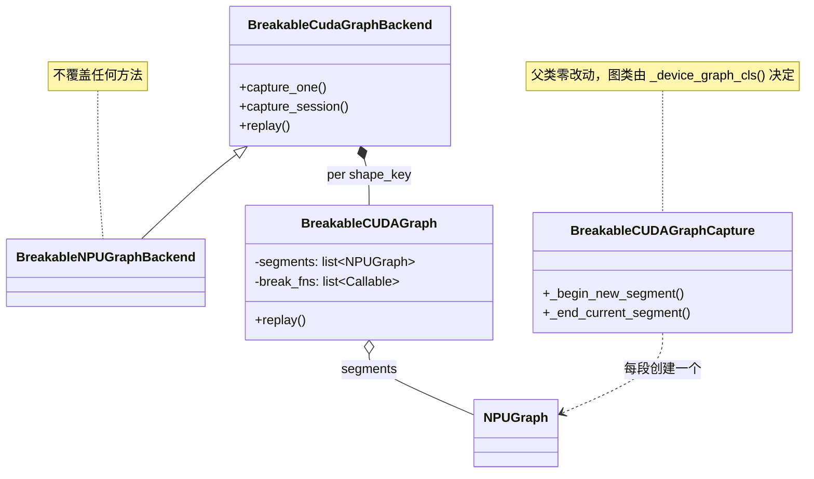
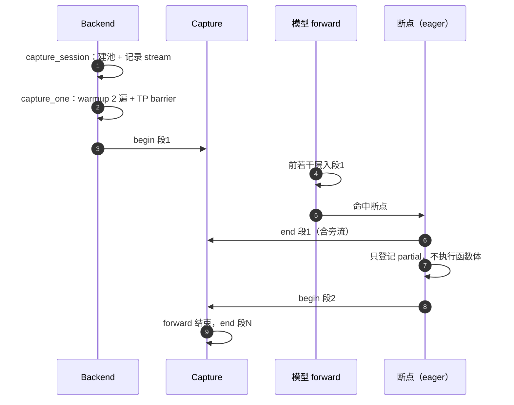
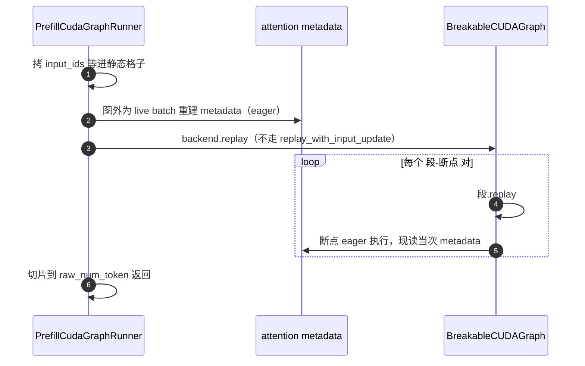

# BreakableNPUGraphBackend 设计

行号会漂移，以内容为准。当前状态与开关见 [README](README.md)。

## 1. 为什么 breakable 适合 NPU

NPU 的注意力算子吃 **host 侧的 IntArray** 序列长度，捕获时会把它固化进图。CUDA
上可变数据放在显存格子里，重放前 `copy_()` 就能换值；NPU 要换这个 host 值只能走
`graph.update(cpu_update_input=...)`。

| 维度 | CUDA | NPU |
|---|---|---|
| 可变数据 | 显存格子，重放前 `copy_()` | 注意力 KV 长度是 host 侧 IntArray，捕获时固化 |
| 换值通道 | `copy_()` | `graph.update(cpu_update_input=...)` |
| breakable 下 | 不变 | 注意力在断点处 eager 执行，每次重放现读现传，**不需要 `update`** |

这是整个方案的立足点：把吃 host 输入的算子摘到段之间 eager 执行，就绕开了
`graph.update` 那套机制（以及它的限制，见 §4.1）。

## 2. 结构

设备相关的只有三处：`_device_graph_cls()` 决定每段用什么图类、
`_is_stream_capturing` 的便携查询分支、`resolve_prefill_backend` 的 NPU 分支。
`BreakableCudaGraphBackend`、`BreakableCUDAGraphCapture` 和
`PrefillCudaGraphRunner` 都没有为 NPU 改动。

**录制**

**重放**

录制期**不执行**断点函数体，只把 `functools.partial(run, *args)` 记进
`_break_fns`。所以断点里的逻辑每次重放都在 eager 下重跑，读的是当次 metadata——
这是 replay 正确性的全部依据，也意味着断点里不能依赖任何 capture 期算出的 host 值。

## 3. 真机已验证的事实

2026-10 在 Ascend 真机上验证，spike 脚本在本目录。

| 结论 | 证据 | 影响 |
|---|---|---|
| `NPUGraph` 有裸 `capture_begin/capture_end`，签名与 CUDA 一致 | `inspect.getsource` | 父类的段捕获代码原样可用，不需要捕获子类或工厂方法 |
| 同 stream + 同 pool 连捕两段合法，地址稳定，换输入重放 `err=0` | [v2](v2_spike_two_segments.py) | 共享池分段成立 |
| 段图存活期间，弱引用跨重放可用 | [v4](v4_weak_ref_spike.py) | 默认弱引用，不加开关 |
| 空段可以捕获和重放 | v2 脚本末尾 | 不需要合并连续断点 |
| 裸捕获在三种在途场景下地址稳定、`err=0`（显式 sync / 另一流有 kernel / 捕获流本身有 kernel） | [v8](v8_raw_capture_spike.py) | 不需要每段同步，见 §4.2 |
| `is_current_stream_capturing` / `Stream.wait_stream` 均存在 | 真机 introspect | `_is_stream_capturing` 并入便携分支即可 |

v4 的负对照（删光段图后读弱引用）不作为安全保证；判定依据是"段图存活时"的正向用例。

## 4. 三个坑

### 4.1 不要对段图调 `graph.update()`

`auto_dispatch_capture` 的唯一作用是让 `graph.update(cpu_update_input=...)` 可用，
且只对 5 类注册过的注意力算子生效（`torch_npu/npu/_npugraph_handlers/`）。breakable
下注意力在断点 eager 执行，段内没有这些算子，`graph_dispatch_records` 为空 →
`update()` 无用，且会因长度校验报错。

将来若把注意力圈回段内，必须改用
`torch.npu.graph(..., auto_dispatch_capture=True)` 并重新验证，代价是最大 workspace
预分配、`.out` 重载、record 数对齐。

### 4.2 裸捕获省掉了每段的整设备同步

不走 `torch.npu.graph` 上下文，就没有它每段的 `synchronize()` + `empty_cache()`。
v8 验证可以省，收益是 61 层 ≈ 122 次整设备同步消失。

### 4.3 池 token 在图全销毁后不可复用

`graph_pool_handle()` 的 token，在所有引用它的图销毁后**不能再用**：`use_count`
计的是活图数（`NPUCachingAllocator.cpp`，递减在 `NPUGraph` 析构）。降到 0 后池被标记
freeable 但 token 仍在表里，再用会撞 `create_or_incref_pool: use_count > 0`，进程
随之不可恢复。

BCG 的图常驻 `_graphs`，当前不触发；将来做图卸载 / 重捕时必须重新取 token。

## 5. 非目标

| 不做 | 原因 |
|---|---|
| decode 入图 | decode 已有全图后端 |
| EAGLE / draft prefill 图 | host 元数据路径不同 |
| 段间 dedup | 无 cuda-python，自动关闭 |
| 新环境变量 | 复用 `--cuda-graph-config` |
| 性能超越全图 | 收益未知，以实测为准 |

## 6. 剩余工作

| 项 | 内容 |
|---|---|
| MLA / DSA 适配 | 见 [mla_dsa_prefill_adaptation.md](mla_dsa_prefill_adaptation.md) |
| 平台兼容表 | `docs/docs/advanced_features/breakable_cuda_graph.mdx:169` 仍写 NPU 不支持 |
| 段粒度调优 | 每层 1~2 个断点，61 层 ≈ 122 次段 launch；空 segment 的重放开销待 profiling。必要时改粗断点（每 N 层），或在模型层把 indexer 与 compressor 合成一个断点 |
| 默认桶偏多 | `memory_hook` 按 `chunked_prefill_size` 展开桶，用 `--cuda-graph-bs-prefill` 收窄 |
