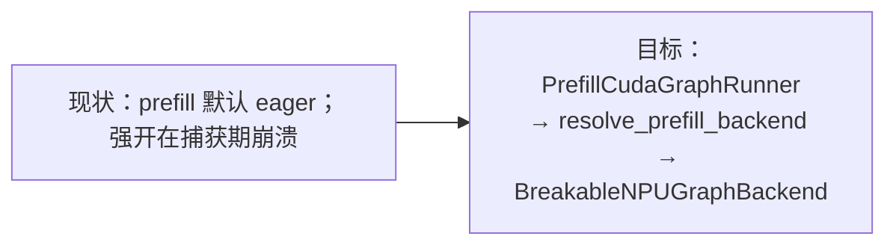
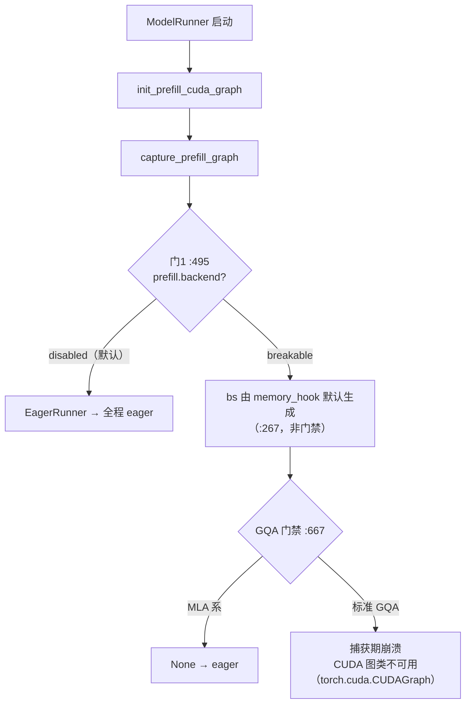
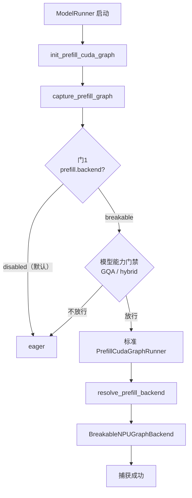
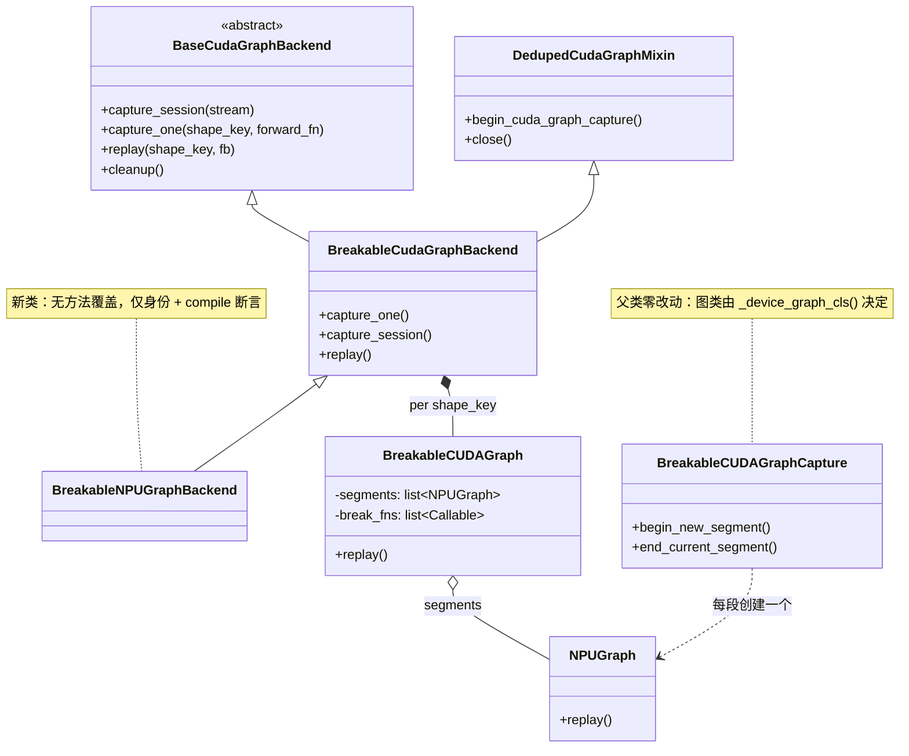
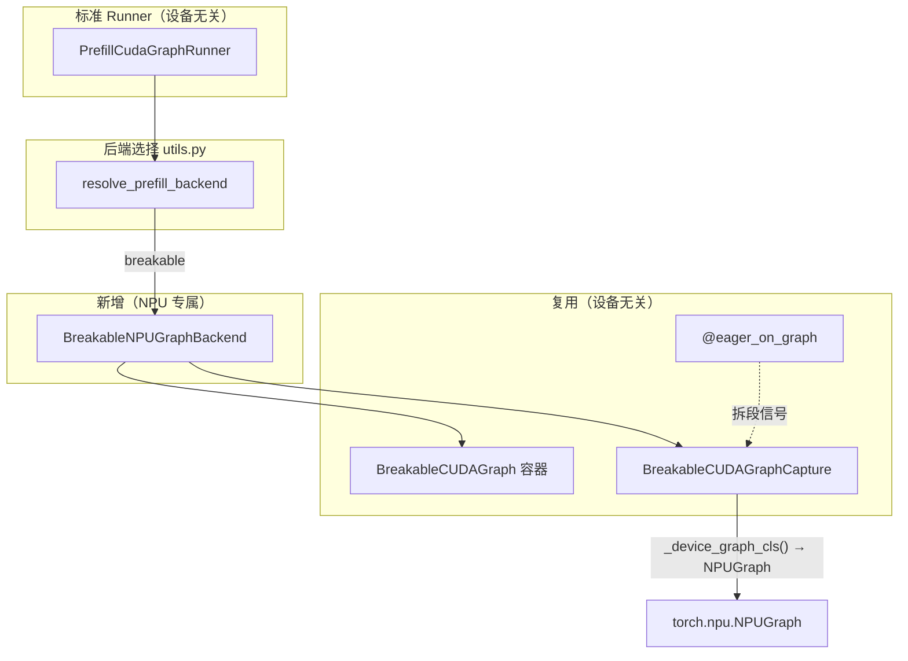
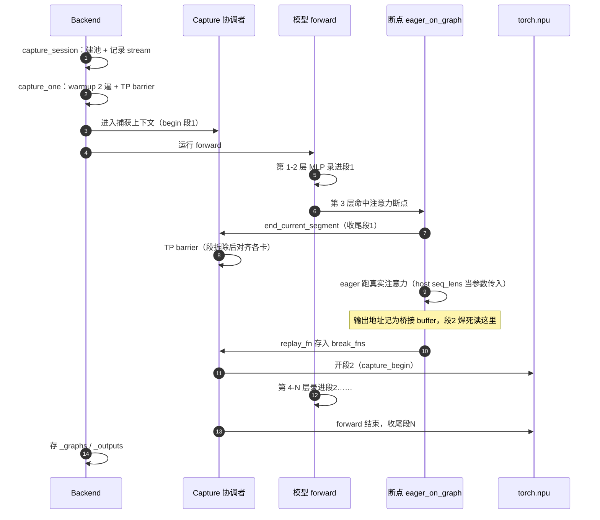
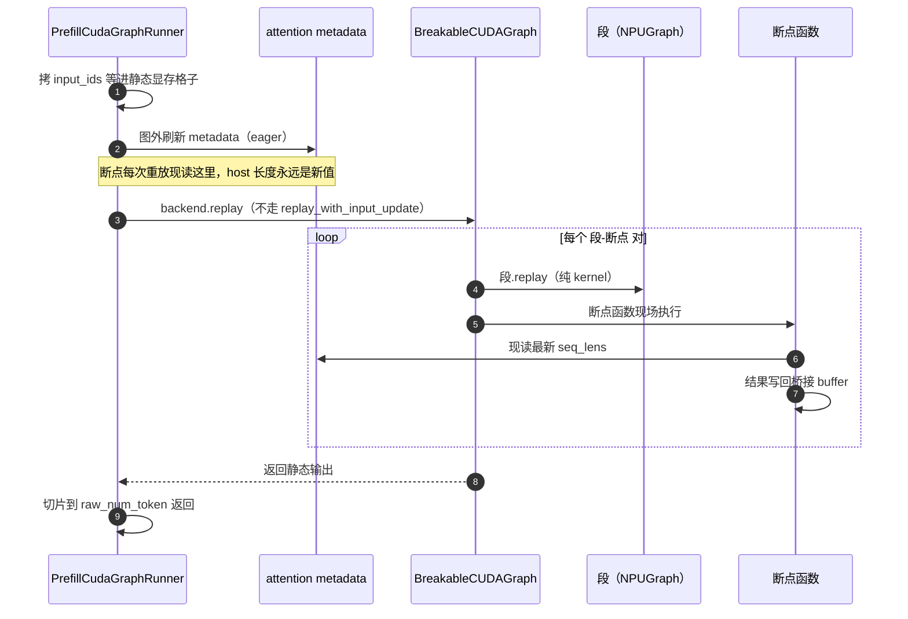
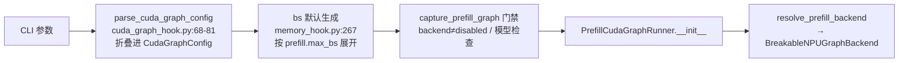

# BreakableNPUGraphBackend 设计方案

状态：设计稿（未实现）· 可行性 spike 已通过（V1/V2/V3/V6，2026-10 真机）· 裸捕获入口待 V8（§4.2）· 行号会漂移，以内容为准 · 重点看 §3 代码改动清单

---

## 0. 摘要

### 0.1 目标与开关

| 阶段 | 现状 | 目标 | 开启方式 |
|---|---|---|---|
| **prefill** | **默认不入图**（全程 eager）；显式开启则在捕获期崩溃 | 可选 breakable（NPU 首次入图） | `--cuda-graph-backend-prefill breakable`（或 JSON 配置），详见 §2.5 |

### 0.2 关键决策

| # | 决策点 | 选择 | 一句话理由 |
|---|---|---|---|
| 1 | 类关系 | **继承** `BreakableCudaGraphBackend`，子类**不覆盖任何方法**；父类只把图类改成设备分支 | prefill runner 十几处 `isinstance(...)` 靠继承自动命中；捕获上下文零副本 |
| 2 | runner | 标准 `PrefillCudaGraphRunner`，**零改动** | 标准 runner 原生支持 BCG，prefill 路径无需改动 |
| 3 | 段捕获入口 | 父类 `_begin_new_segment` 的图类改为设备无关（`_device_graph_cls()` → `torch.npu.NPUGraph`），走裸 `capture_begin/capture_end`；**不开** `auto_dispatch_capture`（§8） | 捕获上下文类零改动、零副本；裸捕获等价性待 V8 |
| 4 | host seq_lens | 断点在图外执行，每次重放现读现传 | 全图模式的 `graph.update` 通道对注意力整体不需要 |
| 5 | 内存池 | 沿用父类全局池（内部即 `device_module.graph_pool_handle()`），不移植 precarve/borrow/scope | NPU 上同样适用；precarve env 默认关，scope 为 no-op |
| 6 | weak-ref | 沿用弱引用（不新增开关） | **已验证（V4）**：段图存活期间弱引用跨重放有效 |
| 7 | dedup / memory saver | 自动关闭 / 沿用父类 `NotImplementedError` | 无 cuda-python；BCG 与 memory saver 不兼容 |

### 0.3 现状 → 目标



### 0.4 改动清单总览

| # | 文件 | 类型 | 内容 | 阶段 |
|---|---|---|---|---|
| 1 | `runner_backend_utils/.../breakable_cuda_graph.py` | 修改 | `_device_graph_cls()` 设备分支 + `_is_stream_capturing` NPU 分支 | P1 |
| 2 | `runner_backend/utils.py` | 修改 | `resolve_prefill_backend` 加 NPU 分支 | P1 |
| 3 | `hardware_backend/npu/graph_runner/breakable_npu_graph_backend.py` | **新增** | NPU 后端（薄子类：身份 + compile 断言） | P1 |
| 4 | `hardware_backend/npu/modules/deepseek_v2_attention_mla_npu.py` | 修改 | MLA/DSA core 加断点 | P3 |
| 5 | `test/registered/unit/npu/graph_runner/` | **新增** | 单测 | P1 |
| 6 | `docs/docs/advanced_features/breakable_cuda_graph.mdx` | 修改 | 兼容性表更新 | P3 |

`breakable_cuda_graph_backend.py` 与捕获上下文类 `BreakableCUDAGraphCapture` **零改动**——NPU 只是把图类换掉。

---

## 1. 背景

### 1.1 Breakable Graph 是什么


录制时剪段，重放时"段一键 replay + 断点函数现场执行"交替。断点用 `@eager_on_graph` 标记（`breakable_cuda_graph.py:253`）。

### 1.2 核心矛盾：seq_lens 住在哪

| 维度 | CUDA 图 | NPU 图 |
|---|---|---|
| 可变数据的位置 | 显存固定格子 | 注意力 KV 长度走 **host 侧 IntArray**，录制时固化进图（`ascend_backend.py:2937`） |
| 换新值的通道 | 重放前 `copy_()` 进格子 | `graph.update(cpu_update_input=...)` + 单 worker 线程 + Event 栅栏（`npu_cudagraph_backend.py:156`） |
| **breakable 下** | 不变 | **注意力断点在图外 → 现读现传，update 通道不再需要** |

### 1.3 现状流程

**启动时的 prefill 图捕获决策（现状）**：



### 1.4 基建复用盘点

| 基建 | 状态 | 说明 |
|---|---|---|
| `eager_on_graph` / `break_graph` 装饰器 | 直接复用 | 拆段逻辑全在 Python 侧，ContextVar 通信 |
| `BreakableCUDAGraph` 容器 | 直接复用 | 段对象只需有 `.replay()` |
| `_copy_output` 输出回写 | 直接复用 | 纯 tensor 操作 |
| `weak_ref_tensor` | NPU 已接好 | `weak_ref_tensor.py:9` → `torch_npu._C._weak_ref_tensor` |
| `DedupedCudaGraphMixin` | 自动关闭 | 缺 cuda-python → `build_deduped_cuda_graph` 返回 None |
| TP barrier / 双 warmup / 共享输出 buffer | 继承即得 | 设备无关 |
| `PrefillCudaGraphRunner` 的 BCG 协议 | 继承自动满足 | 以 isinstance 识别 BCG（`prefill_cuda_graph_runner.py:539-674`） |
| 段捕获 `capture_begin/capture_end` | **需适配** | 硬编码 CUDA/XPU（`breakable_cuda_graph.py:418-439`） |
| `_is_stream_capturing` | **需适配** | 无 NPU 分支（`:90-107`） |
| CUDA 池机制（precarve/borrow/scope） | 不移植 | precarve env 默认关；其余 CUDA 专属 |
| `graph.update` 通道 | 不移植 | 断点在图外（§1.2） |

---

## 2. 设计

### 2.1 架构图

**目标流程图**（与 §1.3 现状图一一对应）：



与 §1.3 对照：崩溃节点消失，只剩"用户显式 disabled"和"模型能力门禁"两种合法降级。

**类图**（只有一个新类，且不覆盖任何方法）：



**运行时组件图**：



### 2.2 设计决策明细

| 问题 | 方案 | 状态 / 回退 |
|---|---|---|
| 段怎么录 | 父类 `_begin_new_segment` 改用 `_device_graph_cls()`（NPU → `torch.npu.NPUGraph`），裸 `capture_begin/capture_end`；每段同 pool；不开 `auto_dispatch_capture` | **待验（V8）**：裸捕获等价性；不过则回退 `torch.npu.graph` 上下文 |
| 捕获上下文 | 完全复用父类 `BreakableCUDAGraphCapture`，不建子类、不加工厂 | 零副本、零漂移 |
| host 绑定 | 不实现 `replay_with_input_update`（调用即 AttributeError）；注意力在图外 | 待验（V5）：发现固化算子 → 套 `@eager_on_graph` 摘出 |
| 旁流追踪 | `_is_stream_capturing` 的 NPU 与 HIP/XPU 合并走便携查询 | **已验证（V3）**：相关 API 均存在 |
| weak-ref | 沿用弱引用（默认行为），不加开关 | **已验证（V4）**：段图存活时跨重放有效，3 次全过 |
| 段间 pool | 沿用父类的全局池（`get_or_create_global_graph_memory_pool` → `device_module.graph_pool_handle()`） | **已验证（V2）**：共享池分段成立，脚本见 `v2_spike_two_segments.py` |
| 父类改动 | `_device_graph_cls()` 一行 + `_is_stream_capturing` NPU 分支；`breakable_cuda_graph_backend.py` 不动 | 均为设备分支，CUDA/XPU 行为不变 |
| dedup | 不处理，自动关闭 | — |
| memory saver | 父类 `NotImplementedError` 保留 | — |
| torch.compile | 断言关闭（BCG 无 compile） | — |
| runner | 零改动，标准 runner 原生支持 BCG | — |


### 2.3 录制 / 重放时序

**录制**：



**重放**：



### 2.4 非目标（v1）

| 不做 | 原因 |
|---|---|
| EAGLE/draft prefill 图 | host 元数据路径复杂度不同 |
| 段间 dedup | 无 cuda-python |
| 新环境变量 | 复用 `--cuda-graph-config` |
| 性能超越全图 | 净收益未知，实测为准 |

### 2.5 如何开启（参数链路）

默认 `prefill.backend = disabled`（非 CUDA 平台，`cuda_graph_config.py:119-123`），因此 **NPU 上 prefill 不入图是默认行为**，不需要额外的“默认关闭”代码。

> **现状 vs 落地后**：目前 NPU 上没有任何参数能**成功**开启 prefill 图。`--cuda-graph-backend-prefill breakable` 一个参数即可过门禁并构造出 `PrefillCudaGraphRunner`（`bs` 由 `memory_hook.py:267` 自动生成，门2 不会拦），但会因缺 NPU 解析分支、捕获时落到 CUDA 图类而崩溃。下表的开启方式在**本设计落地后**才生效。

| 方式 | 命令 | 说明 |
|---|---|---|
| 推荐（简写） | `--cuda-graph-backend-prefill breakable` | 只选后端；`bs` 桶由 `memory_hook.py:267` 按 `max_bs` 自动生成 |
| 完整控制 | `--cuda-graph-config '{"prefill": {"backend": "breakable", "bs": [2048, 4096, 8192]}}'` | JSON 优先级最高 |
| 指定桶 | `--cuda-graph-bs-prefill 2048 4096 8192` | 覆盖默认生成的桶列表 |
| 关闭 | `--disable-prefill-cuda-graph` | 等价 `--cuda-graph-backend-prefill disabled` |



`bs` 无需显式指定：`handle_gpu_memory_settings`（`pipeline.py:215`）在模型启动前运行，`prefill.max_bs` 默认取 `chunked_prefill_size`（MLA 后端 2048），再展开成桶列表。

---

## 3. 代码改动清单（左右对比）

> 约定：只列**需要改的**代码；新增文件左栏为空。`…` 表示未改动部分。
> 第三列回答两件事：**为什么要改**，以及**不改会出什么问题**。
> **验证结论**（§4.1）：段间共享内存池、旁流便携查询、弱引用、空段均已真机验证；**裸捕获入口的行为待 V8 验证**（§4.2）。
> **改动边界**：§3.2–§3.3 都在工具模块 `breakable_cuda_graph.py`，总共三处小改；`breakable_cuda_graph_backend.py` 与捕获上下文 `BreakableCUDAGraphCapture` **零改动**，NPU 只新增一个不覆盖任何方法的薄后端类（§3.4）。

### 3.1 `resolve_prefill_backend`：新增 NPU 分支

`runner_backend/utils.py` :107-126 —— 现状**没有任何设备分支**，NPU 会误拿 CUDA 版后端

<table>
<tr><th>改前</th><th>改后</th><th>为什么改 / 不改会怎样</th></tr>
<tr>
<td><pre>
cfg = get_exec().graph.cuda_graph_config
backend_name = (
    cfg.prefill.backend if cfg is not None else Backend.BREAKABLE
)
if backend_name == Backend.BREAKABLE:
    return BreakableCudaGraphBackend(
        cuda_graph_runner,
        enable_memory_saver=...,
        debug_eager=...,
    )
if backend_name == Backend.FULL:
    ...
</pre></td>
<td><pre>
cfg = get_exec().graph.cuda_graph_config
backend_name = (
    cfg.prefill.backend if cfg is not None else Backend.BREAKABLE
)
if cuda_graph_runner.model_runner.device == "npu":
    if backend_name != Backend.BREAKABLE:
        raise ValueError(
            "NPU prefill graph only supports "
            f"'breakable', got '{backend_name}'"
        )
    from ...breakable_npu_graph_backend import (
        BreakableNPUGraphBackend,
    )
    return BreakableNPUGraphBackend(
        cuda_graph_runner,
        enable_memory_saver=get_exec().features.enable_memory_saver,
        debug_eager=get_exec().graph.debug_cuda_graph,
    )
if backend_name == Backend.BREAKABLE:
    return BreakableCudaGraphBackend(...)
if backend_name == Backend.FULL:
    ...
</pre></td>
<td>prefill 解析器没有任何设备分支，NPU 会拿到 <b>CUDA 版</b> `BreakableCudaGraphBackend`：段捕获走 `torch.cuda.CUDAGraph`（无 NPU 分派）→ 崩；prefill runner 里的能力检查也认不出这是 NPU 后端。<b>不改</b>：NPU prefill 入图不可能；显式 `ValueError` 也比静默拿错类好排查。</td>
</tr>
</table>

### 3.2 `_is_stream_capturing`：NPU 并入便携查询分支（V3 已验证）

`breakable_cuda_graph.py` :90-107

<table>
<tr><th>改前</th><th>改后</th><th>为什么改 / 不改会怎样</th></tr>
<tr>
<td><pre>
def _is_stream_capturing(stream):
    if is_hip() or _is_xpu:
        with get_device_module().stream(stream):
            return get_device_module().is_current_stream_capturing()
    return (
        _capture_status(stream.cuda_stream)
        == rt.cudaStreamCaptureStatus.cudaStreamCaptureStatusActive
    )
</pre></td>
<td><pre>
def _is_stream_capturing(stream):
    # NPU/HIP/XPU: portable per-device-module query.
    # V3 verified on Ascend: the API exists, so the
    # conservative "always capturing" fallback is gone.
    if is_npu() or is_hip() or _is_xpu:
        with get_device_module().stream(stream):
            return get_device_module().is_current_stream_capturing()
    return (
        _capture_status(stream.cuda_stream)
        == rt.cudaStreamCaptureStatus.cudaStreamCaptureStatusActive
    )
</pre></td>
<td>该函数在段收尾合流旁路流时被调用。CUDA 路径依赖 `stream.cuda_stream` 和 cuda-python，NPU 两者都没有 → `AttributeError`/`ImportError`。真机验证 V3 后，NPU 可直接用便携查询（按流查询需先把目标流切成当前流），与 HIP/XPU 合并成一个分支，不再需要“保守返回 True”的兜底。<b>不改</b>：任何在图内 fork 旁流的模型，段收尾时崩溃。</td>
</tr>
</table>

同时 import 行加 `is_npu`：`from sglang.srt.utils import get_device_module, is_hip, is_npu, is_xpu`

### 3.3 图类选择：`_device_graph_cls()`（`breakable_cuda_graph.py`）

`breakable_cuda_graph.py` · `_begin_new_segment()` :418-440

<table>
<tr><th>改前</th><th>改后</th><th>为什么改 / 不改会怎样</th></tr>
<tr>
<td><pre>
def _begin_new_segment(self) -> None:
    graph_cls = torch.xpu.XPUGraph \
        if _is_xpu else torch.cuda.CUDAGraph
    if self.cuda_graph._deduped_cuda_graph is not None:
        try:
            graph = graph_cls(keep_graph=True)
            ...
</pre></td>
<td><pre>
def _device_graph_cls():
    if is_npu():
        return torch.npu.NPUGraph
    if _is_xpu:
        return torch.xpu.XPUGraph
    return torch.cuda.CUDAGraph

def _begin_new_segment(self) -> None:
    graph_cls = _device_graph_cls()
    if self.cuda_graph._deduped_cuda_graph is not None:
        try:
            graph = graph_cls(keep_graph=True)
            ...
</pre></td>
<td>父类把图类写死成 CUDA/XPU。NPU 上 <code>torch.cuda.CUDAGraph</code> 不存在（§1.3 的崩溃点）。改成设备分支后，父类的 <code>capture_begin/capture_end</code> 原样在 NPU 上工作（签名一致：<code>capture_begin(pool, capture_error_mode)</code>），<b>既不需要 NPU 捕获子类，也不需要 <code>_make_capture_ctx</code> 工厂</b>。<b>不改</b>：NPU prefill 入图必崩；要绕开只能复制整个捕获上下文（约 100 行）。</td>
</tr>
</table>

- `keep_graph=True` 只服务 dedup；NPU 上 dedup 关闭（`_deduped_cuda_graph is None`），走不到该分支。
- 与 `torch.npu.graph` 上下文的唯一差异：不再有每段的 `synchronize()` + `empty_cache()`；父类 `capture_one` 已在 warmup 前 `device_module.synchronize()`（`:122`）。等价性由 §4.2 的 V8 验证；失败则回退“`torch.npu.graph` 上下文 + 捕获子类 + `_make_capture_ctx` 工厂”。
- `_is_stream_capturing` 的 NPU 分支（§3.2）仍在同一文件，`is_npu` 只 import 一次。

### 3.4 新文件：`breakable_npu_graph_backend.py`

`python/sglang/srt/hardware_backend/npu/graph_runner/breakable_npu_graph_backend.py`

父类与捕获上下文全部复用；本文件只提供 NPU 身份和一条 `torch.compile` 断言——`capture_one`、内存池、共享输出 buffer、dedup、`replay_session()`、段捕获入口全部继承。

```python
"""Breakable NPU graph backend: one torch.npu.NPUGraph per segment,
attention (and other host-input ops) eager between segments.

The parent capture context, capture loop and replay path are used
unchanged; only the per-segment graph class is device-specific
(_device_graph_cls in breakable_cuda_graph.py).
"""

from __future__ import annotations

from typing import Any

from sglang.srt.model_executor.runner_backend.breakable_cuda_graph_backend import (
    BreakableCudaGraphBackend,
)


class BreakableNPUGraphBackend(BreakableCudaGraphBackend):
    """NPU prefill graphs split at eager_on_graph break points."""

    def __init__(
        self,
        cuda_graph_runner: Any,
        *,
        enable_memory_saver: bool = False,
        debug_eager: bool = False,
    ) -> None:
        super().__init__(
            cuda_graph_runner,
            enable_memory_saver=enable_memory_saver,
            debug_eager=debug_eager,
        )
        assert not getattr(cuda_graph_runner, "enable_torch_compile", False), (
            "breakable NPU graph does not support torch.compile"
        )
```

要点：

- **无方法覆盖**：段捕获、断点记录、replay 全在父类；NPU 的全部差异集中在 `_device_graph_cls()`（§3.3）。
- 为什么还要这个类：`resolve_prefill_backend` 需要一个明确的返回类型（日志与 `isinstance` 可读），并挡住 NPU 上不支持的 `torch.compile`。
- `capture_session` 不重写：父类内部就是 `device_module.graph_pool_handle()`（`pool.py:109-115`），NPU 直接适用。
- 父类段收尾里那条 “The CUDA Graph is empty” 警告过滤（`breakable_cuda_graph.py:458`）只是文案不匹配，NPU 上不生效，无功能影响。

### 3.5 模型断点：MLA/DSA core 加装饰器（Phase 3）

`hardware_backend/npu/modules/deepseek_v2_attention_mla_npu.py`

<table>
<tr><th>改前</th><th>改后</th><th>为什么改 / 不改会怎样</th></tr>
<tr>
<td><pre>
# 顶部无 eager_on_graph 导入
def forward_mha_core_npu(m, q, k, v, ...):
    ...
def forward_mla_core_npu(m, q_pe, k_pe,
                         q_nope_out, ...):
    ...
</pre></td>
<td><pre>
from sglang.srt.model_executor.runner_backend_utils.breakable_cuda_graph import (
    eager_on_graph,
)
@eager_on_graph
def forward_mha_core_npu(m, q, k, v, ...):
    ...
@eager_on_graph
def forward_mla_core_npu(m, q_pe, k_pe,
                         q_nope_out, ...):
    ...
</pre></td>
<td>MLA/DSA core 最终调用吃 host 侧 seq_lens 列表的 `npu_fused_infer_attention_score*`；不摘出图外就会被固化，重放读到<b>捕获时的旧长度</b>——数值错误且<b>不报错</b>，是最难排查的一类 bug（V5 专门抓它）。加装饰器后它们在图外执行，每次重放现读新值。<b>不改</b>：MLA 系模型 breakable 结果必然错误。</td>
</tr>
</table>

> 通用 MHA 路径 `radix_attention.py:176` 已有装饰器，无需改动。装饰器在图外调用时是透传，对 eager/CUDA 无副作用。

### 3.6 新增单测

`test/registered/unit/npu/graph_runner/test_breakable_npu_graph_backend.py`

<table>
<tr><th>改前</th><th>改后</th></tr>
<tr>
<td><pre>（文件不存在，新建）</pre></td>
<td><pre>
def test_resolve_npu_breakable():
    # device=npu + prefill breakable
    #   → BreakableNPUGraphBackend
    # 默认配置 → 跳过 prefill
    ...
def test_segment_split():
    # 假 forward + @eager_on_graph
    # mock _device_graph_cls / capture_begin
    # 断言：每断点 end/begin 各一次，
    # break_fns 顺序正确，输出写回 buffer
    ...
def test_replay_never_updates():
    # backend 为 BCG 时走 plain replay，
    # 不触碰 replay_with_input_update
    ...
</pre></td>
</tr>
</table>

### 3.7 文档兼容性表

`docs/docs/advanced_features/breakable_cuda_graph.mdx` :142

<table>
<tr><th>改前</th><th>改后</th></tr>
<tr>
<td><pre>
- **CUDA and ROCm/HIP.** Breakable CUDA graph
  runs on both NVIDIA and AMD GPUs. Other
  platforms (NPU, CPU, MPS, XPU) are
  unsupported; there `--debug-cuda-graph` is
  automatically disabled with a warning.
</pre></td>
<td><pre>
- **CUDA, ROCm/HIP, and Ascend NPU.**
  Breakable graph runs on NVIDIA/AMD GPUs and
  on Ascend NPU for prefill of
  non-speculative models. CPU, MPS, and XPU
  remain unsupported; there `--debug-cuda-graph`
  is automatically disabled with a warning.
</pre></td>
</tr>
</table>

---

## 4. 验证状态

### 4.1 已真机验证的结论（2026-10）

| # | 结论 | 证据 | 对设计的定型 |
|---|---|---|---|
| V1 | `NPUGraph` 有裸 `capture_begin/capture_end`（另有 `replay`/`reset`/`update`/`pool`），签名与 CUDA 一致（`capture_begin(pool, capture_error_mode)`）；`auto_dispatch_capture` **不是** `capture_begin` 的参数，由上下文管理器实现 | `inspect.getsource(torch.npu.graph)` | 采用**裸 API**（行为等价性由 V8 关闭）；该开关不启用（§8） |
| V2 | 同一 stream + 同一 pool 连续捕获两段合法；段间张量地址不变；换新输入重放 `max abs err = 0` | `v2_spike_two_segments.py` | **共享池分段定型**；独立池回退删除 |
| V3 | `torch.npu.is_current_stream_capturing` 与 `torch.npu.Stream.wait_stream` 均存在（True/True） | 真机 introspect | §3.2 与 HIP/XPU 合并走便携查询 |
| V4 | 段图存活期间，段内产出的张量取弱引用后（删掉强引用）仍可跨重放使用：同池捕获 + 普通分配搅动下，用弱引用执行断点乘法重放，`max abs err = 0`（3 次全过） | `v4_weak_ref_spike.py` | 默认弱引用路径可行，**不需要额外开关** |
| V6 | 空段（连续断点）捕获与重放均正常 | 同 V2 脚本末尾 | 不做连续断点合并 |

> V4 的负对照（删掉所有段图后读弱引用）未观察到数据被复用，但这属于未定义行为，**不作为安全保证**；判定依据是“段图存活时”的正向用例。

### 4.2 实现期验证项

| # | 验证项 | 何时 | 失败回退 |
|---|---|---|---|
| V5 | 段内有 host 固化的非注意力算子？ | Phase 2 parity | 该算子套 `@eager_on_graph` 摘出图外 |
| V7 | prefill 门禁（GQA / hybrid 检查）对目标模型放行？（ascend 未 opt-in captured metadata，两个 NotImplementedError 钩子不会被调用） | Phase 2 | 该模型 prefill 保持 eager |
| V8 | 裸 `capture_begin/capture_end` 与 `torch.npu.graph` 等价？（同 pool 连捕两段 + 换输入重放 `err=0`；再加一个“捕获前不额外同步”的变体） | Phase 1 末 | 回退 A 方案：`torch.npu.graph` 上下文 + NPU 捕获子类 + `_make_capture_ctx` 工厂 |

---

## 5. 测试与基准

| 测试 | 内容 | 通过标准 |
|---|---|---|
| 单测（CPU，mock torch_npu） | §3.6 三项 | CI 绿 |
| prefill parity | eager vs breakable，**用不同 seq_lens 重放** | logits 对齐（无 full 后端可对照） |
| 性能 | prefill 吞吐、每步 CPU 占比 | 如实报告，含负结果 |

---

## 6. 分阶段

| 阶段 | 内容 | 出口条件 |
|---|---|---|
| **P0 spike（已完成）** | ✅ V1/V2/V3/V6 真机关闭（2026-10） | 共享池分段成立；捕获 API 齐备 |
| P1 核心（~1 周） | **V8 裸捕获 spike** + 工具模块适配 + 新后端 + `resolve_prefill_backend` 接线 + 单测（CPU mock） | V8 通过（否则回退 A 方案）；单测通过 |
| P2 prefill 入图 | 真机 prefill parity | breakable 配置跑通 prefill，logits 对齐 |
| P3 MLA/DSA | MLA/DSA 断点 + mdx 更新 | 主力 NPU 模型 prefill breakable 可用 |
| P4 调优（可选） | 段粒度、性能回归 | 结论（含负结果）落文档 |

---

## 7. 风险

| 风险 | 影响 | 缓解 |
|---|---|---|
| 段数 × launch 开销 | 每层一个断点，61 层 ≈ 122 次段 launch，可能拖慢 | 实测；需要时改"粗断点"（每 N 层断一次） |
| 默认桶数量偏多 | `memory_hook` 按 `max_bs`（默认 = `chunked_prefill_size`）展开桶列表，捕获耗时与图内存偏高 | 用 `--cuda-graph-bs-prefill` 收窄，P4 调优 |
| 裸捕获未验证（V8） | 少了每段的 `synchronize()`/`empty_cache()`，ACL 捕获可能报状态错或被在途 kernel 污染 | V8 先行；失败回退 `torch.npu.graph` 上下文（方案 A） |
| prefill 全新领地（V7） | NPU prefill 从未入图 | 风险集中在门禁与模型适配，非图机制 |
| DeepEP/DP 交互 | a2a 断点复杂度 | v1 不承诺，按 Phase 3 评估 |

---

## 8. 后续注意事项

### 8.1 为什么不开 `auto_dispatch_capture`

`auto_dispatch_capture=True` 的唯一功能性作用是：在捕获期由 `torch.npu.graph.__enter__` 压入 `_GraphDispatchMode`（`torch_npu/npu/graphs.py:420`，进入点 `:898-915`），使 `graph.update(cpu_update_input=...)` 可用；不开启时 `update()` 直接抛 RuntimeError（`:655-663`）。裸 `capture_begin` 没有对应入口。

它只对注册表里的 5 类注意力算子生效（`_npu_paged_attention`、`npu_multi_head_latent_attention`、`npu_fused_infer_attention_score` v1/v2、`npu_fusion_attention_v3`，见 `torch_npu/npu/_npugraph_handlers/`），其余算子原样放行。

BCG 的注意力在断点处 eager 执行，**段内不会出现这些算子** → 捕获后 `graph_dispatch_records` 为空 → `update()` 既无用又会因长度校验报错。因此：不启用该开关；且**任何情况下都不要对段图调用 `update()`**。

### 8.2 什么时候需要重新评估

段内一旦出现注册表里的注意力算子，就需要改用 `torch.npu.graph(..., auto_dispatch_capture=True)`（该开关只在上下文管理器里实现，裸 `capture_begin` 没有），并重新验证。触发条件：

- 某层注意力漏打 `@eager_on_graph`（或新后端没走断点），被圈进段内；
- 将来想让注意力本身也入图（放弃 BCG 的 eager 断点语义）。

届时若仍需裸捕获，只能自己复刻 `graph_dispatch_mode.__enter__/__exit__`（非公开 API）。启用后的额外代价：命中的算子走 `prepare_capture`（按最大 workspace 预分配 + 切 `.out` 重载），捕获更慢、显存更高；`update` 的 `cpu_update_input` 长度必须等于该段内的 record 数（每层一条）。

### 8.3 裸捕获省掉了什么

方案 B 不再经过 `torch.npu.graph`，因此**没有**它每段都做的 `torch.npu.synchronize()` + `empty_cache()` + `host_empty_cache()`（`graphs.py:898-907`）。省掉的这三步正是 V8 要验证的等价性：

- 若 V8 通过：61 层 ≈ 122 次的整设备同步一并消失，是相对方案 A 的额外收益；
- 若 V8 失败：回退 A 时要把这三步的代价记回来（捕获耗时 + 每段一次全局同步），并在 P4 实测。

无论走哪条路，`auto_dispatch_capture` 都不启用（§8.1）。

---

## 附：文件速查

```
python/sglang/srt/model_executor/runner_backend/
  utils.py                               # §3.1 resolve_prefill 接线
python/sglang/srt/model_executor/runner_backend_utils/
  breakable_cuda_graph/breakable_cuda_graph.py  # §3.2 §3.3
python/sglang/srt/hardware_backend/npu/graph_runner/
  breakable_npu_graph_backend.py         # §3.4 新增（薄子类）
python/sglang/srt/hardware_backend/npu/modules/
  deepseek_v2_attention_mla_npu.py       # §3.5 Phase 3
test/registered/unit/npu/graph_runner/                 # §3.6
docs/docs/advanced_features/breakable_cuda_graph.mdx   # §3.7
```

`runner_backend/breakable_cuda_graph_backend.py`（父类后端）与 `breakable_cuda_graph.py` 里的 `BreakableCUDAGraphCapture`：**无改动**。
