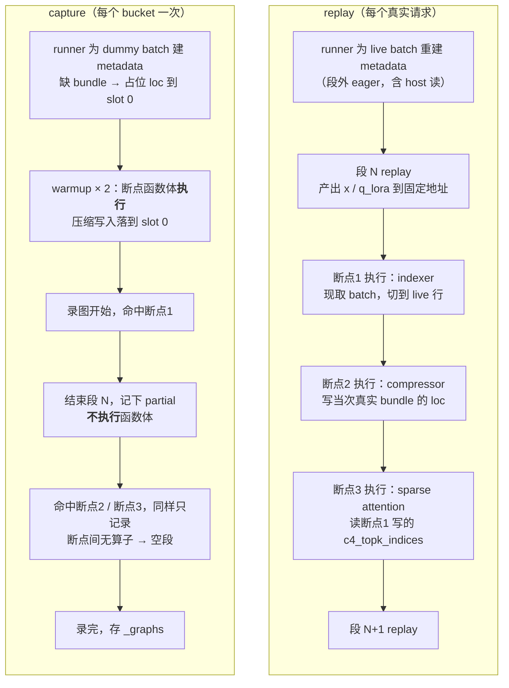

# f7d7201a09 逐行讲解：DSV4 适配 prefill graph

这个 commit 让 DSV4 Flash 能在 `--cuda-graph-backend-prefill breakable` 下跑起来。
改了 3 个文件、251 行。设计背景见
[breakable_npu_graph_backend_design.md](breakable_npu_graph_backend_design.md)，
本文只讲这个 commit 的每一处改动是什么意思、为什么必须这么改。

它修的是两个线上报错：

```
# 启动 capture 时
set_index_k_scale: loc_long = loc.view(-1, 1).long()
AttributeError: 'NoneType' object has no attribute 'view'

# 修好上面那个、能起服务之后，第一个真实请求进来时
[compressor] ropeSin shape dim 0, should be equal to
min(tokenSize, tokenSize/cmpRatio+batchSize): 17, but got 33
```

---

## 第一部分：三个预备概念

不懂这三件事，后面的代码看不出所以然。

### 1.1 eager 断点有三个执行时机，行为各不相同

`@eager_on_graph` 装饰的函数（下称**断点**）在三种场合被调用，走三条完全不同的路径。
代码在 `breakable_cuda_graph.py` 的 `eager_on_graph`：

```python
def wrapper(*args, **kwargs):
    capture = _current_capture_var.get()
    if capture is None:              # ← 不在录图：直接执行
        run(*args, **kwargs)
        return
    capture._end_current_segment()   # ← 正在录图：结束当前段
    captured_args = tuple(_weak_ref_if_tensor(a) for a in args)
    capture.cuda_graph._break_fns.append(
        functools.partial(run, *captured_args, **captured_kwargs)
    )                                #   把调用记下来，但不执行函数体
    capture._begin_new_segment()     #   开新段
```

| 时机 | 发生什么 | 函数体执行吗 |
| --- | --- | --- |
| **warmup**（`capture_one` 录图前跑 2 遍） | `capture is None`，走第一个分支 | **执行** |
| **capture**（正在录图） | 结束当前段 → 把 `partial(run, *参数)` 记进 `_break_fns` → 开新段 | **不执行** |
| **replay**（每次真实请求） | 不走 `wrapper`，由 `replay()` 直接调 `_break_fns[i]()`，见 1.1.1 | **执行** |

replay 这一行跟另两行不是一回事，单独说。

#### 1.1.1 replay 时是谁调用断点的

warmup 和 capture 时，是**模型代码调用那个被装饰的函数**，走进上面那个 `wrapper`。
replay 时完全不同：**decoder 层里那几行代码根本不会再执行**，所以 `forward_c4_indexer`
这个函数在 replay 时一次也不会被调用。

runner 的做法是把 layer model 的 forward 整体替换掉
（`prefill_cuda_graph_runner.py:2296`）：

```python
self.layer_model.forward = replay_layer_forward     # 换成"重放这张图"
...
finally:
    self.layer_model.forward = original_layer_forward
```

注意被换掉的只是 `layer_model.forward`，也就是那 61 层 decoder。**外层
`model.forward` 仍然 eager 执行**（embedding 查表、最终 norm 和 lm head），它照常调用
`layer_model.forward`，只是这一次调到的是重放。

断点是被 `BreakableCUDAGraph.replay()` 按下标取出来调的，整个函数就 6 行：

```python
def replay(self) -> None:
    stream = get_device_module().current_stream()
    token = _current_stream_var.set(stream)
    try:
        for i, seg in enumerate(self._segments):   # 录了 N 段
            seg.replay()                           # 放第 i 段（纯 device 执行）
            if i < len(self._break_fns):
                self._break_fns[i]()               # 调第 i 个断点（eager 执行）
    finally:
        _current_stream_var.reset(token)
```

三件事从这 6 行直接读出来：

1. **`_break_fns[i]()` 是个无参调用。** 参数早在 capture 期就被 `functools.partial` 绑进去了
   （`partial(run, *captured_args, **captured_kwargs)`），所以这里不需要、也没法再传参。
   这就是"参数在 capture 固定、函数体在 replay 执行"的实现方式。
2. **段与断点严格按下标配对**，所以执行顺序就是列表顺序。indexer 断点写
   `c4_topk_indices`、sparse attention 断点随后读它，这个先后关系靠的就是它们被 append
   进 `_break_fns` 的顺序。
3. **判定只在 capture 期做过一次。** `if in_prefill_graph(forward_batch)` 这行代码在 replay
   时不会被重新求值——capture 时它为真，于是记下了一个断点；replay 时那个断点被无条件调用。

你那次报错的调用栈正好把这条路径完整打印出来了，自下往上读：

```
_execute_body_capture        prefill_cuda_graph_runner.py:2331
  forward                    deepseek_v4.py:4938
    replay_layer_forward     prefill_cuda_graph_runner.py:2291   ← 模型层被换成图重放
      replay                 breakable_cuda_graph_backend.py:304
        replay               breakable_cuda_graph.py:367         ← 正是 _break_fns[i]()
          run                breakable_cuda_graph.py:283         ← partial 绑定的 run
            bcg_dsv4_c4_indexer   dsv4_prefill_graph.py:54       ← 断点函数体
```

栈里没有 `forward_c4_indexer`，也没有 `in_prefill_graph`——它们属于 capture 期，replay
期已经不在路径上了。

#### 1.1.2 录成图之后，CPU 和 NPU 之间传的是什么

先破一个误解：**录成图不会把一串计算变成"一次 NPU 计算"。** kernel 还是原来那些 kernel，
个数一样、顺序一样、每个算的东西一样。变的只是**谁在什么时候把它们提交给设备**。

##### eager 下的一次提交长什么样

eager 执行时，CPU 对每个 kernel 做一次提交，每次提交带一个参数块：

```
launch gemm_wq_a    args = { in=0x7f..1000, w=0x7f..8000, out=0x7f..2000, M=64, N=…, K=… }
launch rmsnorm      args = { in=0x7f..2000, out=0x7f..2400, n=64, eps=1e-6 }
launch rope         args = { q=0x7f..2400, positions=0x7f..3000, n=64 }
launch store_cache  args = { kv=0x7f..2400, loc=0x7f..4000, n=64 }
---- host 同步：cu.cpu().tolist() ----      CPU 等 NPU，拿到 [0, 64]，在 host 上算 metadata
launch compressor   args = { x=..., cu_seqlens=0x7f..5000, seqused=..., tokenSize=64 }
launch sparse_attn  args = { ..., actual_seq_lengths=[64] ← host 侧 IntArray }
launch gemm_o_proj  args = { ... }
...                                          × 61 层
```

参数块里只有两类东西：**设备地址**和**标量值**。每层几十个 kernel，61 层下来是几千次提交，
每次都有 host 侧的参数组装和驱动调用开销。中间还夹着 host 同步——CPU 要等 NPU 算完才能读到
序列长度，算完 metadata 再接着提交，这期间 NPU 空着。

##### 录图把什么固定下来了

capture 就是把这串提交**连同它们的参数块一起**录进一个预先建好的任务序列。所以：

| | 录进图里了吗 |
| --- | --- |
| kernel 的顺序和个数 | **是** |
| 每个 kernel 的参数块：设备地址 | **是**（地址被写死） |
| 每个 kernel 的参数块：标量（`n=64`、`tokenSize=64`、host IntArray `[64]`） | **是**（值被写死） |
| 那些地址里**存的数据** | **不是** |

最后一行是全部奥妙所在：地址写死了，但地址里的内容每次可以不一样。

##### 于是接口从"传值"变成了"约定地址"

| | eager | graph replay |
| --- | --- | --- |
| **入参** | 每个 kernel 一个参数块，CPU 逐次传 | replay 之前，CPU 把当次数据 `copy_()` 进那些**写死的地址**；replay 调用本身不带任何数据 |
| **提交次数** | 段内每个 kernel 一次 | 每段一次 |
| **出参** | 每个 kernel 产出新 tensor | 固定输出 buffer 的前 N 行 |

代码里看得最清楚（`breakable_cuda_graph_backend.py:295-305`）：

```python
def replay(self, shape_key, static_forward_batch, **kwargs):
    with graph_pool_replay_scope():
        self._graphs[shape_key].replay()    # 不传任何数据
    return self._outputs[shape_key]         # capture 期就建好的视图，每次返回同一个
```

**这个 `replay()` 没有数据入参，返回值也是 capture 时就存下来的对象。** 真正的"入参"动作
发生在它之前，由 `load_batch()` 里的 `buffer_registry.fill_from(...)` 完成：把当次的
`input_ids` / `positions` / `out_cache_loc`，以及 `seq_lens` / `extend_seq_lens` /
`extend_prefix_lens` / `extend_start_loc` / `req_pool_indices` / `orig_seq_lens`
（即 `_PREFILL_STATIC_FIELDS`）逐个拷进静态 buffer。

##### 一个具体例子：bucket 128，来了一个 64 token 的请求

**eager：**

```
CPU: launch gemm(in=0x1000, out=0x2000, M=64)     ← M 就是 64，当场传
CPU: launch rope(positions=0x3000, n=64)
...
CPU: 读 seq_lens → 在 host 上算出 cu=[0,64]
CPU: launch compressor(cu_seqlens=0x5000, tokenSize=64)
CPU: 拿到输出 tensor，形状 [64, 7168]
```

**graph replay：**

```
CPU: static_input_ids[:64].copy_(live_input_ids)      ← 往写死的地址里填数据
CPU: static_positions[:64].copy_(live_positions)         尾部 64~127 行是上一次的残留
CPU: static_out_cache_loc[:64].copy_(live_loc)
CPU: static_seq_lens[:1].copy_(live_seq_lens)
CPU: graph.replay()                                   ← 一次提交，不带数据
     └─ 设备按录好的序列执行：gemm(in=0x1000, out=0x2000, M=128) …
                                                          ↑ M 是录进去的 128，不是 64
CPU: return self._outputs[shape_key]                  ← 固定 buffer
CPU: output[:64]                                      ← 自己切到真实行数
```

两件事直接从这个例子里掉出来：

1. **shape 是写死的，所以必须 padding。** 录的是 `M=128`，replay 时设备就按 128 行算，
   包括 64~127 行那些残留数据。算完的垃圾行由调用方切掉（`_slice_output` 的
   `output[:num_tokens]`）。这就是 bucket 机制存在的原因，也是为什么断点里到处是
   `x[:num_tokens]`。
2. **写死的标量就是三个 bug 的来源。** `tokenSize` 这类标量一旦录进去就定死在 128，而当次
   请求是 64。对纯 device 的 kernel 来说这不要紧（多算几行垃圾然后切掉），但对
   compressor / indexer 这类**要靠 host 算出的长度去对齐内存布局**的算子，录进去就是错的
   ——这正是 1.2 要讲的。

##### 断点改变了这幅图的哪一部分

breakable 不是"全录成一张图"，而是**段 + eager 区交替**：

```
段1(一次提交) → 断点1(CPU 正常逐个 launch) → 段2(一次提交) → 断点2(CPU 逐个 launch) → …
```

所以 CPU↔NPU 的交替**并没有被消除**，只是从"每个 kernel 一次"变成了"每个断点一次"：

| kernel | 提交方式 | host 同步 |
| --- | --- | --- |
| 段内的 GEMM / norm / RoPE / MLP / MoE（数量最多） | 每段一次提交，参数全部写死 | 无 |
| 断点内的 compressor / indexer / sparse attention | 照旧每个 kernel 一次提交 | 照旧有（这正是它们必须留在图外的原因） |

省掉的是数量最多的那一类的提交开销；留下的是必须留的。DSV4 每层 3 个断点（见 5.1），
所以每层从"几十次提交"变成"4 段提交 + 3 个断点里的若干次提交"。

#### 1.1.3 kernel 之间的数据是怎么交接的

很自然会这样想：第一次下发写出到地址 B，第二次下发要从地址 C 读入，那原来是 CPU 把数据从
B 搬到 C 的，录成图之后谁来搬？

**这个前提不成立：eager 下 CPU 也从来不搬数据。** CPU 搬的是**地址**，不是字节。
kernel 之间的数据流动，靠的是**同一个地址出现在前一个 kernel 的输出位和后一个 kernel 的
输入位**。数据全程待在设备上，一步都没动过。

```python
b = torch.matmul(x, w)   # allocator 给出地址 0x2000；launch matmul(out=0x2000)
c = torch.relu(b)        # allocator 给出地址 0x2400；launch relu(in=0x2000, out=0x2400)
                         #                                     ↑ 就是上一行的输出地址
```

CPU 在这里只做两件事：向 allocator 要一个地址，把这个地址填进下一个 kernel 的参数块。
`b` 这个 Python 对象也只是"地址 0x2000 + 形状 dtype"的一个壳子。

所以录图时什么都不用额外做：capture 把这两次下发连同 `in=0x2000` / `out=0x2400` 一起录下，
replay 时 matmul 往 0x2000 写、rmsnorm 从 0x2000 读，交接自然成立——因为它**本来就不是一次
拷贝，而是同一个地址被用了两次**。

这也解释了为什么必须有专门的图内存池：0x2000 这个地址在图的整个生命周期里都不能被别人拿去
复用，否则 replay 时读到的就是别人的数据。`breakable_cuda_graph_backend.py:192` 那行注释
把这件事说透了：

```python
# CUDA graphs retain tensor addresses, not Python tensor lifetimes.
```

图记住的是地址，不是 Python 对象的生命周期。Python 侧的 `b` 早就被回收了也没关系，
地址由池的 use-count 钉住。

于是只剩三种情况需要区分：

| 情况 | eager 下 | 录图后 |
| --- | --- | --- |
| **① 普通串联**（上一个的输出就是下一个的输入） | 同一地址用两次，CPU 不搬数据 | 地址一起录进去，自动成立 |
| **② eager 本来就做了一次拷贝**（`c.copy_(b)`、`cat`、`contiguous()`、device→device） | 那次拷贝**本身就是一个 kernel** | 和别的 kernel 一样被录进去 |
| **③ 数据真的绕了 host 一圈**（`b.cpu().tolist()` → host 上算 → 作为标量/IntArray 喂给下一个 kernel） | CPU 等 NPU、算完再下发 | **录不进去**，只能做成断点 |

情况 ② 在本仓就有现成例子。capture 结束时录了一次 device→device 拷贝，把 forward 的输出
搬进一个固定的共享 buffer（`breakable_cuda_graph_backend.py:256`）：

```python
output_buffer[:num_tokens].copy_(output[:num_tokens])
```

这行拷贝是**被录进图里的一个 kernel**。正因为每次 replay 都会重新执行它，输出才总是落在同一
个固定地址上，`replay()` 才能直接 `return self._outputs[shape_key]`——那是 capture 期就对
着这个共享 buffer 建好的视图。

情况 ③ 才是真正的麻烦，而它正是断点存在的全部理由。本 commit 里的例子就是
`_build_npu_compress_metadata_prefill` 里的 `cu.cpu().tolist()`：把设备上的前缀和读回
host，在 host 上算出 `positions_cmp_padding_c*` 的长度，再喂给 compressor。这个 host 往返
没法录进图，所以这整段必须留在段外、每次 replay 重新跑一遍。

最后把这条原理接回 1.1 的那个"参数在 capture 固定"：断点收到的 `x` 和 `q_lora`，
**就是上一个段的输出地址**。每次 replay，那个段都会往同一地址写入当次的新数据，断点再从
那里读。所以固定参数和"读到的是当次数据"并不矛盾——固定下来的是地址，变的是内容。

---

这里有一个**本 commit 的全部设计都建立在上面的关键区别**：

- **参数在 capture 时就被固定**了（存的是 capture 期张量的弱引用）。
- **函数体在 replay 时才执行**，所以函数体内部现读的东西是当次的。

为什么参数可以被固定？因为断点的张量参数（`x`、`q_lora`）是**上一个段在图内存池里产出的**，
每次 replay 这个段都会在**同一地址**重写它们。弱引用由池的 use-count 保活。

为什么 batch 和 metadata 不能当参数传？因为 replay 时 runner 会为当次请求**重建**一整套
metadata，capture 期那套会被释放。所以它们必须在函数体里现取——这正是下面
`get_tc_piecewise_forward_context()` 的用途。

### 1.2 DSV4 Flash 的 attention 长什么样，为什么它进不了图

#### 1.2.1 每层一种形态：ratio 0 / 4 / 128

DSV4 的压缩比例是**按层配置**的，来自 checkpoint config 的一个列表：

```python
# models/deepseek_v4.py:1041
self.compress_ratio: int = compress_ratio if ... else config.compress_ratios[layer_id]
assert self.compress_ratio in (0, 1, 2, 4, 128)
```

`compress_ratios: List[int]` 每层一个值（`configs/deepseek_v4.py:105`），所以模型是把不同
形态的层交错堆起来的。NPU 的 attention 入口只接受 `(0, 4, 128)` 三种：

| ratio | 近期 KV（`ori_kv`，未压缩） | 远期 KV（`cmp_kv`，压缩） | 入口 |
| --- | --- | --- | --- |
| **0** | 滑窗 128 内精确 | 无，只看窗口 | `_forward_swa` |
| **4** | 同上 | 4:1 压缩，**indexer 选 top-k 条** | `_forward_compressed` |
| **128** | 同上 | 128:1 压缩，**全读** | 同上 |

容易误解的一点：压缩层**不是只看压缩 KV**。`_forward_compressed` 把 `ori_kv` 和 `cmp_kv`
同时传进同一个融合算子，`ori_win_left = sliding_window - 1`（= 127）管局部精确、
`cmp_mask_mode = 3` 管全局压缩。所以每个压缩层都是**局部精确 + 全局压缩**两路合一。

代码里那行注释把 c4 和 c128 的差别说尽了：

```python
# c4 attends via indexer topk; c128 reads the full compressed history
if compress_ratio == 4:
    attn_kwargs["cmp_sparse_indices"] = topk.view(-1, 1, topk.shape[-1])
else:
    attn_kwargs["cmp_sparse_indices"] = None
```

为什么只有 c4 需要挑：4:1 压完历史还是很长（1M token 压成 25 万条），全读不划算；128:1 压完
只剩几千条，直接全读更省事。所以 `cmp_topk = index_topk` 这个参数只有 c4a 那一路会传。

#### 1.2.2 compressor 做什么

把**连续 `ratio` 个 token 的 KV 压成 1 条**。权重形状就是机制本身（`compressor.py:58-64`）：

```python
self.overlap = self.ratio == 4
self.coff = coff = 1 + self.overlap          # c4 → 2，c128 → 1
self.ape = nn.Parameter(
    torch.empty(self.ratio, coff * self.head_dim, dtype=torch.float32)
)
```

`ape` 有 `ratio` 行，是"组内第几个位置"的学习式嵌入；配上一个门控投影
（`wkv_gate` 拆成 `wkv` 和 `wgate`），`ratio` 个 token 进、1 条压缩 KV 出。c4 的 `coff=2`
表示每条压缩项保留 `2 × head_dim`（代码里把这叫 overlap），c128 是 1。

#### 1.2.3 indexer 和 top-k 是什么

**indexer 不算 attention 输出，它只负责"挑出该读哪些"。** 它是一个便宜的打分器：有自己的
一套小 Q/K、自己的压缩 KV 缓冲（int8 或 fp8 量化），对每个 query token 给每条压缩 KV 打一个
分，然后取分最高的 `k` 条，把**下标**交给真正的 attention。

bf16 回退分支里写着 "architecture-faithful"，是最清楚的说明
（`ascend_dsv4_backend.py:786-807`）：

```python
index_score = torch.einsum("shd,td->sht", q[start:end], kv_cache_value.squeeze(1))
#   s = query token，h = indexer 的头，d = 头维度，t = 压缩 KV 条数 → [s, h, t]
index_score = (index_score.relu_() * weights.unsqueeze(-1)[start:end]).sum(dim=1)
#   ReLU、按头加权、对头求和 → [s, t]：每个 query 对每条压缩 KV 一个分
index_score += torch.where(causal, float("-inf"), 0)
#   因果屏蔽：压缩块下标必须 <= query_pos // ratio，不能看未来
topk_idx = index_score.topk(min(self._dsv4_index_topk, seq_i // ratio), dim=-1)[1]
#   [1] 取的是 indices，不是 values —— 要的是"读哪些"，不是分数
topk_idx = torch.where(drop, -1, topk_idx)     # -1 = 这个槽位没用上
```

所以 **top-k 就是"每个 query token 挑 k 条压缩 KV"**，`k = index_topk`，配置默认 512
（`configs/deepseek_v4.py:60`）。产物 `c4_topk_indices` 形状 `[T, index_topk]`、dtype int32，
元素是压缩 KV 的下标，`-1` 表示空位。它随后被塞进真正的 attention 当 `cmp_sparse_indices`，
于是那个重算子只读这 k 条，而不是整段压缩历史。

indexer 之所以便宜：它的头维度小、KV 被量化成 int8/fp8、而且它打分的对象**本身已经是 4:1
压缩过的**。相当于用一次廉价的粗筛，换掉一次昂贵的全读。

#### 1.2.4 和别的模型比，特殊在哪

| | 每层 KV | 稀疏选择 | KV 压缩 |
| --- | --- | --- | --- |
| 标准 MLA（V3 / R1） | 全量 | 无 | 无 |
| DSA（V3.2） | 全量 | lightning indexer 选 top-k | **无** |
| **DSV4 Flash** | 滑窗 + 压缩，两路合一 | c4 层用 indexer | **有，多档比例、按层配置** |

DSA 已经有 indexer 和 top-k 了，但它挑的是**未压缩**的 KV；DSV4 多出来的是 KV 压缩本身。
代码上也对得起来：`layers/attention/dsv4/compressor.py` 只被 `deepseek_v4*` 系列引用，而
`layers/attention/dsa/` 下有 indexer、没有 compressor。

DSV4 还有两个结构特征：`num_key_value_heads == 1`（单 KV 头），以及
`kv_source_layer_ids` / `index_source_layer_ids`——跨层共享 KV。

#### 1.2.5 于是这条路径进不了图

压缩是**有状态**的：一个压缩组可能跨 chunk 边界，所以每个 ratio 都有一个 compress state
pool 当进位缓冲，它的表宽要往前多看 `coff * ratio` 个 token
（`ascend_dsv4_backend.py:134`）：

```python
history_size = coff * compress_ratio
width = history_size + max_input_capacity
positions = start_pos[:, None] - history_size + columns
```

`start_pos`（本 chunk 的全局起点）、`max_input_capacity`、表宽——**全要在 host 上算**。
加上 metadata 本身：

| 组件 | 依赖的 metadata |
| --- | --- |
| c4 / c128 compressor | `positions_cmp_padding_c*`、`start_pos`、`seqused`、`actual_seq_lengths_q_pa`、state block table、`c*_loc` |
| lightning indexer | `actual_seq_lengths_q/kv`、`c4_page_table`、`kernel_metadata["li_quant_metadata"]` |

这些值和形状都跟着当次请求变，而且 `kernel_metadata` 由 AICPU/host 算子生成、state block
table 的宽度来自 host 上的序列长度。按 1.1.2 的结论，这类标量一旦录进图就被写死；按
1.1.3 的分类，这是情况 ③（数据绕 host 一圈），**根本录不进去**。

这不是性能问题，是正确性问题——也正因如此，`_build_npu_compress_metadata_prefill` 是整条
链上唯一需要 host 参与的环节，而第三部分那三个 bug 全部出在它里面。

### 1.3 三种 batch 的差异

同一套代码会收到三种不同的 `ForwardBatch`，本 commit 的三个 bug 全部源于它们的差异：

| | eager batch | capture dummy batch | replay static batch |
| --- | --- | --- | --- |
| 来源 | 调度器真实请求 | `capture_prepare()` 造的假 batch | 静态缓冲 + runner 用当次值刷新 |
| `out_cache_loc_dsv4` | 调度器分配 KV 时写入 | **没有这个字段** | 当次真实 bundle |
| `positions` 长度 | 等于 token 数 | bucket 大小 | **bucket 大小**（补齐） |
| `extend_seq_lens` / `cu` | 真实长度 | bucket 大小 | **当次真实长度** |

注意最后两行：replay 时 `positions` 是 bucket 长度（如 128），而 `cu` 是真实长度（如 64）。
**eager 下这两者恒等**，所以这个分歧在改成入图之前永远不会暴露。这就是第二个报错的根源。

---

## 第二部分：新文件 `dsv4_prefill_graph.py`（69 行）

整个文件只有两个断点函数和一个判定函数。为什么单独建文件：断点是"图"和"DSV4"的交界处，
放在 DSV4 后端里会让后端文件再长 69 行，放在 graph backend 里则让通用代码知道 DSV4 的细节。

### 2.1 判定函数

```python
def in_prefill_graph(forward_batch: ForwardBatch) -> bool:
    # Same predicate as the attention break in models/deepseek_v4.py.
    return forward_batch.forward_mode.is_extend() and is_in_breakable_cuda_graph()
```

两个条件都必要：

- `is_extend()`：只有 prefill 走这条路。decode 用的是另一套全图后端，它有自己的
  metadata 刷新机制（`_init_dsv4_graph_metadata` / `_refresh_graph_*`），不能混。
- `is_in_breakable_cuda_graph()`：这是个全局开关，由 `enable_breakable_cuda_graph()`
  上下文置位，**capture 和 replay 期间都为 True**。eager 服务时为 False，所以 eager
  路径完全不受影响。

和 `models/deepseek_v4.py` 里 sparse attention 断点用的是同一个判定——这不是巧合，
三个断点必须同时生效或同时不生效，否则会出现"indexer 进了图、attention 没进"的半截状态。

### 2.2 indexer 断点

```python
@eager_on_graph
def bcg_dsv4_c4_indexer(
    *,
    backend: C4IndexerAscendBackendMixin,
    x: torch.Tensor,
    q_lora: torch.Tensor,
    c4_indexer,
    skip_compressor: bool,
) -> None:
```

- `@eager_on_graph`：套上就具备 1.1 的三时机行为。
- **返回 `None` 是硬要求**。`eager_on_graph` 内部 `assert out is None`，报错信息是
  "is a graph break and must return None; write the results into buffers the caller
  allocated"。原因是 capture 期函数体不执行，没有真实返回值可给后续段用。本例的结果
  写在 `self.forward_metadata.c4_topk_indices` 上，不靠返回值。
- `*` 强制关键字传参，按仓库规范（2 个以上参数用关键字）。
- `backend` 作为普通参数传进来：`_weak_ref_if_tensor` 只对张量做弱引用，非张量原样保留，
  而 backend 是生命周期长于图的对象，所以可以安全固定。

```python
    forward_batch = get_tc_piecewise_forward_context().forward_batch
    num_tokens = forward_batch.global_num_token_non_padded_cpu
    if num_tokens == 0:
        return
```

- **batch 从 forward context 现取，不从参数拿**——这就是 1.1 讲的那条分界线。warmup 时
  取到的是 capture dummy batch，replay 时取到的是 runner 刷新过的 static batch。
- `num_tokens == 0`：DP attention 下某个 rank 可能这一轮没有请求（idle）。它仍要参与
  集合通信所以保留图形状，但没有真实 token，直接返回，不写任何 KV。

```python
    # The static batch keeps bucket-sized positions; the indexer RoPE reads one
    # per live row.
    live_batch = copy.copy(forward_batch)
    live_batch.positions = forward_batch.positions[:num_tokens]
```

这两行是 1.3 那张表的直接后果。indexer 内部 `_compute_q_npu` 要用 `positions` 算 RoPE，
而 static batch 的 `positions` 是 bucket 长度。

为什么用**浅拷贝**而不是直接改 `forward_batch.positions`：这个 batch 对象是三个断点共用的，
后面的 sparse attention 断点还要读它。如果原地改了再改回去（初稿用的是 context manager
`try/finally`），任何一次异常都会让它停在被改过的状态。浅拷贝只是新建一个对象头，
字段仍指向同一批张量，代价可以忽略，而且 runner 自己构造 `padded_view` / `tail_batch`
时也是这么写的。

浅拷贝安全的前提是**断点不往 batch 上写结果**。indexer 的结果写在后端的
`forward_metadata` 上，所以拷贝不会丢结果。另外 RoPE 的 per-forward 缓存是按 positions
对象匹配的，换了切片对象后会按真实 positions 重算，不会误用 bucket 长度那份缓存。

```python
    backend.forward_c4_indexer_eager(
        x=x[:num_tokens],
        q_lora=q_lora[:num_tokens],
        forward_batch=live_batch,
        c4_indexer=c4_indexer,
        skip_compressor=skip_compressor,
    )
```

- 调的是 `forward_c4_indexer_eager`，**不是** `forward_c4_indexer`。后者是入口，里面有
  `in_prefill_graph` 判定；断点执行时 `is_in_breakable_cuda_graph()` 仍然为 True，
  要是调入口就会无限递归。所以本 commit 把原来的函数体拆成了 `_eager` 版本（见 3.6）。
- `x[:num_tokens]` / `q_lora[:num_tokens]`：切到真实行。张量本身是 bucket 大小的，
  尾部是 padding。

### 2.3 compressor 断点

```python
@eager_on_graph
def bcg_dsv4_compressor(*, x: torch.Tensor, compressor) -> None:
    forward_batch = get_tc_piecewise_forward_context().forward_batch
    num_tokens = forward_batch.global_num_token_non_padded_cpu
    if num_tokens == 0:
        return
    compressor(x[:num_tokens], forward_batch)
```

结构同上，但有两点不同：

- **不需要浅拷贝**。compressor 不读 `positions`（它的 rope 表来自
  `fm.positions_cmp_padding_c*`，由 metadata 构建时算好），所以把原 batch 直接传进去即可。
- **没有 `layer_id` 参数**。入口 `forward_core_compressor(self, x, forward_batch, layer_id, compressor)`
  收了 `layer_id`，但它的函数体 `compressor(x, forward_batch)` 根本没用到——层号由
  `compressor.layer_id` 自带。断点不传它，就少固定一个无用参数。

---

## 第三部分：`ascend_dsv4_backend.py`（+57 / -4）

### 3.1 新增 import

```python
from sglang.srt.hardware_backend.npu.attention.dsv4_prefill_graph import (
    bcg_dsv4_c4_indexer, bcg_dsv4_compressor, in_prefill_graph,
)
from sglang.srt.runtime_context import get_flags, get_parallel   # 原来只有 get_parallel
```

`get_flags` 是为 3.4 的 capture 判定加的。

### 3.2 一句过期注释

```diff
-        # eager-only: prefill is never graph-captured, host reads (cu_cpu) are safe here
+        # Runs outside captured segments (prefill graph breaks read its output
+        # eagerly), so host reads (cu_cpu) are safe here.
```

这不是文字润色。`_build_npu_compress_metadata_prefill` 里有 `cu.cpu().tolist()`，
这是一次 **host 同步**——录在图里会直接报错。原注释给出的安全理由是"prefill 永远不入图"，
而这个前提被 P1 打破了。

新的安全理由不同：这个函数由 runner 在**段外**调用（capture 期在
`_init_forward_metadata_for_capture`，replay 期在 `_prepare_forward_metadata_for_replay`），
它产出的 metadata 只被 eager 断点读取。所以 host 读依然安全，但成立的原因换了。
注释必须跟着换，否则下一个人会据此做出错误推断。

### 3.3 token 数改为取自 cu（第二个报错的修复）

```diff
         fm = self.forward_metadata
         device = forward_batch.seq_lens.device
-        positions = forward_batch.positions
-        t = positions.shape[0]
         bs = forward_batch.batch_size
         cu = fm.actual_seq_lengths_q_pa
 
         cu_cpu = cu.cpu().tolist()
+        # Token count must come from cu, not positions: the compressor derives
+        # its own tokenSize from cu_seqlens, while prefill graph replay keeps
+        # positions at the bucket-padded length.
+        t = int(cu_cpu[bs])
```

`t` 在这个函数里只有一个用途——决定 rope / padding 数组的长度：

```python
padding_size = min(t, t // ratio + bs)
padding = torch.zeros(padding_size, dtype=torch.int64, device=device)
...
setattr(fm, f"positions_cmp_padding_c{ratio}", padding)
```

而 `forward_compress` 用这个数组去建 rope 表：

```python
cos, sin = Dsv4NpuRoPE.for_freqs(...).get_cos_sin(
    getattr(fm, f"positions_cmp_padding_c{ratio}"), ...
)
```

算子自己**从 `cu_seqlens` 推 tokenSize**，并校验
`ropeSin.shape[0] == min(tokenSize, tokenSize/cmpRatio + batchSize)`。

代入线上那个请求（bucket 128，一个 64 token 的请求，ratio=4，bs=1）：

| | 取自 `positions` | 取自 `cu` |
| --- | --- | --- |
| `t` | 128（bucket 补齐） | 64（真实） |
| `padding_size` = `min(t, t//4+1)` | min(128, 33) = **33** | min(64, 17) = **17** |
| 算子期望（按 cu 推 tokenSize=64） | 17 | 17 |
| 结果 | **不匹配,报错** | 匹配 |

同一个函数里的 `cu`、`seqused`、`start_pos` 和算子收到的 `x` 全都是 live 的，只有 `t`
跟着 bucket，这是一处纯粹的口径不一致。

`cu_cpu[bs]` 取的是**第 bs 个前缀和**，即前 bs 个请求的 token 总数。`cu` 有 `bs+1` 个元素，
所以这是最后一个。用 `cu_cpu[bs]` 而不是 `cu_cpu[-1]`，是因为别处（dspark 分支）出现过
`cu` 比 `bs+1` 长的情况，按下标取更稳。

把 `t` 的赋值移到 `cu_cpu` 之后，是因为它现在依赖 `cu_cpu`。`positions` 这个局部变量
至此无人使用，连同删掉。

### 3.4 capture 期的占位 loc（第一个报错的修复）

```diff
             bundle_loc = (
                 (bundle.out_c4_loc if ratio == 4 else bundle.out_c128_loc)
                 if bundle is not None
                 else None
             )
+            if bundle_loc is None and get_flags().dp.capturing_prefill_graph:
+                # The capture batch has no allocation bundle; route its compressed
+                # writes to padding slot 0, as decode graph capture does.
+                bundle_loc = torch.zeros(
+                    sum(blocks.numel() for blocks in ratio_lists[ratio]),
+                    dtype=torch.int32,
+                    device=device,
+                )
             setattr(
                 fm,
                 f"c{ratio}_loc",
                 bundle_loc.to(torch.int32) if bundle_loc is not None else None,
             )
```

**崩溃链条**：capture dummy batch 没有 `out_cache_loc_dsv4`（它只由调度器分配 KV 时写入）
→ `bundle is None` → `c4_loc = None` → `forward_compress` 在 `loc is None` 时跳过长度检查、
照常进入 epilog → `set_index_k_scale` 执行 `loc.view(-1, 1)` → `AttributeError`。

四个设计选择逐一说明：

**(a) 长度为什么用 `sum(blocks.numel() for blocks in ratio_lists[ratio])`**

`ratio_lists` 是同一个函数里刚算好的、每个请求新完成的压缩块下标。直接求和得到的就是本次
新增的块数，与 `positions_cmp_padding_c*` 的来源**天然一致**，不需要另写一遍公式——
另写就意味着两处要同步维护。

真实 bundle 给出的也是这个量（"本次 extend 新分配的压缩槽位，按 batch 顺序紧凑排列"）。

块数会**少于** `cmp_kv` 的行数（后者按 `padding_size` 补齐），这会走 `forward_compress`
里已有的裁剪分支：

```python
if is_prefill and loc.numel() < cmp_kv.shape[0]:
    cmp_kv = cmp_kv[: loc.numel()]
elif loc.numel() != cmp_kv.shape[0]:
    raise RuntimeError("DSV4 NPU fused compressor loc/kv length mismatch ...")
```

所以长度算错不会变成显存越界，而是一个带信息的 Python 报错。这一点在排查第二个报错时
帮了忙：它直接排除了"占位长度写错导致显存被污染"这条假设。

**(b) 条件为什么是 `capturing_prefill_graph` 而不是 `is_in_breakable_cuda_graph()`**

这是本处最要紧的一个判断。`is_in_breakable_cuda_graph()` 在 **replay 时也为 True**。
如果用它，那么万一哪天 replay 时 bundle 缺失（比如调度器路径改动引入 bug），占位 loc 会把
**真实请求的压缩 KV 悄悄写进 slot 0**，服务不报错、精度慢慢变差，极难排查。

`capturing_prefill_graph` 只在 capture 期为真：

```python
# prefill_cuda_graph_runner.py _capture()
self.warmup()                                   # ← 置位之前
dp_flags.capturing_prefill_graph = True
try:
    ...  self._capture_one_stream()             # 每个 bucket 的 metadata init + warmup + 录图
finally:
    dp_flags.capturing_prefill_graph = False
```

用它就保证了 replay 期缺 bundle 依然会按原样抛错。两个附带事实：这个标志虽然挂在 `dp`
下，但 `_capture` 不论是否开 DP 都会设置；它在 `self.warmup()` **之后**才置位，所以不影响
capture 之前的 kernel warmup。

**(c) 为什么写 slot 0 是安全的**

需要证明 slot 0 永远不会被分给真实请求，否则 capture 期的 warmup 就会破坏真实数据。
三步：

1. **page 0 整页永不分配。** 分页分配器的 `clear()` 让空闲页从 **1** 开始
   （`mem_cache/allocator/paged.py:396-398`）：

   ```python
   # The padded slot 0 is used for writing dummy outputs from padded tokens.
   self.free_pages = torch.arange(1, self.num_pages + 1, ...)
   ```

   所以 full slot `0 .. page_size-1` 这一整页不会被分出去。NPU 用的
   `NPUPagedTokenToKVPoolAllocator`（`hardware_backend/npu/allocator_npu.py:15`）继承
   `PagedTokenToKVPoolAllocator`，直接得到这个行为。

2. **c4 的 loc 由 full loc 整除 4 得到**
   （`hardware_backend/npu/dsv4/dsv4_allocator.py:181`）：

   ```python
   return out_full_loc[completed_group] // 4
   ```

3. 于是 c4 slot 0 只能来自 full slot 0~3，而它们属于 page 0，由第 1 步永不分配。

这个推导**不依赖 page_size 的具体取值**，只需要 `page_size >= 4`。DSV4 的断言是
`assert page_size in (64, 128)`（`kernels/ops/attention/dsv4/attn.py:58`），两种取值都满足。
（本次部署用的是 `--page-size 128`，但结论与它无关。）

decode 的图捕获用的是同一个办法（`metadata.c4_loc = torch.zeros(...)`），所以这不是新发明。

**(d) 为什么是 int32 全 0**

全 0 = slot 0。int32 与 eager 路径从 bundle 转换出来的 dtype 一致（下一行的
`bundle_loc.to(torch.int32)`），避免下游算子遇到两种 dtype。

### 3.5 compressor 入口分发

```diff
     def forward_core_compressor(self, x, forward_batch, layer_id, compressor) -> None:
         if forward_batch.forward_mode.is_idle():
             return
+        if in_prefill_graph(forward_batch):
+            bcg_dsv4_compressor(x=x, compressor=compressor)
+            return
         compressor(x, forward_batch)
```

插在 idle 判定**之后**：idle 的 rank 连断点都不需要记。

紧跟其后的这一行是本文件里一个容易看漏的点：

```python
    # The NPU fused compressor writes c4/indexer payloads identically.
    forward_indexer_compressor = forward_core_compressor
```

`forward_indexer_compressor` 是**类级别名**，指向同一个函数对象，所以它自动获得了断点分发。
CP 路径走的是这个别名。

### 3.6 indexer 入口分发 + 拆出 `_eager`

```diff
     def forward_c4_indexer(self, *, x, q_lora, forward_batch, c4_indexer=None,
                            alt_streams=None, enable_multi_stream=False,
                            q_lora_ready=None, skip_compressor=False) -> None:
         if forward_batch.forward_mode.is_idle():
             return
+        if in_prefill_graph(forward_batch):
+            # A break runs on the replay stream after the preceding segment,
+            # so q_lora is ready without the capture-time event.
+            bcg_dsv4_c4_indexer(
+                backend=self, x=x, q_lora=q_lora,
+                c4_indexer=c4_indexer, skip_compressor=skip_compressor,
+            )
+            return
+        self.forward_c4_indexer_eager(
+            x=x, q_lora=q_lora, forward_batch=forward_batch,
+            c4_indexer=c4_indexer, q_lora_ready=q_lora_ready,
+            skip_compressor=skip_compressor,
+        )
+
+    def forward_c4_indexer_eager(self, *, x, q_lora, forward_batch, c4_indexer,
+                                 q_lora_ready=None, skip_compressor=False) -> None:
         # 以下为原 forward_c4_indexer 的函数体，一行未改
         self._ensure_npu_c4_indexer(c4_indexer, x.device)
         ...
```

**为什么必须拆函数**：断点函数体执行时 `is_in_breakable_cuda_graph()` 仍为 True，如果断点
回调入口就会再次命中 `in_prefill_graph` 判定，无限递归。拆出 `_eager` 后，入口负责分发、
`_eager` 负责干活，断点直接调后者。原函数体一行未改地搬了过去。

**断点少传了三个参数**，各有原因：

| 参数 | 为什么不传 |
| --- | --- |
| `forward_batch` | 必须在函数体里现取（1.1），传进来就固定成 capture 期那个了 |
| `alt_streams` / `enable_multi_stream` | `_eager` 签名里本来就没有，它内部用 `self._can_use_indexer_multi_stream()` 自己判断 |
| `q_lora_ready` | 见下 |

`q_lora_ready` 是一个 **CUDA event**，由 `deepseek_v4.py` 里 `current_stream.record_event()`
记录，用途是在 `_forward_prepare_multi_stream` 里让侧流等待主流上的 q_lora 算完：

```python
if q_lora_ready is not None:
    stream_q.wait_event(q_lora_ready)
```

断点路径下不需要它：断点在**上一个段结束之后**、在 replay 流上按序执行，上一段产出的
`q_lora` 已经在流序上先于断点完成，不存在需要 event 跨流对齐的时序。传 `None` 进去，
上面那个 `if` 自然跳过。

> 这是本 commit 里唯一一处"丢掉了一个参数"，也是多流开关下**未在设备上验证**的那条路径
> （`SGLANG_NPU_USE_MULTI_STREAM=1`）。官方部署文档只在 decode 节点设这个开关。

---

## 第四部分：测试（+129 行）

三组用例，每组守一个具体的失败模式。按仓库的单测准入规则，每条都要能回答"将来哪个改动会让
它变红"。

### 4.1 `test_capture_routes_every_completed_block_to_slot_zero`

```python
with get_flags().dp.override(capturing_prefill_graph=True):
    fm = self._prefill_metadata([130, 7])
self.assertEqual(fm.c4_loc.tolist(), [0] * 33)   # 130//4 + 7//4
self.assertEqual(fm.c128_loc.tolist(), [0])      # 只有第一个请求凑满一个 c128 块
self.assertEqual(fm.c4_loc.dtype, torch.int32)
```

守 3.4：占位 loc 的**块数算法**和 **dtype**。长度 130 和 7 这两个数故意选成非 4 / 非 128
的整数倍，这样 `130//4 + 7//4 = 33` 能同时验证"按请求分别取整再相加"而不是"总长度取整"
（后者会得到 `137//4 = 34`，错 1）。

### 4.2 `test_missing_bundle_outside_capture_stays_none`

```python
fm = self._prefill_metadata([130, 7])   # 不加 capture 标志
self.assertIsNone(fm.c4_loc)
self.assertIsNone(fm.c128_loc)
```

守 3.4(b)：**负向分支**。如果哪天有人把条件从 `capturing_prefill_graph` 改回
`is_in_breakable_cuda_graph()`，或者干脆去掉条件，这个用例会红。没有它，那个改动能通过
其余所有测试，而后果是 replay 期静默写坏数据。

### 4.3 `test_padding_length_follows_cu_not_padded_positions`

```python
fm = self._prefill_metadata([64], bucket_num_tokens=128)
self.assertEqual(fm.positions_cmp_padding_c4.numel(), 17)
self.assertEqual(fm.positions_cmp_padding_c128.numel(), 1)
```

守 3.3。测试辅助函数为此加了 `bucket_num_tokens` 参数，用来构造"`positions` 是 128 行、
`cu` 只有 64"的 replay 情形——这正是线上那个报错的形状。修复前这里会得到 33 和 2。

这个用例在修复前的代码上确实是红的（已验证），符合"bug 回归测试必须先验证它在修复前失败"
的要求。

### 4.4 `test_sources_run_at_replay_on_live_rows`

用**真实的** `eager_on_graph` 和 `BreakableCUDAGraph` 走一遍 capture 和 replay，只把图类和
设备模块 mock 掉。断言分两段：

- **capture 期**：indexer 函数体和 compressor 都**没有被执行**，且恰好记下 2 个断点。
  这守的是 1.1 的核心语义——如果哪天装饰器丢了，函数体会在 capture 期直接跑掉。
- **replay 期**：换成 8 行 bucket、5 个真实行、positions 从 100 开始的 batch。断言 indexer
  收到前 5 行的 `x` / `q_lora` 和 positions 100~104，compressor 收到前 5 行，而
  **replay batch 自己的 positions 仍是 8 行**。

最后那条断言专门守 2.2 的浅拷贝：如果有人改回原地修改 `forward_batch.positions`，这条会红。

---

## 第五部分：三个时机的完整对照



eager 服务（未开 prefill graph）时 `is_in_breakable_cuda_graph()` 为 False，
`in_prefill_graph` 短路，两个入口都直接走原路径，本 commit 对它零影响。

---

## 第六部分：为什么不用别的做法

**为什么不在 graph backend 里临时替换后端的方法**（最初考虑过的"方案 A"）：
在 `capture_one` 期间把 `backend.forward_c4_indexer` 换成断点、`finally` 里恢复。好处是只动
一个新增文件。坏处是隐式耦合——将来模型若改从别的入口调 indexer，这里不会报错，而是**悄悄
把它录进图**；而且 graph backend 要知道 DSV4 metadata 的字段名，分层不干净。

**为什么不照搬 CUDA 的 captured-metadata 契约**：CUDA 的 DSV4 后端打开
`use_captured_forward_metadata_for_breakable_cuda_graph`，capture 时建一份地址稳定的
metadata、replay 时原地刷新。这套契约的前提是**段内有 kernel 读这份 metadata**。而按 1.2，
NPU 的 compressor / indexer / sparse attention 本来就进不了图，照搬只是把 metadata 改写成
可原地刷新的 buffer，工作量与 decode 的 `_init_dsv4_graph_metadata` / `_refresh_graph_*`
相当（数百行），换不来任何算子进图。只有将来 compressor 有了纯 device 侧接口才值得做。

---

## 已知限制

- **prefill bucket 必须 >= 128。** 小于压缩粒度 128 的 bucket 会被 sparse-attn metadata
  AICPU 算子拒绝。capture batch 对该算子而言与一个真实的 N token 单请求 prefill 无法区分，
  所以 eager 下的超短 prompt 多半同样不可用；这是既有限制，本 commit 未处理。
- **多流未验证。** 见 3.6 末尾。
- **`global_num_token_non_padded_cpu` 必须恒等于 `cu[-1]`。** 两个断点都用前者切行，而
  compressor 的算子按后者推 tokenSize。目前只在单请求场景核对过，DP 下未在设备上验证——
  这是 3.3 那类口径问题的下一个候选位置。
