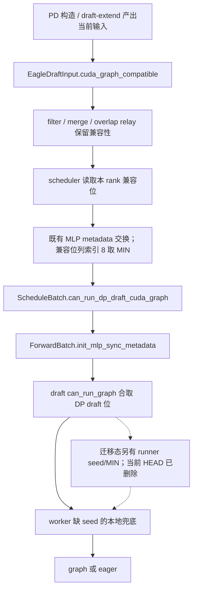

# EAGLE draft `can_run_graph` 投票逻辑的来源与可删除性分析

- 分析日期：2026-10-30。
- 主仓基线：`sglang`，分支 `graph_refactor_1028`，HEAD `925d7d86762c045e00239b97c43e2cf287778bbd`。
- torch_npu 对照基线：`pytorch`，HEAD `286bee5fc1`。
- 分析对象：迁移提交 `d0258809d8` 中，`EAGLEDraftCudaGraphRunner.can_run_graph()` 末尾从 NPU 子类迁入的 seed 检查和 `all_reduce(MIN)`，在该历史版本为第 395–421 行；不包括前面的宽度、batch size、MLP 同步检查。
- 交付范围：分析文档及[源码片段验证脚本](verify_draft_graph_admission.py)。未修改 SGLang 或 torch_npu 代码。

**源码定位补充：本次实际读取的当前 HEAD `925d7d8676` 已不含该额外投票，方法第 395 行直接返回。** 以下保留 / 删除推导用于比较含投票的迁移态与去掉投票后的行为；图中灰色条也按历史对照标注。逐块的当前代码位置以 §1.2 和[源码对照表](draft_seed_sync_code_map.md)为准，历史投票位置需查看 `d0258809d8`。

## 1. 结论与建议

**当初加入这段代码有明确的正确性原因：它修复了 NPU PD decode warm-up 中，缺少 DSA seed 的活跃 rank 走 eager、空闲 rank 走 graph，导致 TP/EP 通信路径不一致的卡死。** 来源是 2026-07-27 的 [PR #32210](https://github.com/sgl-project/sglang/pull/32210)，commit `db9143ee08`。

**但这项历史原因不能直接作为今天继续保留整段投票的充分理由。** 2026-09-29 合入的 [PR #32196](https://github.com/sgl-project/sglang/pull/32196)，commit `7889fbab9a`，已经把 draft seed 兼容性加入 scheduler 原有的 DP metadata 交换，并由公共 runner 消费。这个修复在删除 NPU 子类之前就已存在，已经覆盖原始问题的常规输入路径。

对于“现在能否直接删”，需要分开回答：

| 问题 | 判定 |
| --- | --- |
| 只看原始的“active 缺 seed、idle 无请求”场景，runner 还需要第二次 seed 投票吗？ | **当前标准输入链路中重复了。** scheduler 已经让全体 draft 降级 eager，见 §4–5。 |
| 是否因此可以推导整段投票在全部配置中都没有作用？ | **不能直接推导。** 该投票还归约了本地 graph 可运行性；scheduler 的 seed 位没有同步这些条件。含投票 / 无投票两个版本仍可能有决策差异，见 §6、§10。当前 HEAD 已经没有该投票。 |
| 默认使用全 DP batch size、seed 元数据一致的配置呢？ | **可以证明该段在这些前提下冗余。** 删除可作为去重方向，但需要明确配置边界并补齐回归。 |
| 删除 `EAGLEDraftNpuGraphRunner` 是否让这段逻辑自动失去作用？ | 没有。类层级变化与跨 rank 决策不变量是两件事。 |
| 是否只能在 NPU 上解决？ | 不是。原始问题涉及分布式执行一致性；NPU 首先加了局部修复，CUDA 后来在 scheduler 层也修了同类问题。 |

**审查建议：把 seed 保护去重与完整 graph admission 等价分开判断。** #32196 已覆盖原始 seed 问题；当前 HEAD 也已去掉第二次归约。评估该删除的配置覆盖面时，仍需检查既有 DP 同步是否覆盖本地图条件，或者明确限制需要保证等价的配置。证据支持“原始 seed 保护已被上游替代”，不支持“整段在全部配置下都已无效”。

这也修正了[此前的上移分析](dp_vote_promotion_analysis.md)：其中“scheduler 只掌握计划位，消费时必然还需要最终 seed 投票”和“上移后正确性严格更好、不会引入新的挂死”的表述过强。当前需要按实际数据链路和 collective 参与条件判断，不能仅凭异步传输推导。

### 1.1 两次修复的并排流程图：原始缺 seed 问题为什么已被覆盖

固定同一个输入：需要 DSA seed 的活跃 rank A 缺 seed，rank B 为 idle；其余图条件全组一致且通过。左图按原始 #32210 的实现画出独立设备归约，右图只依靠 #32196 的公共机制即可得到全员 eager。


[打开可缩放 SVG 原图](draft_seed_sync_pr_comparison.svg)。源码依据为 `db9143ee08`、`7889fbab9a`，当前字段传递对应本文 §4。

关键是右图第③步：**所有 rank 的 `ForwardBatch.can_run_dp_draft_cuda_graph` 在进入公共 runner 前已经是 False。** runner 在原有判断中合取这个值后，所有 rank 都返回 False。此时删掉末尾从 NPU 子类迁来的 seed/MIN 块，worker 仍然全员选择 eager。

若保留那一块，这一轮只会再计算：

```text
#32196：MIN(active 的 0, idle 的 1) = 0 → 所有 rank 的 DP draft 位为 False
原有 runner 判断：本地图条件 AND False → 所有 rank 的 is_bs_supported=False
迁入的额外投票：MIN(False AND False, False AND True) = MIN(0, 0) = 0
```

所以，**为了解决 #32210 的原始缺 seed 故障，确实无需再加一次 runner seed 投票**。这不是取消全组同步；#32196 已经在 scheduler 的既有 metadata 交换中完成了这次同步。

其它图条件全组一致时，有 seed 的正常路径也不会被错误降级：

| 同一轮的输入 | #32210 独立投票 | #32196，移除末尾额外投票 | 结果是否相同 |
| --- | --- | --- | --- |
| active 缺 seed / 另一个 idle | MIN(0,1)=0，全员 eager | 兼容位 MIN(0,1)=0，全员 eager | 相同 |
| active 有 seed / 另一个 idle | MIN(1,1)=1，全员 graph | 兼容位 MIN(1,1)=1，全员 graph | 相同 |
| 两个 active，仅一个缺 seed | MIN(1,0)=0，全员 eager | 兼容位 MIN(1,0)=0，全员 eager | 相同 |
| 两个 active，seed 都齐全 | MIN(1,1)=1，全员 graph | 兼容位 MIN(1,1)=1，全员 graph | 相同 |

本图说明 seed 这部分保护已经重复；若要把整个末尾块从支持所有配置的公共 runner 删除，仍需覆盖 §6 中本地 bs / graph key 条件不一致的情况。

### 1.2 每个图块对应的代码位置

图内已直接标注文件和行号；完整定位见[逐块源码对照表](draft_seed_sync_code_map.md)，包括函数名、关键语句和可点击的代码链接。

- `L1–L5`：PR #32210 原始 commit `db9143ee08` 的 scheduler、NPU 子类投票、worker 分支。
- `R1–R5`：当前 HEAD `925d7d8676` 中的输入兼容位、metadata 打包 / 交换 / 本地 MIN、`ScheduleBatch → ForwardBatch` 传递、公共 runner 合取、worker 分支。
- `C1–C3`：灰色历史对照，其中额外投票 `C2` 位于迁移 commit `d0258809d8`，当前文件已无该块。

最关键的现有链路为：`eagle_disaggregation.py:131` 写 False → `dp_attn.py:187` 打包 → `:260` 交换 → `:294` 本地取 MIN → `:348` 写 batch → `forward_batch_info.py:1089` 传入 forward batch → `eagle_draft_cuda_graph_runner.py:392` 合取 → `:395` 返回 → `eagle_worker_v2.py:722` 进入 eager。

## 2. 最近几个 commit 实际改变了什么

本次检查了最近提交及相关文件历史。关键提交如下；合并提交不重复列出。

| Commit | 作用 | 与本次删除判断的关系 |
| --- | --- | --- |
| `dbd117a27e`，2026-10-28 | 删除普通 `NPUGraphRunner`，设备能力移入 backend | 建立共享 runner 的重构方式；没有替代 seed 协调。 |
| `7499e04b8f`，2026-10-28 | multi-layer draft-extend 改用共享 runner | 属于 extend 路径，不是本段 draft-decode 投票的替代机制。 |
| `d0258809d8`，2026-10-28 | 删除 `EAGLEDraftNpuGraphRunner` | 将 seed/MIN 逻辑移入公共 `can_run_graph`；dtype 与逐 step host 长度更新另行下沉 backend。 |
| `6ffc88ee03`，2026-10-29 | 单层 draft-extend 的 NPU 图处理下沉 backend | 没有移除 worker 中的缺 seed 降级，也没有扩大 scheduler seed 位的语义。 |
| `925d7d8676`，2026-10-29 | 清理 worker 和测试代码 | 没有再次改变本段投票。 |

`d0258809d8` 保留了 NPU 原来的保护，并把它扩大到使用该公共 runner 的 CUDA/XPU/MUSA 等设备。后者是行为变化：满足门控时新增一次 CPU 归约；不是所有设备的行为都只是代码换位置。

## 3. 历史问题是如何产生的

### 3.1 第一阶段：有 seed 的图与无 seed 的 eager，本来就是两条不同路径

GLM-5.2 一类 DSA MTP 模型会把 draft-extend 最后选中位置的 DSA top-k 索引，交给下一轮 draft-decode 使用。这样第一步就可以复用 seed，后续 MTP step 继续复用，避免重复计算 indexer。

当前代码仍能看到这一约定：

1. `EagleDraftWorker._init_dsa_index_share_state()`：结合 `index_share_for_mtp_iteration`、`topk == 1`、`index_topk` 等配置设置 `seed_dsa_topk_from_draft_extend`。
2. runner 构造时分配 `buffers.dsa_seed_topk`；capture 时把它绑定为非空的 `spec_info.dsa_topk_indices`。
3. `IndexTopKShareState.mtp_iteration(..., keep_carry_seed=True)`：有 seed 时保留，没有时允许 eager 重新计算；退出时清理本轮 carry。
4. runner replay 只更新静态输入，执行已经捕获的计算；不会重新运行 Python 中依据 `None` 选择路径的判断。

所以不能把 `seed is None` 当成普通的输入数值差异。**图按“有 seed”捕获，零填充静态 buffer 也不会让它变成“无 seed、重新计算 indexer”的图。** 当前 `execute()` 第 728–733 行仍在 seed 为 `None` 时零填 buffer，而 0 本身可以是有效索引。[PR #30839 中的说明](https://github.com/sgl-project/sglang/pull/30839)也解释了这种错误复用；本地 commit 的 worker 降级和 replay 改动与之对应，可通过 `git show 78dc581518` 独立核查。

### 3.2 第二阶段：PR #30839 增加本地 fallback

2026-07-14，`78dc581518`，即 [PR #30839](https://github.com/sgl-project/sglang/pull/30839)，补齐 PD seed 传递、有效性处理与 graph replay 状态保护。其中 worker 新增了以下本地选择，至当前仍保留在 `eagle_worker_v2.py:679`：

```python
if (
    can_run_decode_cuda_graph
    and not forward_batch.forward_mode.is_idle()
    and self.seed_dsa_topk_from_draft_extend
    and draft_input.dsa_topk_indices is None
):
    can_run_decode_cuda_graph = False
```

它保护本 rank 的模型计算，但在 attention DP 下会出现：

| rank | 请求情况 | seed | 原有本地图判断 | worker 最终选择 |
| --- | --- | --- | --- | --- |
| A | 活跃，有真实请求 | 无 | True | eager |
| B | idle，没有真实请求 | 无；不需要 seed | True | graph |

空闲 rank 不是退出参与。当前 `_draft_forward_idle()` 会执行 `speculative_num_steps - 1` 次模型 forward，以参与各步需要的通信；graph 路径则执行捕获好的 forward。两条路径的通信必须保持相容，不能任由各 rank 各自跳转。

### 3.3 第三阶段：PR #32210 在 NPU 子类补上跨 rank 投票

2026-07-27，`db9143ee08`，即 [PR #32210](https://github.com/sgl-project/sglang/pull/32210)，明确报告 NPU decode warm-up 卡死，并在 `EAGLEDraftNpuGraphRunner.can_run_graph()` 中加入：

```text
本地图条件 AND（idle OR seed 非空）
    → TP group 上 MIN all_reduce
    → 全员 graph，或者全员 eager
```

把 idle 视作 seed-ready，是因为它没有真实请求；如果将 idle 的 `seed=None` 也作为否决，存在空闲 rank 时就永远不能使用 graph。投票同时包括本地图条件，所以即便本 rank 没有图可用，也必须进入归约投 0。

原始实现使用设备 tensor 和设备通信组。后续变化如下：

| Commit | 变化 |
| --- | --- |
| `986cb8268b`，2026-09-30，PR #41817 | 从 `model_runner.tp_group` 改读当前 runtime context 的 `get_parallel().tp_group`。 |
| `07eb671b6a`，2026-10-20，PR #38461 | 改为 CPU tensor 和 `tp_group.cpu_group`。 |
| `d0258809d8`，2026-10-28 | 将当前版本移入公共 runner。 |

因此，这不是 NPU graph 长度更新、NPU dtype 或 torch_npu 算子限制产生的特殊判断。它是在 NPU 类中落地的一项控制流协调修复。PR #32210 同时修过 prefill CP 的 tuple/list 索引问题，但那是另外一个问题，不能用其修复来判断本段投票是否已无用。

## 4. 当前已有的替代机制：PR #32196

### 4.1 这次后续修复早于本次 runner 重构

2026-09-29，`7889fbab9a`，即 [PR #32196](https://github.com/sgl-project/sglang/pull/32196)，把缺少 GLM DSA seed 导致的局部 fallback 也纳入修复，并同时处理 target/draft 不同 MoE backend 使用的 token 数表示。

本地 ancestry 检查确认：

```text
git merge-base --is-ancestor 7889fbab9a d0258809d8  → exit 0
```

因此，删除 NPU 子类时，scheduler 里的这套公共协调已经存在。PR 编号 #32196 比 #32210 小，但合入时间更晚；这里应以实际 commit 和合入时间判断。

### 4.2 它不是凭空猜测下一轮 seed，而是给当前输入携带兼容性

核心路径是：



具体证据如下，行号均对应本文 HEAD：

| 环节 | 当前实现 | 语义 |
| --- | --- | --- |
| PD 输入构造 | `eagle_disaggregation.py:80–145` | 任一请求 seed 缺失或整行无效，整个 batch 的 seed 置 `None`；需要 seed 的 DSA 模型同时得到 `cuda_graph_compatible=False`。 |
| 普通 prefill 后的 draft-extend | `eagle_worker_v2.py:1051–1111` | 生成 seed，并随 `EagleDraftInput` 写入兼容性。 |
| decode 后的 draft-extend | 同文件 `1242–1324` | 从选中位置收集下一轮 seed，和对应兼容性一起写回 `next_draft_input`。 |
| batch 合并 | `eagle_info.py:258–312` | 两个非空输入的兼容性取 AND；future seed 可用性也取 AND；空 stub 有专门处理。 |
| scheduler 本地判定 | `scheduler_components/dp_attn.py:83–99` | 活跃 batch 读取 `spec_info.cuda_graph_compatible`；idle/None/prebuilt 使用中性值 True。 |
| DP 归约 | 同文件 `176–294` | 兼容位进入 metadata 的第 9 个字段（索引 8），交换后取全 DP 最小值。这里复用既有交换，不新增一次 collective。 |
| 写回 batch | 同文件 `346–348` | 写入独立的 `can_run_dp_draft_cuda_graph`。 |
| forward 传递 | `forward_batch_info.py:900–958` | 传入 `ForwardBatch`。 |
| runner 消费 | `eagle_draft_cuda_graph_runner.py:388–393` | 在 `require_mlp_sync` 下同时合取 generic decode 位和独立 draft 位。 |

PD 判定中的 `_requires_dsa_seed_for_cuda_graph()` 最终还会检查模型是否为 DSA；worker 的 feature flag 则由 draft 模型配置派生。因此这里已确认的是 GLM DSA 等预期输入路径，不能把任意具有同名 config 字段的自定义模型都直接纳入证明。

### 4.3 最关键的 overlap 情况也被兼容位覆盖

考虑“已有 seed 的 running batch 合并缺 seed 的 prebuilt batch”：

```text
合并前：running.compatible=True；prebuilt.compatible=False
合并后：compatible=False；future_seed_available=False
```

future 分支合并时，旧的 `dsa_topk_indices` Python 引用可能暂时仍然非空，但 `cuda_graph_compatible` 已取 AND 变成 False。scheduler 不依赖这个旧 tensor 是否非空，因此能够提前全组否决。

真正消费时，`resolve_forward_inputs()` 经 `FutureMap._resolve_spec_extras()`，按 `future_dsa_topk_indices_available` 决定读 relay buffer 还是设置 `dsa_topk_indices=None`（`overlap_utils.py:526–530`）。普通 worker 产出后，scheduler 也会记录下一轮的 future seed 可用性（`scheduler.py:4816–4821`）。配套脚本直接执行了当前 `merge_batch`，验证“旧 tensor 非空，但兼容位已经 False”的情况。

这意味着：**不能只因为 scheduler 同步发生在 FutureMap materialize 之前，就断定它一定读不到正确状态。** 兼容位正是用来跨越这个时序的；普通生产者、merge 和 future flag 的语义需要一起看。

### 4.4 PD 的异步传输也不等于消费点会随机看到 `None`

当前 PD 会在 metadata 提交时解释无效 seed sentinel，并在构造输入时同时设置 seed 和兼容性；poll 路径还有 metadata gate（`disaggregation/utils.py:365–368`）。P 端不产生 seed 时，也可能合法地传递“无有效 seed”，这不是简单多等一次传输就能解决的状态。

这里的 `seed_ready` 实际检查的是 **Python tensor 引用是否存在**。它不检查设备写入是否完成、索引内容是否合法、shape 是否正确。设备数据可用性仍依赖传输、stream 和 relay 的同步约定，CPU MIN 投票不能替代这些机制。

## 5. 为什么说原始 seed 场景现在重复：等价条件证明

以下讨论限定在需要共同保持 draft 执行一致性的通信组内，并假定宽度检查通过、成员都调用本方法。

定义：

- `B_r`：rank r 的本地图条件，包括 batch size / graph key 支持。
- `D`：scheduler 同步后的 `can_run_dp_draft_cuda_graph`。
- `M`：scheduler 同步后的 generic decode graph 位。
- `Q_r`：rank r 是 idle，或者有非空 seed。

正常启用 attention DP 的路径需要 MLP sync，`require_mlp_sync()` 由 `attn_dp_enabled` 等条件派生；不应在证明中跳过这一前提。

保留迁移态投票时，runner 给所有参与者的结果是：

```text
G = AND_r(B_r AND M AND D AND Q_r)
```

如果只删除末尾投票，保留 worker 中的缺 seed 兜底，各 rank 最终选择变为：

```text
G'_r = B_r AND M AND D AND Q_r
```

当前标准 seed 协议保证：对需要 seed 的活跃输入，缺 seed 会使该输入的兼容位为 False。由 scheduler 归约可得：

```text
D=True  ⇒  每个相关 rank 的 Q_r=True
```

于是：

1. `M=False` 或 `D=False`：两种实现均全员 eager，第二次投票不改变结果。
2. `M=True` 且 `D=True`：seed 不再产生分歧，删除是否等价只剩 `B_r` 是否一致。
3. 当 `B_r` 也全组一致时，`G` 与每个 `G'_r` 完全相等。

**因此，seed 状态被当前协议正确表达，且本地图条件全组一致，是删除整段投票的充分条件。** 在 `M=D=True` 的轮次里，本地图条件是否一致也直接决定两种实现是否相等。

原始 warm-up 的例子，在当前协议下会是：

| rank | 输入兼容性 | scheduler 的 D | 删除后本地最终结果 |
| --- | --- | --- | --- |
| 活跃、缺 seed | False | False | eager |
| idle | True，中性票 | False | eager |

这已经不需要 runner 再做一次相同的 seed 归约。

## 6. 为何不能据此无条件删除：本地图条件还没有全局化

### 6.1 scheduler 归约的 seed 位不是完整的 graph admission

`_spec_input_cuda_graph_compatible()` 只读输入兼容性；generic `_local_decode_cuda_graph_vote()` 主要检查是否禁用 graph 及 batch mode。两者都没有检查 draft runner 的 `max_bs`、各个 graph key 是否存在。

公共 draft runner 还有两种 batch size 来源：

```python
if self.require_mlp_tp_gather:
    cuda_graph_bs = max(forward_batch.original_global_num_tokens_cpu)
else:
    cuda_graph_bs = forward_batch.batch_size
```

第一种在共享完整全局计数、各 rank 捕获配置一致时通常一致；第二种明确取本地 batch size。`require_mlp_sync=True` 不意味着 `require_mlp_tp_gather=True`。例如在启用 DP LM head、dense TP 较小且使用某些 MoE A2A backend 时，`utils/common.py:4067–4128` 允许后者为 False。

### 6.2 反例一：局部 batch 跨过 graph 上限

设置：需要 seed、attention DP>1、各活跃 rank 都有 seed、scheduler 的 `M=D=True`、`require_mlp_tp_gather=False`、`max_bs=8`，允许运行请求数大于 graph 上限。

| 项目 | rank A | rank B |
| --- | --- | --- |
| 本地 batch size | 9 | 1 |
| seed | 有 | 有 |
| 本地图条件 B | False | True |
| 当前投票后的结果 | False | False |
| 删除投票后的结果 | False | True |

`get_batch_sizes_to_capture()` 把捕获列表限制在请求池容量以内，并不强制把所有可运行 batch 都捕获。因此不能假定 `max_running_requests` 永远不超过 `max_bs`。

这个例子说明：**即使 seed 协议完全正确，整个投票仍可能改变结果。** 配套脚本执行了当前 runner 和 worker guard，得到上述结果。该验证没有启动模型，不应把它描述成已在某个具体 NPU/FuseEP 组合复现了卡死。

### 6.3 反例二：禁用 padding 时，idle 没有 size=0 的图

设置：同样使用本地 batch size；启用 `disable_cuda_graph_padding`；活跃 rank 的 size=1 图已捕获，idle rank 的 size=0 图不存在。

当前 `get_batch_sizes_to_capture()` 保证捕获 size 大于 0；NPU 与 Full CUDA backend 的 `can_run()` 都是检查 graph key 是否存在。

| 项目 | 活跃 rank | idle rank |
| --- | --- | --- |
| scheduler 的 D | True | True |
| 本地图条件 B | True | False |
| 当前投票后的结果 | False | False |
| 删除投票后的结果 | True | False |

所以“idle 在 scheduler seed 位中投 True”与“idle 一定能走自己的本地图”不是同一件事。后者仍取决于 bucket 和 padding 规则。

### 6.4 如何解释这些反例

这些是**删除前后决策不等价**的源码级证据；它们不是对所有后端都会卡死的硬件证明。真正需要保持的是同一通信域里的 collective 顺序、参与者和 shape 相容。

NPU 原始 warm-up 的分歧已经在 PR #32210 中报告为卡死。CUDA 中若图捕获了 NCCL 通信，NCCL 的官方约束也要求同一次集体操作的图捕获属性在参与 rank 上一致，并对含 NCCL 的 graph launch 提出集体参与要求，见 [Using NCCL with CUDA Graphs](https://docs.nvidia.com/deeplearning/nccl/user-guide/docs/usage/cudagraph.html)。具体模型可能还使用 DeepEP、FuseEP 或其它通信实现，其行为需要对应验证。

因此，这些差异足以否定“整段对所有输入严格冗余”的说法；是否保留它作为某一后端的必要保护，要结合该后端和拓扑。它还只在 IndexShare 门控下生效，**并不是一个覆盖所有 speculative 模型的完整分布式 admission 方案**。

## 7. 本次上移本身也有需要限定的结论

### 7.1 它确实没有 NPU 专有操作，但跨设备适用性仍有条件

这段代码使用普通 tensor、runtime group 和 `torch.distributed`。NPU 设备差异来自其它方法：cache location dtype、捕获和 replay、host 参数更新。

但“API 可移植”不等于“在全部调用方式中无条件正确”。额外 collective 要求：成员数量、调用次数和调用顺序一致；不能有 rank 在它之前局部返回，也不能有 rank 没有 runner。

门控也没有检查 `disaggregation_mode`。只要 IndexShare feature 开启、`attn_dp_size>1` 并且调用到这个 runner，统一部署中也可能执行它。使用公共 runner 的设备是否支持某个具体模型，需另行判断，不能仅凭分发表推导。

### 7.2 内联改变了宽度不匹配时的 collective 参与方式

旧结构：

```text
NPU 子类：local = super().can_run_graph(batch)
        即使父类因宽度不匹配返回 False，子类仍进入 MIN 并投 0
```

`d0258809d8` 上移后的迁移态结构：

```text
公共方法：宽度不匹配 → 立即 return False
         后面的 MIN 不再执行
```

如果同组一方宽度不匹配、另一方匹配，在该迁移态中后者会独自进入归约。配套脚本以超时模拟器验证了这个参与差异；当前 HEAD 已没有这次归约。

**这不是已确认的当前普通请求故障。** 当前 `prepare_for_draft()` 在所有 rank 构造 `ForwardBatch` 前，都把实际宽度写成配置的 `topk`（`eagle_worker_common.py:350–375`）；对应配置一致时宽度提前返回也是一致的。这里说明的是：旧子类与当前内联结构并非对任意输入都完全等价；“MIN 决策只能更保守，所以绝不会新增卡死”不是成立的通用证明。

### 7.3 通信组应按 draft 的实际 scope 理解

投票用的是**调用时** `get_parallel().tp_group`。`draft_tp_context()` 可能根据模型的 draft parallel layout 切换这个 group；独立 draft 还可能只覆盖自己的 attention TP 范围（`spec_utils.py:874`、`distributed/parallel_state.py:3132`）。

对保留 target layout 的 DSA MTP，注释中“TP group 包含该 stage 的 attention-DP ranks”的解释适用。但不应将这个描述推广到所有共享此类的模型。

CPU group 在常见配置下为 gloo；当前仓库也存在 `mooncake-cpu` 分支（`parallel_state.py:380`），所以此前文档“全平台无条件都是 gloo”的表述也应收窄。CPU tensor 上的 `.item()` 不应与旧设备 tensor 的 `.item()` 混为一谈；此处主要新增代价是同步 CPU collective 和 rank 等待，不能无测量就定量称作几微秒。

## 8. 为什么 backend / torch_npu 的重构没有自动解决这个问题

当前 `NPUCudaGraphBackend.replay()` 处理的是 graph 选定后的回放：非 DSA/V4 路径构造每个 draft step 的 host KV 长度更新；DSA/V4 路径直接回放。它不检查跨 rank seed 是否一致，也不对 graph/eager 选择投票。

对应 torch_npu 中：

- `torch_npu/npu/graphs.py:637` 的 `NPUGraph.replay()` 调到底层 replay。
- `torch_npu/csrc/core/npu/NPUGraph.cpp:392–407` 最终用 `AclmdlRIExecuteAsync` 提交已捕获图。
- `NPUGraph.update()` 用于更新已记录的算子参数，不会给应用层补出 seedless 图分支，也不会为 SGLang 重新选择 graph/eager。

这两类职责没有互相替代：**可删除性的关键变化来自 #32196 的 scheduler 输入协议，而不是最近把 NPU graph 实现下沉 backend。**

## 9. 如果要删除，怎样把改动做完整

### 9.1 推荐路径：保留一次公共协调，去掉重复归约

目标可以是让 runner 的 `can_run_graph()` 恢复本地纯判断，由 scheduler 的既有同步提供一致的 admission。但要先完成以下条件：

1. **输入协议完整。** 对需要 seed 的活跃输入，缺 seed 必须对应不兼容；普通生产者、PD、future merge 已有实现。还需针对计划支持的 HiSparse staging、PP relay、扩展 worker 等构造入口审计，不能依赖 `cuda_graph_compatible=True` 的 dataclass 默认值。
2. **本地图条件得到统一处理。** 对含跨 rank 通信的 draft，覆盖局部 bs 超限、无 padding 的缺失图 key、必要的 graph variant。可以在既有 metadata 交换中加入完整的 draft admission 位，或者从共享 metadata 和一致的捕获配置推导。
3. **真实通信域正确。** 统一范围与 draft 的 TP/EP group 匹配；独立 draft 不应无端要求整个 deployment 所有 DP replica 共同投票。
4. **消费时不再局部推翻共同决定。** 保留 worker seed guard 时，要验证 `D=True` 时它不会只在某个参与 rank 触发；发现违反输入协议应修复来源。

不能直接把 `require_mlp_tp_gather=False` 分支改成 `max(original_global_num_tokens_cpu)` 就认为完成了第 2 项：#32196 允许 draft metadata 使用 `[local_count]`，此时该字段并不保证保留全部 DP 计数。若要全局 admission，需要在 scheduler 本来掌握完整计数时保留相应结果，并与实际 replay 所需的局部计数分开。

### 9.2 如果只处理已限定的默认配置

如果本次 PR 明确只承诺以下条件：

```text
标准 DSA seed 生产链路
＋ scheduler DP 同步启用，且覆盖所有相关参与者
＋ require_mlp_sync=True
＋ 全 DP batch size 的 admission
＋ 捕获配置、宽度和相关 variant 可用性一致
```

那么 §5 的等价证明成立，可以删除末尾 seed/MIN 块、保留 `return is_bs_supported`。但如果该公共 runner 继续支持其它配置，就需要对这些配置另行保持原有行为，不能仅用默认配置测试通过代替全部等价性判断。

### 9.3 不应顺手删除的保护

- worker 的缺 seed fallback：它防止无 seed 的输入使用有 seed 的图；仅删除它可能带来静默的索引错误。
- `can_run_dp_draft_cuda_graph`：它正是已合入的公共替代机制；应继续与 target verify / draft-extend 的 graph 选择分开。
- 宽度检查、batch size / key 检查：它们属于图输入约束。
- backend 的逐 step host 长度更新：与本段投票无关。

若暂时只减少明显重复的否决轮次，可以考虑基于**已经全组同步的 False 位**一致早退；不能写成 `if not is_bs_supported: return False`，因为该量可能是本地的，会让其余 rank 卡在现有归约上。这类优化仍需独立审查 collective 参与条件。

## 10. 已完成的验证与证据边界

### 10.1 标准库源码片段验证：9 项通过

这里保留的是先前针对含投票源码快照的验证记录。本次只补充图和源码定位；当前 checkout 已不含投票块，不能把此前的 9 项通过记录解释为本次又对当前 checkout 执行了一遍。脚本提取 / 删除投票的部分需要含该块的源码版本。

配套脚本：[verify_draft_graph_admission.py](verify_draft_graph_admission.py)。运行命令：

```powershell
& 'C:\Users\admin\miniconda3\python.exe' `
  'FE\RemoveEAGLEDraftNpuGraphRunner设计方案\verify_draft_graph_admission.py' -v
```

也可在任意平台使用：

```bash
python verify_draft_graph_admission.py --sglang-dir /path/to/sglang -v
```

脚本通过 AST 从当前 checkout 提取并执行真实的：

- `EAGLEDraftCudaGraphRunner.can_run_graph()`。
- 仅删除最终 seed/MIN 块的候选版本；前面的判断保留。
- `EagleDraftWorker.draft()` 中直到缺 seed guard 结束的前缀。
- scheduler 的 `_spec_input_cuda_graph_compatible()`。
- `EagleDraftInput.merge_batch()`。

tensor、graph key 查询、metadata 的交换归约和分布式 MIN 使用最小模拟器；不会 import SGLang 或 PyTorch。它验证 Python 决策与 collective 参与，不能证明 HCCL/NCCL、设备执行或准确率。

| 验证 | 实际结果 |
| --- | --- |
| idle / 有 seed / 无 seed 的两 rank 组合，配合全局 bs 在图上限内外 | 共 18 个组合，删除前后相等，且组内决策一致。 |
| 历史兼容位尚未表达缺 seed 的输入 | 删除前全员 eager；删除后 active eager / idle graph，复现历史控制流差异。 |
| 本地 bs=9/1，max_bs=8，seed 完整 | 删除后 False / True；当前实现全员 False。 |
| 无 padding，active size=1、idle size=0 | 删除后 True / False；当前实现全员 False。 |
| 相同 bs=9/1，改用全局 batch size admission | 两种实现全员 False。 |
| seeded future batch 与 seedless future batch 合并 | 旧 seed 引用仍非空，但兼容位与 future seed 位都为 False，scheduler 能否决。 |
| feature 关闭或 DP=1 | 当前额外投票不执行。 |
| 注入同组宽度不一致 | 当前一方提前返回，另一方缺少投票参与者；模拟器超时识别。此输入不是已确认的普通生产路径。 |
| 现有最小 `__new__` 测试 fixture | 新块访问缺失的 `eagle_worker`，可单独复现 AttributeError；删除该块的候选返回 False。 |

本地执行结果：`Ran 9 tests ... OK`。

最后一项对应现有 `test_mlp_sync_pad_unpad.py:143` 的 `test_draft_only_gate_does_not_disable_draft_extend_graph`：它构造 bare runner，只填原先需要的几个字段。迁入代码即使已被 scheduler 位否决，也会继续读取 `self.eagle_worker`。**这里验证的是当前函数与该 fixture 的字段不匹配，不是声称完整 pytest 已在当前机器跑过。** 保留投票时，测试需要补上 worker 和合适的 DP 配置。

### 10.2 尚未运行的硬件回归

当前环境的可用 Python 未安装 torch，本次没有执行完整 SGLang pytest，也没有 NPU/CUDA 模型运行。旧文档中的“NPU 已验证”等历史陈述未作为本次实测结果复用。

若实施删除，至少需要以下回归；优先看所有 rank 的路径记录，不能只看进程存活或单条输出：

| 维度 | 需覆盖的输入 | 关注结果 |
| --- | --- | --- |
| 原始故障 | NPU、DSA MTP、attention DP≥2、PD warm-up，活跃 rank 无 seed、其它 rank idle | 全员 draft eager，warm-up 完成。 |
| 正常性能路径 | seed 齐全，持续多轮 decode | graph 使用率、accept length、输出和吞吐与基线对比。 |
| PD 输入 | P 端产生 / 不产生 seed；无效 sentinel；多请求中只有一个无 seed | 兼容位正确，target verify 和 draft-extend 的 graph 不受 draft-only fallback 牵连。 |
| overlap | seeded running 合并 seedless prebuilt、filter、空批重新活跃 | future 标记与实际 seed 对齐，所有 rank 最终路径一致。 |
| graph 边界 | local bs 超过 max_bs、显式捕获列表、禁用 padding、idle | 覆盖 §6 的两个差异。 |
| 通信配置 | draft MoE A2A 为 none / 对应 EP backend；target 与 draft backend 不同 | admission 的同步域和 token 数表示正确。 |
| 跨设备 | 至少 CUDA 的 DSA+DP 回归，再按实际支持范围扩展 | 检查新增 CPU collective 或删除它的控制流变化。 |

建议每轮记录：rank、draft group、local mode、bs、`num_tokens_per_req`、`future_dsa_topk_indices_available`、seed 是否为空、输入兼容位、两个 DP graph 位、最终 graph/eager 选择。device seed 内容的有效性和传输完成情况需要另外观察，不能以非空判断替代。

## 11. 对此前分析中几个结论的修正

| 此前说法 | 当前证据支持的说法 |
| --- | --- |
| scheduler 只同步计划位，异步 seed 必须到 runner 再投一次 | #32196 给当前输入传递兼容性，普通 producer/merge/future 链路已表达缺 seed；不能凭异步一词推导第二次归约必需。 |
| 上移是纯位置变更 | NPU 普通路径保留保护；其它设备新增 collective；宽度早退也从父类返回后仍投票，变成当前方法直接返回。 |
| MIN 只能否决，因此绝不引入挂死 | Boolean 结果单调；collective 参与未必对称。必须另外证明全员调用。 |
| 触发面只有 PD | 门控没有检查 PD role；统一部署也可能触发。 |
| CPU group 总是 gloo | 常见分支为 gloo，当前还有 mooncake-cpu 分支。 |
| 每轮增加几微秒 | 增加一次同步 CPU collective；具体开销未测量。 |
| 删掉就一定复现原始缺 seed hang | 当前协议已经修复普通原始场景。要讨论的是剩余配置、协议缺口或最终 admission 是否一致。 |
| 所以整段已完全无用 | 它仍可能同步本地图条件；§6 已验证删除前后决策不同。 |

## 12. 证据索引与复查方法

### 12.1 上游历史

- [PR #30839](https://github.com/sgl-project/sglang/pull/30839)：GLM-5.2 MTP IndexShare 的 PD / graph / overlap 修复；本地 `78dc581518`。
- [PR #32210](https://github.com/sgl-project/sglang/pull/32210)：NPU warm-up 卡死与子类 MIN 投票的来源；本地 `db9143ee08`。
- [PR #32196](https://github.com/sgl-project/sglang/pull/32196)：后续公共 scheduler 协调与 draft 专用 token metadata；本地 `7889fbab9a`。
- [PR #32209](https://github.com/sgl-project/sglang/pull/32209)：相关方案讨论，包括 future seed 与独立 draft graph 位。查询时仍为未合入状态，**不是本文判断已生效修复的依据**。
- [NCCL CUDA Graphs 说明](https://docs.nvidia.com/deeplearning/nccl/user-guide/docs/usage/cudagraph.html)：用于解释 CUDA 通信约束；不能代替 NPU 实测。

### 12.2 本地源码

以下链接按三个仓库并列的工作区结构解析，行号对应本文基线：

| 文件 | 重点位置 |
| --- | --- |
| [eagle_draft_cuda_graph_runner.py](../../../sglang/python/sglang/srt/speculative/eagle_draft_cuda_graph_runner.py) | 260 静态 seed；355 admission；499 capture 绑定；728 replay 输入。 |
| [eagle_worker_v2.py](../../../sglang/python/sglang/srt/speculative/eagle_worker_v2.py) | 307 feature；666 draft；939 idle；1051/1242 seed 产出；1322 兼容位。 |
| [eagle_worker_common.py](../../../sglang/python/sglang/srt/speculative/eagle_worker_common.py) | 350 实际宽度；373 调用 runner。 |
| [eagle_disaggregation.py](../../../sglang/python/sglang/srt/speculative/eagle_disaggregation.py) | 80–145 PD seed 与兼容性。 |
| [eagle_info.py](../../../sglang/python/sglang/srt/speculative/eagle_info.py) | 197 兼容位定义；258 merge。 |
| [dp_attn.py](../../../sglang/python/sglang/srt/managers/scheduler_components/dp_attn.py) | 83 输入判定；176/294 metadata；348 写回；369 generic 判定；568 发起同步。 |
| [forward_batch_info.py](../../../sglang/python/sglang/srt/model_executor/forward_batch_info.py) | 900–958 draft token metadata 与 DP 位传递。 |
| [overlap_utils.py](../../../sglang/python/sglang/srt/managers/overlap_utils.py) | 445 staging 构造；526 future seed materialize；680 stash。 |
| [scheduler.py](../../../sglang/python/sglang/srt/managers/scheduler.py) | 3924 staging；4068 DP 同步；4746 resolve；4816 future seed 标记。 |
| [index_topk_share.py](../../../sglang/python/sglang/srt/layers/attention/index_topk_share.py) | 73–91 有 seed / 无 seed 的 MTP 状态。 |
| [common.py](../../../sglang/python/sglang/srt/utils/common.py) | 4067 gather 条件；4163 MLP sync 条件。 |
| [base_cuda_graph_runner.py](../../../sglang/python/sglang/srt/model_executor/runner/base_cuda_graph_runner.py) | 65–110 捕获尺寸来源。 |
| [npu_cudagraph_backend.py](../../../sglang/python/sglang/srt/hardware_backend/npu/graph_runner/npu_cudagraph_backend.py) | 430 key 判断；437 replay；507 逐步 host 更新。 |
| [parallel_state.py](../../../sglang/python/sglang/srt/distributed/parallel_state.py) | 380/404 CPU group；3132 draft TP scope。 |
| [test_mlp_sync_pad_unpad.py](../../../sglang/test/registered/unit/model_executor/test_mlp_sync_pad_unpad.py) | 116 独立 draft 位；143 bare runner fixture。 |
| [torch_npu graphs.py](../../../pytorch/torch_npu/npu/graphs.py) | 637 replay；655 update。 |
| [NPUGraph.cpp](../../../pytorch/torch_npu/csrc/core/npu/NPUGraph.cpp) | 392–407 提交已捕获图。 |

历史与改动可直接在主仓复查：

```bash
git show db9143ee08 -- python/sglang/srt/hardware_backend/npu/graph_runner/eagle_draft_npu_graph_runner.py
git show 7889fbab9a -- python/sglang/srt/managers/scheduler_components/dp_attn.py python/sglang/srt/speculative/eagle_info.py python/sglang/srt/speculative/eagle_worker_v2.py
git show 07eb671b6a -- python/sglang/srt/hardware_backend/npu/graph_runner/eagle_draft_npu_graph_runner.py
git show d0258809d8 -- python/sglang/srt/speculative/eagle_draft_cuda_graph_runner.py
git show d0258809d8^:python/sglang/srt/hardware_backend/npu/graph_runner/eagle_draft_npu_graph_runner.py
```
