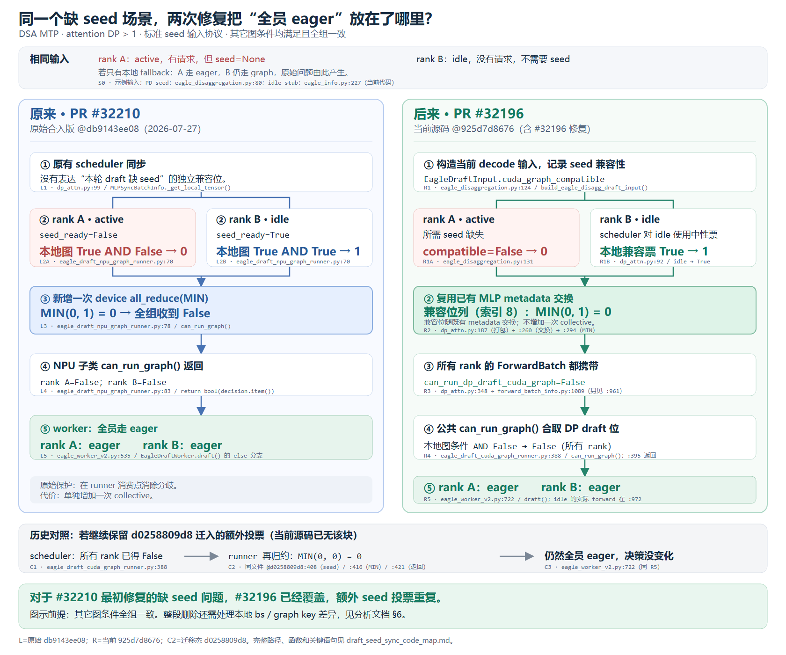

# PR #32210 / #32196 对比图：逐块源码定位

本文对应[流程对比图](draft_seed_sync_pr_comparison.svg)。图内使用 `L`、`R`、`C` 编号，下面给出每一块的文件、函数、行号和关键语句。

## 1. 先区分三个版本

| 图中区域 | 使用的源码版本 | 定位规则 |
| --- | --- | --- |
| 左侧 `L1–L5` | 原始 PR #32210 合入 commit `db9143ee08` | 行号来自该历史 commit；链接指向 GitHub 固定版本。NPU 子类文件在当前仓库已删除。 |
| 右侧 `R1–R5` | 当前 checkout / HEAD `925d7d8676`，包含 PR #32196 的修复 | 行号来自本次实际读取的当前文件；链接可打开本地代码。 |
| 灰色条 `C1–C3` | 与迁移 commit `d0258809d8` 的对照 | `C2` 指的是迁入公共 runner 的历史投票块，当前 HEAD 已经没有该块。 |

**当前现状：`EAGLEDraftCudaGraphRunner.can_run_graph()` 在第 392 行合取 DP draft 位，在第 395 行直接 `return is_bs_supported`。** 图中灰色条表示“如果继续保留迁移版额外投票，会再得到什么结果”，不表示当前代码仍执行这次投票。



## 2. 左图：PR #32210 的原始实现

以下行号全部来自 `db9143ee08`，不是当前文件行号。

| 图中块 | 文件和位置 | 函数 / 关键语句 | 这一块的作用 |
| --- | --- | --- | --- |
| **L1 · ① 原有 scheduler 同步** | [dp_attn.py:99](https://github.com/sgl-project/sglang/blob/db9143ee08/python/sglang/srt/managers/scheduler_components/dp_attn.py#L99)；同文件 129、186 行 | `MLPSyncBatchInfo._get_local_tensor()`；`all_gather()`；`self.can_cuda_graph = bool(tp0_info[:, 2].min().item())` | 当时同步的只有通用 graph 位等 metadata，打包字段中没有独立的 draft seed 兼容位。 |
| **L2A · ② active 计算 seed_ready=False** | [eagle_draft_npu_graph_runner.py:69](https://github.com/sgl-project/sglang/blob/db9143ee08/python/sglang/srt/hardware_backend/npu/graph_runner/eagle_draft_npu_graph_runner.py#L69) | `EAGLEDraftNpuGraphRunner.can_run_graph()` 第 69–74 行：读取 `spec_info`，计算 `idle or seed is not None`，再与父类返回值合取 | active 且 seed 为 None，得到 0。 |
| **L2B · ② idle 计算 seed_ready=True** | [同一方法第 70 行](https://github.com/sgl-project/sglang/blob/db9143ee08/python/sglang/srt/hardware_backend/npu/graph_runner/eagle_draft_npu_graph_runner.py#L70) | `forward_batch.forward_mode.is_idle() or (...)` | idle 没有真实请求，作为中性方得到 True；不是因为它拥有 seed。 |
| **L2 补充 · “本地图 True”从哪里来** | [子类第 56 行](https://github.com/sgl-project/sglang/blob/db9143ee08/python/sglang/srt/hardware_backend/npu/graph_runner/eagle_draft_npu_graph_runner.py#L56) → [父类第 294 行](https://github.com/sgl-project/sglang/blob/db9143ee08/python/sglang/srt/speculative/eagle_draft_cuda_graph_runner.py#L294) | `can_run_graph = super().can_run_graph(forward_batch)`；父类检查宽度、bs、通用 DP graph 位，在第 321 行返回 | 图示假定这些条件都通过，所以给 seed 投票的前置值为 True。 |
| **L3 · ③ 额外 device all_reduce(MIN)** | [eagle_draft_npu_graph_runner.py:73](https://github.com/sgl-project/sglang/blob/db9143ee08/python/sglang/srt/hardware_backend/npu/graph_runner/eagle_draft_npu_graph_runner.py#L73)；归约在第 78 行 | 第 73–77 行创建设备 tensor；第 78–82 行执行 `torch.distributed.all_reduce(..., ReduceOp.MIN, group=self.model_runner.tp_group.device_group)` | 新增一次设备通信，把本地的 0/1 统一成全组的 0。原始版本使用设备组；后来才改成 CPU 组。 |
| **L4 · ④ 子类返回相同的 False** | [eagle_draft_npu_graph_runner.py:83](https://github.com/sgl-project/sglang/blob/db9143ee08/python/sglang/srt/hardware_backend/npu/graph_runner/eagle_draft_npu_graph_runner.py#L83) | `return bool(decision.item())` | 返回已经归约过的结果，active 和 idle 都为 False。 |
| **L5 · ⑤ worker 全员选择 eager** | [eagle_worker_v2.py:531](https://github.com/sgl-project/sglang/blob/db9143ee08/python/sglang/srt/speculative/eagle_worker_v2.py#L531)；`else` 在第 535 行，调用在第 545 行 | `EagleDraftWorker.draft()`：`if can_cuda_graph` 调 graph；否则调用 `self.draft_forward(forward_batch)` | 因为每个 rank 收到 False，都进入 eager 分支。 |

原始的本地缺 seed fallback 位于 [eagle_worker_v2.py:511](https://github.com/sgl-project/sglang/blob/db9143ee08/python/sglang/srt/speculative/eagle_worker_v2.py#L511)。没有 L3 时，它可能只把 active rank 改为 eager；L3 让所有参与 rank 在到达这个分支前就共同否决 graph。

## 3. 右图：PR #32196 的修复在当前代码中的位置

以下链接全部指向当前本地代码。图中同一个大块跨了几次赋值时，按真实调用顺序列出。

| 图中块 | 文件和位置 | 函数 / 关键语句 | 这一块的作用 |
| --- | --- | --- | --- |
| **R1 · ① 构造当前 decode 输入** | [eagle_disaggregation.py:124](D:/workspace/SGLang/sglang/python/sglang/srt/speculative/eagle_disaggregation.py:124) | `build_eagle_disagg_draft_input()` 构造 `EagleDraftInput`；第 130 行写 seed，第 131–133 行写兼容位 | seed 和“这个输入能否用 draft 图”一起记录。字段定义位于 [eagle_info.py:213](D:/workspace/SGLang/sglang/python/sglang/srt/speculative/eagle_info.py:213)。 |
| **R1A · active 投 False** | [eagle_disaggregation.py:131](D:/workspace/SGLang/sglang/python/sglang/srt/speculative/eagle_disaggregation.py:131) → [dp_attn.py:99](D:/workspace/SGLang/sglang/python/sglang/srt/managers/scheduler_components/dp_attn.py:99) | producer 设置 `cuda_graph_compatible=not (requires_dsa_seed_for_cuda_graph and dsa_topk_indices is None)`；scheduler 读取 `spec_info.cuda_graph_compatible` | 需要 seed 的活跃输入缺 seed，先记录 False，之后 scheduler 读到 False。 |
| **R1B · idle 投中性 True** | [dp_attn.py:92](D:/workspace/SGLang/sglang/python/sglang/srt/managers/scheduler_components/dp_attn.py:92) | `_spec_input_cuda_graph_compatible()` 第 92–97 行对 None / idle / prebuilt 返回 True | idle 不因自己没有 seed 而否决其它活跃 rank。 |
| **R2a · ② 收集本地兼容票** | [dp_attn.py:568](D:/workspace/SGLang/sglang/python/sglang/srt/managers/scheduler_components/dp_attn.py:568) → [同文件第 634 行](D:/workspace/SGLang/sglang/python/sglang/srt/managers/scheduler_components/dp_attn.py:634) | `prepare_mlp_sync_batch_raw()` 调用兼容性 helper，再传给 `MLPSyncBatchInfo(can_run_draft_cuda_graph=...)` | 把 R1A/R1B 的结果交给既有 metadata 同步结构。 |
| **R2b · ② 打包进 metadata 索引 8** | [dp_attn.py:187](D:/workspace/SGLang/sglang/python/sglang/srt/managers/scheduler_components/dp_attn.py:187) | `MLPSyncBatchInfo._get_local_tensor()` 中的 `int(self.can_run_draft_cuda_graph)`；fallback 中性值在第 206 行 | 新位和 num_tokens、generic graph 位等一起打包。 |
| **R2c · ② 复用既有交换** | [dp_attn.py:649](D:/workspace/SGLang/sglang/python/sglang/srt/managers/scheduler_components/dp_attn.py:649) → [同文件第 226 行](D:/workspace/SGLang/sglang/python/sglang/srt/managers/scheduler_components/dp_attn.py:226) → [第 260 行](D:/workspace/SGLang/sglang/python/sglang/srt/managers/scheduler_components/dp_attn.py:260) | 调用 `MLPSyncBatchInfo.all_gather()`；常规分支执行 `exchange_sync_rows(...)` | 所有 rank 拿到各方的兼容票；复用原本的 metadata 交换。当前另有 WORLD / elastic 分支，第 245 行开始处理。 |
| **R2d · ② 对同一份兼容列取 MIN** | [dp_attn.py:294](D:/workspace/SGLang/sglang/python/sglang/srt/managers/scheduler_components/dp_attn.py:294) | `self.can_run_draft_cuda_graph = bool(tp0_info_cpu[:, 8].min())` | 每个 rank 对已交换的同一列在本地取最小值，全部得到 False。这里的 `.min()` 不再发起一次独立的 `all_reduce(MIN)`。 |
| **R3a · ③ 写入 ScheduleBatch** | [dp_attn.py:348](D:/workspace/SGLang/sglang/python/sglang/srt/managers/scheduler_components/dp_attn.py:348) | `_update_gather_batch()`：`batch.can_run_dp_draft_cuda_graph = mlp_sync_info.can_run_draft_cuda_graph` | 将全组相同的 False 写到调度 batch。 |
| **R3b · ③ 传给 ForwardBatch** | [forward_batch_info.py:1089](D:/workspace/SGLang/sglang/python/sglang/srt/model_executor/forward_batch_info.py:1089)；另见 [第 961 行](D:/workspace/SGLang/sglang/python/sglang/srt/model_executor/forward_batch_info.py:961) | `ForwardBatch.init_new()` 的构造参数直接传入该位；`init_mlp_sync_metadata()` 中也有同字段赋值 | 从调度 batch 进入真实 forward batch，没有重新按本地 seed 计算这份 DP 位。 |
| **R4 · ④ 公共 runner 合取 DP draft 位** | [eagle_draft_cuda_graph_runner.py:388](D:/workspace/SGLang/sglang/python/sglang/srt/speculative/eagle_draft_cuda_graph_runner.py:388)；关键字段在 [第 392 行](D:/workspace/SGLang/sglang/python/sglang/srt/speculative/eagle_draft_cuda_graph_runner.py:392)，返回在 [第 395 行](D:/workspace/SGLang/sglang/python/sglang/srt/speculative/eagle_draft_cuda_graph_runner.py:395) | `EAGLEDraftCudaGraphRunner.can_run_graph()`：`is_bs_supported and can_run_decode_cuda_graph and can_run_dp_draft_cuda_graph` | 全组 DP draft 位已经为 False，因此各 rank 返回 False。 |
| **R5 · ⑤ worker 全员 eager** | [eagle_worker_v2.py:711](D:/workspace/SGLang/sglang/python/sglang/srt/speculative/eagle_worker_v2.py:711)；`else` 在 [第 722 行](D:/workspace/SGLang/sglang/python/sglang/srt/speculative/eagle_worker_v2.py:722)，调用在 [第 732 行](D:/workspace/SGLang/sglang/python/sglang/srt/speculative/eagle_worker_v2.py:732) | `EagleDraftWorker.draft()`：False 进入 else，调用 `self.draft_forward(forward_batch)` | 与左图最终行为相同，已经无需 L3 那次独立归约。idle 的 eager forward 在 `_draft_forward_idle()`，实际模型调用位于 [第 972 行](D:/workspace/SGLang/sglang/python/sglang/srt/speculative/eagle_worker_v2.py:972)。 |

R3 到 R4 之间的调用连接位于 [eagle_worker_common.py:364](D:/workspace/SGLang/sglang/python/sglang/srt/speculative/eagle_worker_common.py:364)：`prepare_for_draft()` 先 `ForwardBatch.init_new()`，随后在 [第 373 行](D:/workspace/SGLang/sglang/python/sglang/srt/speculative/eagle_worker_common.py:373) 调用 `cuda_graph_runner.can_run_graph(forward_batch)`，再将结果交回 worker。

worker 当前仍保留本地缺 seed 兜底，位置是 [eagle_worker_v2.py:683](D:/workspace/SGLang/sglang/python/sglang/srt/speculative/eagle_worker_v2.py:683)。在图示故障轮次中，R4 已经全组返回 False，所以这个兜底不会再造成“只有 active 从 True 改 False”的分歧。

## 4. 灰色条：额外投票到底在哪里重复

| 图中块 | 版本与位置 | 对应语句 |
| --- | --- | --- |
| **C1 · scheduler 位已使本地图判断为 False** | 当前 [eagle_draft_cuda_graph_runner.py:388](D:/workspace/SGLang/sglang/python/sglang/srt/speculative/eagle_draft_cuda_graph_runner.py:388)；迁移版相同位置也存在 | 第 392 行合取 `forward_batch.can_run_dp_draft_cuda_graph`。 |
| **C2 · 继续投票只会归约 0/0** | 历史迁移版 [同文件 @d0258809d8:408](https://github.com/kyrotiko/sglang/blob/d0258809d8/python/sglang/srt/speculative/eagle_draft_cuda_graph_runner.py#L408)；归约在第 416 行，返回在第 421 行 | 第 412 行 `int(is_bs_supported and seed_ready)`。C1 已使所有 rank 的 `is_bs_supported=False`，所以每一方必定投 0。 |
| **C3 · 结果仍是 eager** | 当前 [eagle_worker_v2.py:722](D:/workspace/SGLang/sglang/python/sglang/srt/speculative/eagle_worker_v2.py:722)，与 R5 相同 | worker 消费的仍然是 False。 |

**C2 的代码现在只能在对应历史版本中看到。** 当前本地文件的第 408 行已经属于 capture 代码，不能拿当前第 408 行去找 seed 投票。需要查看迁移版本时，在主仓执行：

```bash
git show d0258809d8:python/sglang/srt/speculative/eagle_draft_cuda_graph_runner.py
```

查看原始 NPU 子类时执行：

```bash
git show db9143ee08:python/sglang/srt/hardware_backend/npu/graph_runner/eagle_draft_npu_graph_runner.py
```

## 5. 图中输入 S0 的来源

S0 是为对比固定的两 rank 输入，不是额外的一次函数调用：

| 输入 | 当前源码位置 | 说明 |
| --- | --- | --- |
| active 的 seed 为 None | [eagle_disaggregation.py:80](D:/workspace/SGLang/sglang/python/sglang/srt/speculative/eagle_disaggregation.py:80)，无效 seed 处理在第 108–109 行 | 没有齐全、有效的请求 seed 时，构造出来的 batch seed 为 None。R1 再同时设置兼容位。 |
| idle 不带真实请求 seed | [eagle_info.py:190](D:/workspace/SGLang/sglang/python/sglang/srt/speculative/eagle_info.py:190) 的 seed 默认值；[create_idle_input():227](D:/workspace/SGLang/sglang/python/sglang/srt/speculative/eagle_info.py:227) | idle stub 不填真实 seed。worker 构造 stub 的入口可见 [eagle_worker_v2.py:1523](D:/workspace/SGLang/sglang/python/sglang/srt/speculative/eagle_worker_v2.py:1523)。 |
| 如果只有本地 fallback，为何分歧 | 原始 [eagle_worker_v2.py @db9143ee08:511](https://github.com/sgl-project/sglang/blob/db9143ee08/python/sglang/srt/speculative/eagle_worker_v2.py#L511) | guard 要求 `not is_idle()`，所以只让缺 seed 的 active rank 降级；idle 保留原先 graph 选择。 |

## 6. 图里简称对应的完整路径

以下路径均相对于 `sglang/` 仓库：

| 图内文件名 | 完整路径 |
| --- | --- |
| `dp_attn.py` | `python/sglang/srt/managers/scheduler_components/dp_attn.py` |
| `eagle_draft_npu_graph_runner.py` | `python/sglang/srt/hardware_backend/npu/graph_runner/eagle_draft_npu_graph_runner.py`，当前已删除，只能查看历史版本 |
| `eagle_draft_cuda_graph_runner.py` | `python/sglang/srt/speculative/eagle_draft_cuda_graph_runner.py` |
| `eagle_disaggregation.py` | `python/sglang/srt/speculative/eagle_disaggregation.py` |
| `eagle_info.py` | `python/sglang/srt/speculative/eagle_info.py` |
| `forward_batch_info.py` | `python/sglang/srt/model_executor/forward_batch_info.py` |
| `eagle_worker_v2.py` | `python/sglang/srt/speculative/eagle_worker_v2.py` |
| `eagle_worker_common.py` | `python/sglang/srt/speculative/eagle_worker_common.py` |

本次仅补充图与源码索引。关于“原始 seed 保护重复”和“其它本地图条件是否全组一致”的区别，仍以[分析文档 §5–6](can_run_graph_removal_analysis.md)为准。
