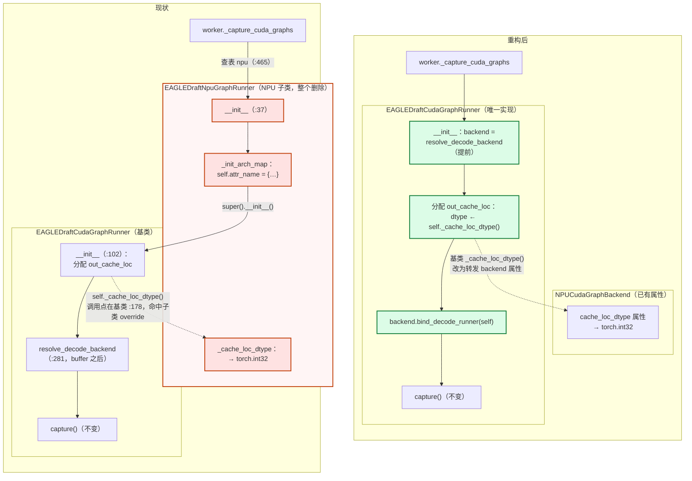
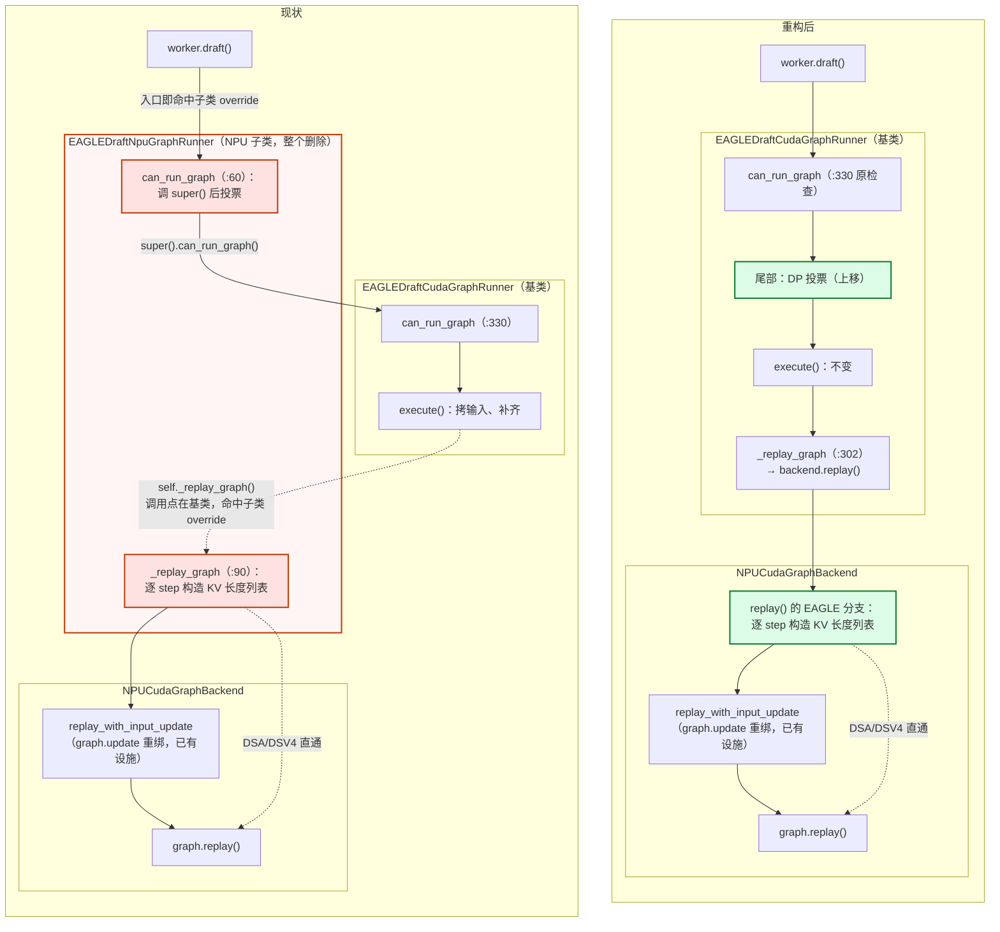

# 去除 EAGLEDraftNpuGraphRunner 设计方案

- 基线：`sglang` 仓 `graph_refactor`（HEAD `a7d9fc2b86`，已含 `4e1ef559` delete npu_graph_runner）
- 待删文件：`python/sglang/srt/hardware_backend/npu/graph_runner/eagle_draft_npu_graph_runner.py`（107 行）
- 改动文件：`speculative/eagle_draft_cuda_graph_runner.py`、`hardware_backend/npu/graph_runner/npu_cudagraph_backend.py`、`speculative/eagle_worker_v2.py`
- **已定决策**：DP seed 投票上移基类（方案 A），风险见 §4.3

## 1. 背景与模式

`4e1ef559` 删除 `NPUGraphRunner` 时确立了重构模式：**设备差异从 runner 子类下沉到 backend**——dtype 变 backend 属性（`cache_loc_dtype`）、NPU 专属回放逻辑进 backend（`prepare_replay` / `replay()` 内分支）、runner 用 `bind_decode_runner` 把自己交给 backend、worker 的设备分发表坍缩为一行。EAGLE 系三个 NPU 子类（draft-decode / draft-extend / multi-layer-extend）是遗留尾巴，本方案先摘 draft-decode。

## 2. 现状：5 个 override 的职责与去向

`EAGLEDraftNpuGraphRunner`（`:36-107`）由 `eagle_worker_v2.py:465` 查表选中（仅 npu 设备、`speculative_num_steps > 1` 时实例化）：

| override | 干什么 | 去向 |
| --- | --- | --- |
| `_replay_graph`（:90） | **存在理由**：NPU 图把 host 侧 `actual_seq_lengths_kv` 烧死，replay 前按 draft step 逐份重绑（`seq_lens_cpu[:raw_bs] + step + 1`，空槽补 0）走 `replay_with_input_update`；DSA/DSV4 直通不重绑 | 下沉 `NPUCudaGraphBackend.replay()` 的 EAGLE 分支（§4.2） |
| `can_run_graph`（:60） | attn-DP 下 IndexShare seed 靠异步传输，各 rank 可用性不一致；draft forward 含 TP/EP collective，分歧即挂死 → `tp_group` 上 `all_reduce(MIN)` 一票否决（`db9143ee08`，PR #32210） | 上移基类 `can_run_graph` 尾部（§4.3，方案 A） |
| `_cache_loc_dtype`（:51） | `out_cache_loc` 用 int32（NPU 算子要求） | 删；基类改读 `backend.cache_loc_dtype`（§4.1） |
| `_init_arch_map` + `_get_update_attr_*`（:41-58） | 死代码：MHA 分支不可达、`attr_type` 全仓无调用者 | 直接删；属性名坍缩为常量 `"actual_seq_lengths_kv"` |
| `__init__`（:37） | 先建 arch map 再 super() | 随上两项消失 |

### 2.1 前后对比图

读图约定：**框 = 类**、实线 = 调用链、**虚线 = Python 动态派发**（调用点写在基类，运行时命中子类 override / backend 属性）。左列现状，右列重构后；**红 = 随类消失的挂载点，绿 = 那段逻辑的新家**。

**启动（capture）**



**每次 draft（replay）——另一条虚线是 DSA/DSV4 的直通特例（不做 update）**



## 3. 目标与非目标

**目标**：删除整个文件 + 分发表项；NPU 行为等价（DSA/DSV4 直通、Qwen EAGLE3 逐 step 重绑两条回归线）。
**非目标**：`EAGLEDraftExtendNpuGraphRunner`、`MultiLayer*ExtendNpuGraphRunner`、`vit_npu_graph_runner`（§8）。

## 4. 迁移设计

### 4.1 dtype 通道（改 EAGLE 基类 `__init__`）

改动全部在 `EAGLEDraftCudaGraphRunner.__init__`（它不调 `DecodeCudaGraphRunner.__init__`；`DecodeCudaGraphRunner:407-408` 只是先例）：

1. `resolve_decode_backend(self)` 从 `:281` **提前到静态 buffer 分配（`:172`）之前**。已核实依赖此时就绪（`model_runner.device` `:118`、`device_module` `:119`）。
2. `_cache_loc_dtype()`（`:309`）改为 `return self.backend.cache_loc_dtype`（NPU 的 int32 属性已存在）。
3. buffer 分配后加 `self.backend.bind_decode_runner(self)`；非 NPU backend 未覆写该 hook（默认 no-op），零影响。

### 4.2 逐 step 重绑下沉 backend（核心改动）

runner 侧 `_replay_graph`（`:302`）一字不改；backend 侧 `NPUCudaGraphBackend.replay()` 加 EAGLE 分支（per-step 约定在 `replay_with_input_update` 里已存在）：

```python
def replay(self, shape_key, static_forward_batch, **kwargs):
    runner = self._decode_runner
    if runner is not None:
        hf_config = runner.model_runner.model_config.hf_config
        if not (is_deepseek_dsa(hf_config) or is_deepseek_v4(hf_config)):
            # isinstance 必须先查 EAGLE：EAGLE 也继承 DecodeCudaGraphRunner
            if isinstance(runner, EAGLEDraftCudaGraphRunner):
                return self.replay_with_input_update(
                    shape_key, seq_lens=None,
                    cpu_update_input=self._eagle_draft_update_lengths(
                        runner, static_forward_batch),
                )
            return self.replay_with_input_update(   # 现有 decode 分支，原样
                shape_key,
                seq_lens=self._decode_update_lengths(static_forward_batch),
                attr_name=self._decode_update_attr_name(),
                attr_type=[],
            )
    self._graphs[shape_key].replay()
    return self._outputs[shape_key]

def _eagle_draft_update_lengths(self, runner, forward_batch):
    # 从 eagle_draft_npu_graph_runner.py:93-101 原样搬入
    attr_name = "actual_seq_lengths_kv"
    cpu_update_input = []
    for step in range(runner.speculative_num_steps - 1):
        seq_lens_cpu = forward_batch.seq_lens_cpu[: runner.raw_bs] + step + 1
        seq_lens = seq_lens_cpu.tolist() + [0] * (runner.bs - runner.raw_bs)
        cpu_update_input.append({attr_name: seq_lens})
    return cpu_update_input
```

已核实的边界：

- `EAGLE` 类在 `replay()` 内 lazy import（避免 speculative ↔ npu 模块环，文件已有此风格）。
- `EAGLEDraftExtend*` / `MultiLayer*` 不继承 `EAGLEDraftCudaGraphRunner` 也不 bind，不误入本分支。
- `raw_bs`/`bs` 由基类 `execute()` 在 `_replay_graph` 前写入（`:724-725`），backend 经绑定 runner 读到同一份值。
- DSA/DSV4 守卫在 `replay()` 顶部，新旧路径共用。
- `model_context` 差异：搬迁后 NPU replay 多包一层 wrapper；replay/update 期无模型 Python 执行，预期 no-op（与 CUDA 行为对齐），NPU CI 用 accept-length 对比兜底。

### 4.3 DP 投票上移基类（已定方案 A）

把子类 `:62-88` 原样搬到基类 `can_run_graph` 的 `return` 前：

```python
if self.eagle_worker.seed_dsa_topk_from_draft_extend and self.attn_dp_size > 1:
    spec_info = forward_batch.spec_info
    seed_ready = forward_batch.forward_mode.is_idle() or (
        spec_info is not None and spec_info.dsa_topk_indices is not None)
    decision = torch.tensor(int(is_bs_supported and seed_ready), dtype=torch.int32, device="cpu")
    torch.distributed.all_reduce(decision, op=torch.distributed.ReduceOp.MIN,
                                group=get_parallel().tp_group.cpu_group)
    return bool(decision.item())
return is_bs_supported
```

选 A 的理由：语义设备无关（分歧挂死任何设备都可能发生），门控是全 rank 一致的配置、触发面极窄（仅 PD-disagg DSA + attn-DP 组合）。

**风险（跨设备行为变更）**：CUDA/XPU/MUSA 在上述组合下从"各 rank 本地决策"变为"全员一票否决转 eager"——正确性严格更好（消除潜在 collective 挂死），但触发组合下每次 draft 多一次 CPU all_reduce。验证：CUDA 侧 DSA+attn-DP 回归一条（无环境则单测 mock `tp_group` 验证门控路径）。若回归不过，退路是加 backend 属性 `needs_uniform_graph_decision`（NPU True）门控投票，一行改动。

> 逐变量设备无关性审计、参与对称性论证与跨设备影响明细见[配套分析](dp_vote_promotion_analysis.md)。

### 4.4 死代码删除

`_init_arch_map` / `_get_update_attr_*` / `attr_name`、`attr_type` 字典及相关 import 随文件删除，无替代品。

### 4.5 调用点清理

删 `eagle_worker_v2.py:18` import 与 `:465-471` 表中 `"npu"` 项；表坍缩后直接写 `EAGLEDraftCudaGraphRunner(self)`（对齐 `4e1ef559` 对 `TargetGraphRunnerCls` 的做法）。

## 5. 改动文件清单

| 文件 | 改动 |
| --- | --- |
| `hardware_backend/npu/graph_runner/eagle_draft_npu_graph_runner.py` | **删除整个文件** |
| `speculative/eagle_draft_cuda_graph_runner.py` | backend resolve 提前至 buffer 前；`_cache_loc_dtype()` 改读 backend；`__init__` 加 `bind_decode_runner(self)`；`can_run_graph` 尾部加 DP 投票（方案 A） |
| `hardware_backend/npu/graph_runner/npu_cudagraph_backend.py` | `replay()` 加 EAGLE draft 分支 + `_eagle_draft_update_lengths()`（lazy import EAGLE 类） |
| `speculative/eagle_worker_v2.py` | 删 import 与 `"npu"` 分发表项；分发表坍缩 |
| 测试 | `test_eagle_draft_cuda_graph_runner.py` 经 `__new__` 绕过 `__init__` 且 stub `_replay_graph`，不受影响；NPU 单测无本类引用 |

## 6. 风险清单

| 风险 | 评估 | 缓解 |
| --- | --- | --- |
| backend resolve 提前引入构造顺序问题 | 低：依赖已核实就绪 | NPU 启动冒烟 |
| isinstance 分支误伤 extend/multi-layer | 无：类层级与 bind 调用面已核实 | 单测断言绑定关系 |
| `model_context` wrapper 差异 | 低：replay 期无 Python 执行 | accept-length 对比 |
| 投票上移的跨设备行为变更（§4.3） | 中：触发组合下新增 CPU all_reduce、决策由本地变全局 | CUDA DSA+attn-DP 回归；不过则退属性门控 |
| 逐 step 重绑搬运笔误（off-by-one） | 中：纯代码搬家 | 非 DSA 模型 draft 输出与基线 diff |

## 7. 验证

1. **NPU（必做）**：Qwen EAGLE3（重绑路径，draft 输出与 accept-length 对比基线）；DSA/DSV4（确认直通、无重绑）；attn-DP + PD disagg（投票输出 rank 一致）。
2. **CPU 单测**：draft runner 白盒单测保持绿。
3. **CUDA 冒烟**：DSA + attn-DP 跑通；无环境则单测 mock `tp_group` 验证门控。

## 8. 后续（独立 PR）

- extend / multi-layer NPU 子类按同模式下沉（extend runner bind → `replay()` 加 extend 分支），删除对应文件与表项。
- 届时 `replay_with_input_update` 的 `attr_type` 参数一并清理。
